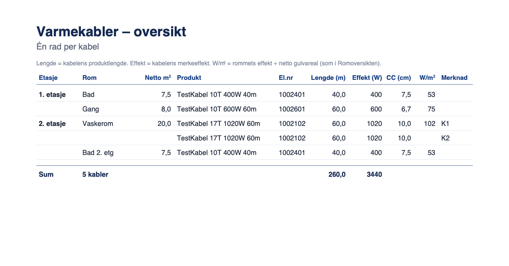

# 181 · PDF: egen oversiktsside for varmekabler

Fredriks ønske (02.11.2026, via Kenneth): «… Jeg tenker det ville være ryddig å ha en egen side med oversikt over
varmekabler, som den man får i Varmeplan.»

## Kort fortalt
- Ny PDF-side **«Varmekabler – oversikt»** (undertittel «Én rad per kabel»), rett etter **Romoversikt**.
- **Én rad per kabel**. Et rom med to kabler gir to rader (K1 og K2). Romoversikten slår dem sammen til «Ant 2».
- Kolonner: **Etasje · Rom · Netto m² · Produkt · El.nr · Lengde (m) · Effekt (W) · CC (cm) · W/m² · Merknad**.
  Nederst står en sumrad med antall kabler, sum lengde og sum effekt.
- Siden kommer bare med når prosjektet har **kabel i et innendørs rom**. Snø, frost og trapp er ikke med.
- **Nytt valg i PDF-dialogen:** «Varmekabler – oversikt». Det står rett under «Romoversikt», er på som standard og
  vises bare når prosjektet har innendørs kabel. Klikk på navnet gir forhåndsvisning. Mønsteret er det samme som for
  «Motstandsmåling – varmefolie».
- Ingen utregninger er endret, og ingenting nytt lagres i prosjektet. Romsidene, Romoversikten, materiallista og
  foliesidene er bevist uendret (se under).

## STEG 0.1 · PDF-en før endringen
Fixture (`probe/maal.mjs`, «blandet»): to etasjer og fem rom.
- **1. etasje:** «Stue» med folie (2 × B=60), «Bad» med 1 × 400 W / 40 m (CC 7,5) og «Gang» med 1 × 600 W / 60 m
  (CC 6,7).
- **2. etasje:** «Vaskerom» med **to** kabler, 2 × 1020 W / 60 m (K1 og K2, CC 10), og «Bad 2. etg» med
  1 × 400 W / 40 m.

Alle valg var på: forside, prosjektoversikt, romsider, romoversikt, motstandsmåling og materialliste. Det ga 10 sider.

| Side | Innhold | Kablene i dag |
|---|---|---|
| 1 | Forside | — |
| 2 | Prosjektoversikt | Bare «Type»-kolonnen per rom (produktfamilie, f.eks. «TestKabel 10T»). Ingen lengde eller el.nr. |
| 3 | Romside Stue (folie) | — |
| 4–7 | Romsider Bad, Gang, Vaskerom, Bad 2. etg | Spesifikasjon «Kabel · produkt · Antall · Lengde · Effekt» + «Senteravstand (CC)». **Vaskerom: én rad «2 stk · 60,0 m · 2040 W»** |
| 8 | Romoversikt | Én rad per produktvariant per rom: Ant, Lengde, El.nr, Art.nr, Produkt, Gruppe, Type, W, W/m², CC. **Vaskerom: «Ant 2 · 2040 W»**, de to kablene er slått sammen |
| 9 | Motstandsmåling – varmefolie | Bare folie |
| 10 | Materialliste | Gruppe «Varmekabel»: Lev.art.nr · El.nr · Produkt · Antall (stk). Ingen lengde, effekt eller rom |

Kablene står altså spredt: én rad per produkt i Romoversikten og antall per produkt i materiallista. Ingen side viser
hver enkelt kabel.

## STEG 0.2 · «Oversikten man får i Varmeplan»
Jeg søkte gjennom hele appen. **Ingen skjerm viser én rad per kabel for hele prosjektet.** Kandidatene:

| Sted i appen | Kode | Rader | Kolonner |
|---|---|---|---|
| **Listevisningen** (Hurtig prosjektering / tegnet del i listevisning) | `renderListModule` / `_renderListModuleDrawn`, radene i `_listDrawnRowHtml` og `_listFinalizedRowHtml` | én per rom | Etasje, Rom, (Varmetype), Netto m², Type, Produkt/antall («2× …»), Effekt, W/m², CC/str., Status (Tegnet/Kalkyle) |
| Romdetaljpanelet «Varme (N)» | `_renderDetailPanel` | én per kabel, men **bare valgt rom** | produkt, kalkyle/reserve, lengde, W |
| Kabelinfopanelet (valgt kabel) | `updateSelectedObjInfo`, ca. linje 68742 | én kabel | Art.nr, El.nummer, Leverandør, Familie, Total lengde, CC, Retning, Antall løp, Effekt, W/m² … |
| Romkortet på lerretet | rundt `_legCables` (ca. linje 6066) | én per kabel i rommet | fargeprikk + K1/K2 + produkt · lengde · W |
| Excel «Per rom» | `_exportMaterialListXLSX` | én per produktvariant per rom | som Romoversikten |
| Statistikk-widget | `updateStatsWidget` | — | bare «Kabler N stk (… m)» |

**Malen er listevisningen.** Den ligner mest på en kabelliste: hele prosjektet i én tabell, med etasje, rom, netto
areal, produkt, effekt, W/m² og CC. Det er sannsynligvis den Fredrik mener. Den har én rad per rom, så jeg tok i
tillegg fra romkortet det at hver kabel får sin egen rad og sin **K1/K2**. Det er nøkkelen elektrikeren bruker for å
koble farge og kurs på tegningen. Fredriks skjermbilde har vi ikke, så dette valget er en tolkning (SPØRSMÅL 1).

## STEG 0.3 · Tallene som alt finnes, og kilden
| Tall | Kilde | Brukt slik |
|---|---|---|
| Effekt per kabel | Uttrykket i `_roomProductRows`: `total_effect_w`, ellers produktlengde × W/m, ellers tegnet lengde × W/m. Reserve = 0 W | Flyttet **uendret** ut i `_cableRatedW(p, c)`. `_roomProductRows` kaller den nå, og den nye siden kaller den samme. |
| Lengde | Romoversiktens «Lengde» = produktets `cable_length_m` (det som bestilles) | Samme. Mangler feltet, brukes tegnet lengde (`totalLength_cm`). |
| CC | `cable.spacing_cm` (romsiden: «Senteravstand (CC)»; Romoversikten viser første kabels) | Hver kabels egen. |
| W/m² | Romoversikten: rommets ratede effekt ÷ netto gulv (`_roomRatedEffectW` / `_computeRoomStats().nettoM2`) | Samme tall, på rommets første rad, slik Romoversikten viser det. |
| Netto m² | `_computeRoomStats().nettoM2` | Samme. |
| Motstand per kabel | Finnes **ikke** for innendørs kabel i PDF-en. Dokumentasjonsmodulen regner nominell R = U²/P. | Ikke med (SPØRSMÅL 4). |
| Kurs/fase | Finnes ikke i datamodellen. Nærmeste er K1/K2 (`multiCableIndex`). | K1/K2 står i «Merknad». |

Ny kode som regner noe: ingen. `_cableOverviewRows` og `_cableOverviewTotals` setter bare sammen tallene over. Summen
av effekt summeres urundet og rundes til slutt, slik romtotalen gjør.

## Kolonnene jeg valgte
| Kolonne | Hvorfor |
|---|---|
| Etasje (fet, første rad per etasje) · Rom · Netto m² | Fra listevisningen. Rom og netto står på rommets første rad, og øverst på en ny side. |
| Produkt · El.nr | El.nr er det elektrikeren bestiller og sjekker etter. Art.nr står i materiallista, så jeg droppet den for å gi plass. |
| Lengde (m) · Effekt (W) · CC (cm) | Per kabel. Det er det Romoversikten ikke kan vise for et rom med to kabler. |
| W/m² | Rommets, som i Romoversikten og listevisningen. |
| Merknad | **K1/K2** når rommet har flere kabler (samme nummer og rekkefølge som romkortet), **Reserve** for reservekabel og **Kalkyle** for et produkt valgt i lista uten tegnet utlegg. |

Stilen er kopiert fra motstandsmålingssiden: tittel 16 pt fet, undertittel 10 pt grå, forklaring 7 pt, tabellhode
7,5 pt fet blå med strek og rader 8 pt med tynn skillestrek. Tall har norsk format med komma (`_fmtNo`), som på
motstandsmålingssiden. Romoversikten bruker punktum. Et produktnavn som er for langt for kolonnen (målt: InSnow
«… 117.4m 400V») krympes til 7 pt før det kuttes. Alle InFloor-navn i katalogen (anonym lesing, 148 kabelprodukter)
får plass i 8 pt.

**Plassering:** rett etter Romoversikten. Den er «romlista hvor kablene også dukker opp», og den nye siden er de
samme kablene med én rad per kabel. Rekkefølgen blir Romoversikt → Varmekabler – oversikt → (Trappeoversikt) →
Motstandsmåling – varmefolie → Materialliste.

**Hvilke rom:** alle rom i prosjektet, som Romoversikten og materiallista, ikke bare rommene som er hakt av som
romsider. Da stemmer summen alltid med materiallista (SPØRSMÅL 3).

## Test
Verktøy i `docs/181/probe/`: `maal.mjs` henter PDF-tekst med side, font, størrelse og x/y, og tar skjermbilde av
dialogen. `tester.mjs` kjører testene, `katalog.mjs` måler navnelengder, og `render.swift` / `/tmp/cdp180/render`
lager PNG. `patch.js` og `p2`–`p5.js` er endringene. Gammel kode (HEAD) gikk på port 4181, ny kode på port 4000.

1. **Prosjektet fra STEG 0:** siden finnes som side 9 av 11 og har **5 rader** (Bad, Gang, Vaskerom K1, Vaskerom K2,
   Bad 2. etg). Sumraden sier **5 kabler · 260,0 m · 3440 W**.
   - **Materiallista:** 1 × 60 m + 2 × 40 m + 2 × 60 m = 5 stk og 260 m.
   - **Romoversikten:** 400 + 600 + 2040 + 400 = 3440 W.
   - Skjermbilder: `kabelside.png` og `dialog.png` (valget og forhåndsvisningen).
   - `kabelside-reserve-insnow.png` er en variant med reservekabel og et langt InSnow-navn. Den gir «7 kabler (herav 1
     reserve)», og det kommer en ekstra forklaringslinje.
2. **Bare folie:** 10 → 10 sider og 479 → 479 tekstkall, **0 ulike** (tekst, side, font, størrelse, x, y). Dialogen er
   identisk, så valget vises ikke.
3. **Mange kabler (40 rom, én kabel hver):** 39 rader på side 45 og 1 rad + sum på side 46, med tabellhode på begge
   sidene. Første forsøk ga sumraden alene på side 46, så nå tar siste rad sumraden med seg (`mange-side2.png`).
   Summen er 2140,0 m og 26 860 W, regnet for hånd (14 × 60 + 13 × 40 + 13 × 60 m og 14 × 600 + 13 × 400 + 13 × 1020 W).
4. **Valget av:** blandet prosjekt med `cableTable: false` mot HEAD ga 10 → 10 sider, 505 → 505 tekstkall,
   **0 ulike**. Med valget på og kabelsiden tatt ut (sidetall rettet) var også alle 505 andre tekstkall like.
   **Romsider, Romoversikt, motstandsmåling og materialliste er uendret.**
5. **Regresjon:** ny `_cableOverviewRegressionTest` **33/33**:
   - **Fixturen:** etasjene i feil rekkefølge i `S.floors` og K2 før K1 i `S.cables`, med reservekabel, et snø-rom med
     kabel og et folierom.
   - **Radene:** rekkefølge, effekt, lengde og CC per rad sjekket mot håndregnet fasit. Radene summerer til rommets
     effekt i Romoversikten, og W/m² er lik Romoversiktens.
   - **Summene:** 6 kabler, herav 1 reserve, 300 m og 3440 W. Antallet er det samme som materiallista teller.
   - **PDF-siden:** tittel én gang, rett etter Romoversikten, 6 rader, riktig sumrad, uten snø-rommet, og med
     forklaringen av reserven.
   - **Valget:** av, eller ikke sendt (gamle kallsteder), gir ingen side. Med bare folie kommer verken siden eller
     valget i dialogen. Med kabel er valget på som standard.
   - **60 kabler:** 60 rader, tabellhode på hver side med rader, sumraden aldri alene, og riktige summer.

   Eksisterende tester er grønne på ny kode: `_pdfExportSmokeTest` 55/55, `_foilResistanceRegressionTest` 52/52,
   `_gbao10RegressionTest` 18/18, `_listKalkyleClearRegressionTest` 32/32 (bruker `_roomProductRows`),
   `_foilRegressionTest` 9/9 og `_accessoryFoilQtyRegressionTest` 105/105.

   Konsollen viser to feil som også kommer på HEAD:
   - `_assertProductSurfacesCoverAllCollections` sier at XLSX-bestillingen aldri nevner «strips».
   - «ReferenceError: ci» kommer fra PDF-smoketestens egen vakttest.

   `_listevisningRegressionTest` feiler likt på HEAD og ny kode, fordi den trenger innlogget katalog.

## Endret kode (`index.html`)
- `_cableRatedW(p, c)` er ny og har uttrykket som før sto inne i `_roomProductRows`, uendret.
- `_cableOverviewRows(rooms)` og `_cableOverviewTotals(rows)` er nye og ligger rett over `_fmtNo`.
- `exportPDF`: ny seksjon etter `opts.roomTable`, styrt av `opts.cableTable`. Standard-`opts` (kall uten argument)
  har `cableTable: true`.
- PDF-dialogen: `exp-cabletable` (vises bare med innendørs kabel), `_runExportPDF` sender `cableTable`, og
  `_expPreviewSection('cabletable')` gir forhåndsvisningen.
- `_cableOverviewRegressionTest`.

Ikke pushet.
