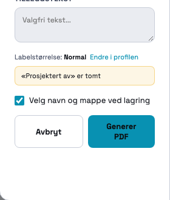
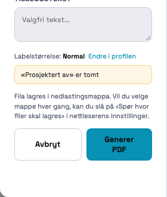

# 195 · PDF: velg navn og mappe når PDF-en lagres

06.11.2026 · `index.html` · committet på `main`, ikke pushet.

## Kort fortalt

Når du trykker «Generer PDF» i Chrome eller Edge, åpner nettleseren nå sin egen «Lagre som»-dialog
med dagens filnavn ferdig utfylt. Du kan endre navnet og velge mappe, og PDF-en skrives dit.
Nettleseren husker mappa til neste gang.

I Safari, Firefox og på mobil finnes ikke denne muligheten i nettleseren. Der lastes PDF-en ned
som før, og PDF-dialogen viser en kort forklaring i stedet for avkrysningen.

Innholdet i PDF-en og filnavnformatet er ikke endret.

**Én ting er ikke prøvd av meg:** selve lagre-dialogen slik den ser ut på skjermen. Testnettleseren
kjører uten skjerm og kan ikke vise den, og jeg ville ikke åpne et Chrome-vindu og styre mus og
tastatur på maskinen din uten at du er der. Alt rundt dialogen er målt mot ekte Chrome (se
«Test» under). Det som gjenstår er en håndsjekk på to minutter, beskrevet nederst — derfor mangler
også skjermbildet av lagre-dialogen som prompten ba om.

## Slik ser det ut

PDF-dialogen i Chrome/Edge — ny avkrysning over knappene, på som standard:

Samme sted i en nettleser uten «Lagre som» (Safari, Firefox, mobil):

Hele dialogen: [dialog-hel.png](dialog-hel.png).

## Hva skjer når du trykker «Generer PDF»

1. Tilbehørsvinduet kommer som før (hvis prosjektet har varme).
2. **Nytt:** lagre-dialogen åpnes med navnet ferdig utfylt, første gang i nedlastingsmappa og
   deretter i mappa du brukte sist.
3. Du trykker «Lagre». PDF-en bygges og skrives til fila du valgte. Nederst på skjermen står
   «PDF lagret: ‹filnavnet›».
4. Trykker du «Avbryt» i lagre-dialogen, skjer ingenting: ingen fil, ingen melding, revisjonen
   telles ikke opp, og prosjektet blir ikke «tilbud sendt».

Slår du av «Velg navn og mappe ved lagring», er alt som før 195. Valget huskes per bruker.

## STEG 0 — funn (målt før endring)

### 0.1 Slutten av `exportPDF()`

Linjenumrene er fra koden etter endringen.

| Linje | Hva |
|---|---|
| `index.html:86642` | `exportPDF` starter |
| `index.html:86647` | tilbehørsvinduet (`showAccessoriesModal`) — avbrutt der stopper hele eksporten |
| `index.html:86663`–`86664` | to nettverkskall: org-logo (`_pdfBranding`) og kartfliser (`_tilesPreloadForPdf`) |
| `index.html:88531` | `doc.save(_exportFileName('Varmeplan', 'pdf', rev))` — **eneste** `doc.save` i hele appen |
| `index.html:88534`–`88535` | revisjonen telles opp og `lastExportedAt` settes — først ETTER lagringen (113) |
| `index.html:88540` | statusovergang `under_arbeid → tilbud_sendt`, bare når PDF-en er priset og prosjektet ligger i skyen |

Etter lagringen kom det ingen melding og ingen logg — nettleserens egen nedlastingsvisning var
kvitteringen. Feil underveis fanges av `_runExport` (`index.html:84726`), som viser en rød melding.

### 0.2 Andre steder som lagrer en fil

Se tabellen lenger ned («Andre PDF-typer og filer»). Bare hoved-PDF-en er endret.

### 0.3 Filnavnet

`_exportFileName` (`index.html:86585`) → `_docFileName` (`index.html:86569`):
`varmeplan_{kunde}_{merking}_{ÅÅÅÅMMDD-TTMM}_{initialer}_P{nr}_rev{N}.pdf`. Ikke endret.
Én liten forskjell: med lagre-dialogen lages navnet idet dialogen åpnes (det er det foreslåtte
navnet), så klokkeslettet er fra da du trykket, ikke fra da PDF-en var ferdig bygget.

### 0.4 «Gjelder» klikket fortsatt når lagre-dialogen skal åpnes?

Målt i Chrome 156 med ekte museklikk (`docs/195/probe/steg0.mjs`):

| Tid fra klikk til `showSaveFilePicker` | Resultat |
|---|---|
| 0 s, 2 s, 4 s, 4,8 s | godtatt |
| 5,5 s, 6 s, 8 s | avvist: `SecurityError: Must be handling a user gesture to show a file picker` |
| uten klikk | avvist, samme feil |

Klikket gjelder altså i **5 sekunder**. Det er det samme om nettleseren venter eller regner i
mellomtiden.

Byggetid for et stort prosjekt (40 rom på to etasjer, 30 kabler, 40 foliestriper, 59 sider):
**0,82–0,89 s** over tre kjøringer. Det går altså med god margin på denne maskinen. Men foran
byggingen ligger de to nettverkskallene (logo og kartfliser), som ikke har noen tidsgrense, og
prosjekter med plantegninger i bakgrunnen og tregere maskiner bruker lenger tid. Marginen er ikke
garantert.

`navigator.share` / `navigator.canShare` finnes **ikke** i `index.html` eller ellers i repoet.
Prompten sier at delingsarket på mobil «skal beholdes som i dag» — det er ikke noe delingsark i
hoved-PDF-en i dag. Mobil laster ned med `doc.save`, og det er uendret. Se spørsmål 2.

## Rekkefølgen jeg valgte (punkt 2), og hvorfor

**Lagre-dialogen åpnes først, PDF-en bygges etterpå.** Dialogen åpnes rett etter det siste klikket
ditt — «Generer PDF», eller «Generer rapport» i tilbehørsvinduet når det vises — og før
nettverkskallene og byggingen.

- Det er den enkleste som alltid virker: byggetiden spiller ingen rolle, og det trengs ingen
  ekstra «Lagre PDF …»-knapp.
- Målt: tilbehørsvinduet kan stå åpent så lenge du vil (prøvd med 6 s). Klikket på knappen der er
  det som teller, og dialogen kalles 2–4 ms etter det.
- Avbryt er billig: ingenting er bygget ennå.

Prisen: Chrome oppretter fila (tom) i det du trykker «Lagre», før PDF-en er bygget. Feiler
byggingen etterpå, fjerner appen den tomme fila igjen og viser den vanlige røde feilmeldingen.
Valgte du å erstatte en eksisterende fil, er den gamle da borte. At fila opprettes allerede i
dialogen er kjent Chrome-oppførsel som jeg ikke har fått målt (se «Ikke prøvd»); selve ryddingen
er målt.

Sikkerhetsnett, så knappen aldri er død: lar dialogen seg ikke åpne (klikket er for gammelt,
appen ligger i en ramme, bedriftspolicy), lastes PDF-en ned på vanlig måte. Feiler skrivingen til
valgt mappe, fjernes den tomme fila, PDF-en lastes ned, og det kommer et gult varsel.

## Hva som er endret i koden

Alt i `index.html`, seksjonen «195 · PDF: VELG NAVN OG MAPPE VED LAGRING» (`index.html:84756`).

| Hvor | Hva |
|---|---|
| `_pdfPickSaveTarget` (`index.html:84817`) | åpner `showSaveFilePicker` med `suggestedName` = dagens filnavn, filtype PDF, `id: 'varmeplan-pdf'` (nettleseren husker mappa) og `startIn: 'downloads'` (gjelder bare første gang) |
| `exportPDF(opts, lev)` (`index.html:86655`) | dialogen åpnes rett etter tilbehørsvinduet; avbrutt → `return` før noe er bygget |
| slutten av `exportPDF` (`index.html:88531`) | valgt fil → `doc.output('blob')` → `createWritable` → skriv → lukk, og «PDF lagret: …». Ellers `doc.save` som før |
| `exportPDFGuarded(opts, lev)` (`index.html:84744`) | bestemmer om dialogen skal brukes (brukerens valg + at nettleseren kan), og fjerner den tomme fila hvis byggingen feiler |
| `_showExportDialog` / `_runExportPDF` (`index.html:84038`, `84681`) | avkrysningen «Velg navn og mappe ved lagring», eller forklaringen der API-et mangler; valget lagres når du trykker «Generer PDF» |
| `_presentDownloadPDF` (`index.html:10159`) | kundelenka laster ned som før (se spørsmål 1) |
| `_saveProfile` | profil-dialogen skrev hele `prefs` på nytt med bare tre felt — nå beholder den nøkler den ikke eier, ellers ville «Lagre endringer» i profilen ha slettet det nye valget |

**Hvor valget lagres:** `profiles.prefs.pdfSavePicker` — samme sted som labelstørrelsen for PDF, altså
per bruker og med på tvers av maskiner. Ikke innlogget: i nettleserens `localStorage`. Ingen verdi
= på. Ingen databaseendring trengs (`prefs` er et JSON-felt som finnes fra før).

De to «Romoversikt (PDF)»-knappene i listevisningen går utenom PDF-dialogen. De følger samme
valg: er det på, får du lagre-dialogen der også.

Testene kaller `exportPDF(opts)` direkte, uten levering. Da åpnes dialogen aldri — derfor er ingen
eksisterende test rørt.

## Test

Kjørt i Chrome 156 uten skjerm (`docs/195/probe/`), med ekte museklikk der klikket betyr noe.

| # | Test fra prompten | Resultat |
|---|---|---|
| 1 | Lagre-dialog med riktig navn, fila ligger der og åpnes | **Delvis.** Chrome fikk kallet 2–4 ms etter klikket med navnet `varmeplan_Elektro-24-AS_LITE-195_20261106-0905_XX_P0264_rev1.pdf`, filtype PDF og `id` — og godtok det. PDF-en ble skrevet til et ekte filhåndtak og lest tilbake: 425 930 byte, `%PDF-1.3` … `%%EOF`, 8 sider, åpnet og sett på. **Ikke prøvd:** å endre navn og mappe i selve dialogen på skjermen. |
| 2 | Neste eksport åpner samme mappe | **Ikke prøvd.** Det er nettleseren som husker mappa for `id: 'varmeplan-pdf'`; appen sender `id` (sjekket). Må ses i den ekte dialogen. |
| 3 | Avbryt: ingen fil, ingen melding, ingen status | **Bestått.** Chrome svarte `AbortError` (det samme som «Avbryt» gir): ingen nedlasting, ingen melding, revisjon 0, ingen statusovergang. |
| 4 | Valget av: dagens nedlasting | **Bestått.** Avkrysningen slått av med et ekte klikk → `doc.save` med dagens navn, 8 sider, ingen dialog. Valget var av neste gang dialogen ble åpnet. |
| 5 | Uten API-et: nedlasting + forklaringen | **Bestått.** Ingen avkrysning, teksten vises ord for ord, `doc.save` som før. |
| 6 | Stort prosjekt | **Bestått.** 40 rom: 57 sider, 6,3 MB skrevet og lest tilbake, 0,88 s fra klikk til «PDF lagret». Og motsatt: klikk som var 6 s gammelt → `SecurityError` → vanlig nedlasting, ingen feilmelding. |
| 7 | Eksisterende PDF-tester | **Bestått**, like tall før og etter: `_pdfExportSmokeTest` 55/55, `_pdfPreviewRegressionTest` 96/96, `_cableOverviewRegressionTest` 33/33, `_foilResistanceRegressionTest` 52/52, `_foilEffectRegressionTest` 32/32, `_accessoryFoilQtyRegressionTest` 105/105, `_prefsRegressionTest` 47/47, `_profileNameRegressionTest` 15/15. |

Ny test: `await _pdfSavePickerRegressionTest195()` — **43/43**. Den dekker også at byggingen feiler
etter at fila er valgt (fila fjernes, ingen revisjon), at skrivingen feiler (nedlasting + varsel),
at valget lagres i profilen uten å slette de andre innstillingene, og at kundelenka er uendret.
Kontrollert at testen kan bli rød: med to feil lagt inn med vilje (avbrutt dialog stopper ikke
eksporten; den tomme fila ryddes ikke) falt den til 39/43. Feilene er tatt ut igjen.

## Andre PDF-typer og filer (STEG 0.2) — ikke endret

Appen lager PDF to steder (`new jsPDF`): hoved-PDF-en og garantibeviset. Presentasjon og
trappeutskrift er ikke egne PDF-er — trappesidene er en del av hoved-PDF-en, og kundelenka bruker
samme `exportPDF`.

| Funksjon | Hva fila er | Hvordan den lagres i dag |
|---|---|---|
| `exportPDF` | Hoved-PDF (tilbud/dokumentasjon, med rom- og trappesider) | **Endret i 195:** «Lagre som» i Chrome/Edge, ellers `doc.save` |
| `_presentDownloadPDF` → `exportPDF` | Samme PDF, fra kundelenka (`?present=`) | `doc.save` (nedlasting) — bevisst uendret |
| `_docBuildPDF` | Garantibevis | Lagres ikke lokalt: `doc.output('blob')` lastes opp til lagringsbøtta `documentation` |
| `_portalOpenPdf` | Garantibevis fra portalen | Åpnes i ny fane via signert lenke; brukeren lagrer selv fra PDF-visningen |
| `_exportMaterialListXLSX` | Materialliste (Excel) | `XLSX.writeFile` — vanlig nedlasting, navn `Materialliste-…xlsx` |
| `_gbao10Export` | Visma-fil (.txt) | Har allerede mappevalg: skriver til valgt Tilbud-/Ordre-mappe (`showDirectoryPicker`), ellers nedlasting |
| `exportProjectFile` | Prosjektfil (.json) | Har allerede «Lagre som» (`showSaveFilePicker`) — mønsteret 195 gjenbruker |
| prosjektlista, «last ned» | Prosjektfil (.json) | Vanlig nedlasting (`<a download>`) |
| `_kundeLoggSkrivUt` | Kundedialog-logg | Åpnes i nytt vindu for utskrift; ingen fil |

Forslag for resten står i `SPØRSMÅL.md` (spørsmål 3).

## Ikke prøvd — håndsjekk for Kenneth (to minutter, Chrome)

1. Åpne et prosjekt, **Eksporter PDF → Generer PDF**. Kommer «Lagre som» med navnet
   `varmeplan_…_revN.pdf` ferdig utfylt?
2. Endre navnet, velg en annen mappe, **Lagre**. Ligger fila der, og åpnes den? Står det
   «PDF lagret: …» nederst?
3. Eksporter én gang til. Åpner dialogen i mappa fra punkt 2?
4. Eksporter og trykk **Avbryt** i lagre-dialogen. Ingenting skal skje, og revisjonen skal ikke
   ha økt.
5. Se i mappa mens lagre-dialogen nettopp er bekreftet på et stort prosjekt: ligger det en tom
   fil der et øyeblikk? (Det er forventet — se «Rekkefølgen».)

Går noe av dette galt, er det nyttig å vite hvilket punkt.

## Verktøy

Økta fikk bare skrive filer gjennom `node -e`, så endringen er lagt inn som patch-filer
(`docs/195/probe/patch*.txt`, brukt med `bruk.js`). Måleskriptene ligger samme sted:
`steg0.mjs` (klikkets levetid og byggetid), `e2e-a.mjs` (ekte klikk mot Chromes eget API),
`e2e-b.mjs` (skriving til ekte filhåndtak + skjermbilder), `tester.mjs` (alle PDF-testene;
resultater i `for.json` og `etter.json`). Chrome på port 9333, appen på 4000.
