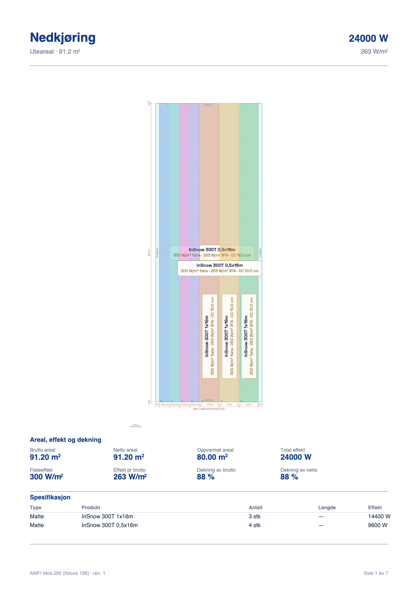
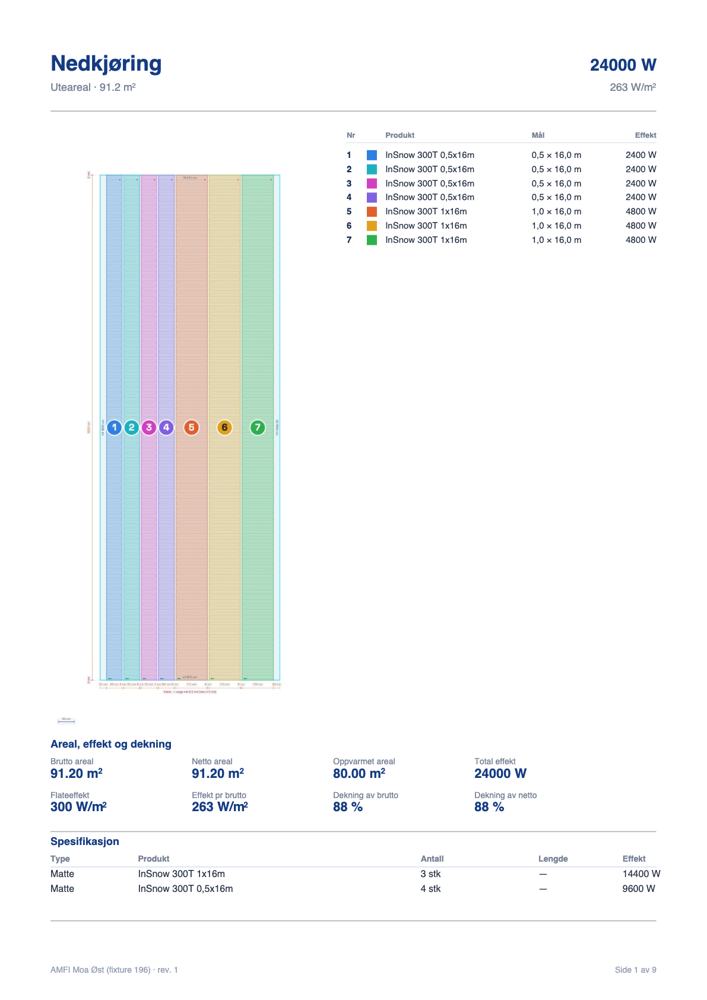
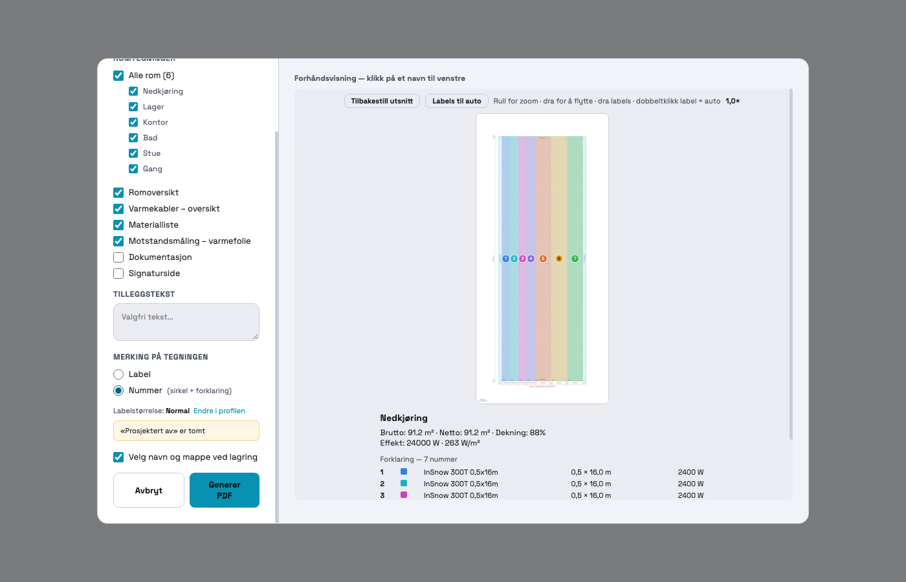
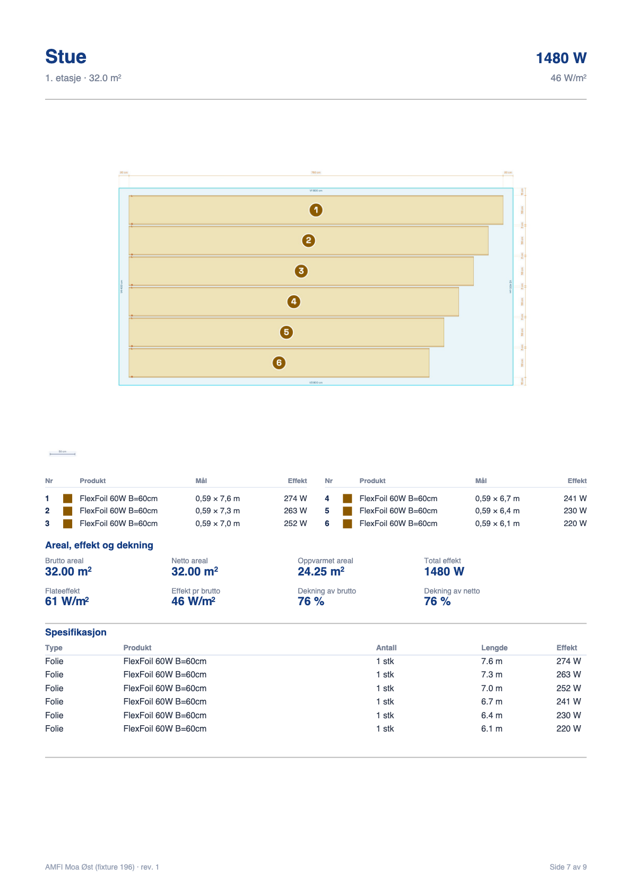
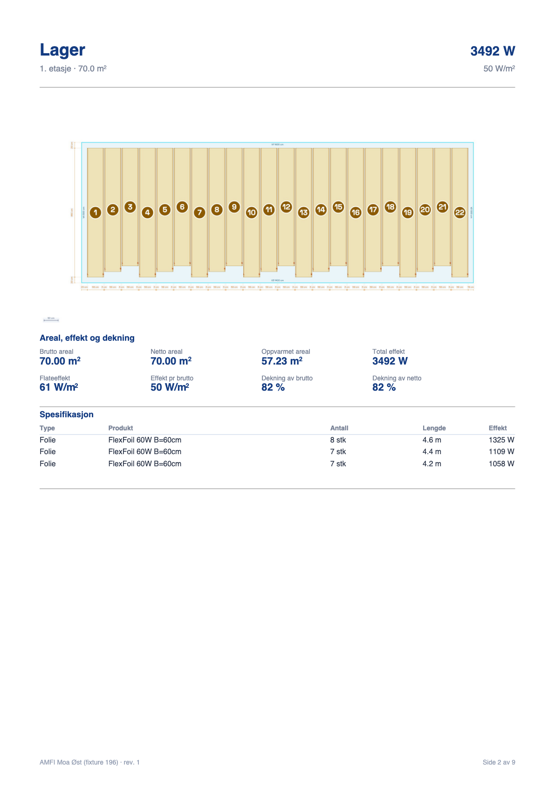
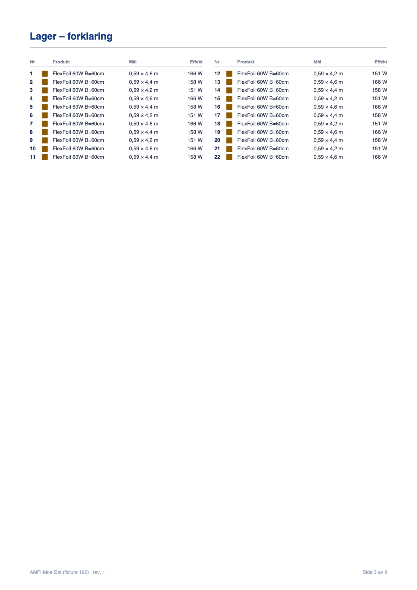
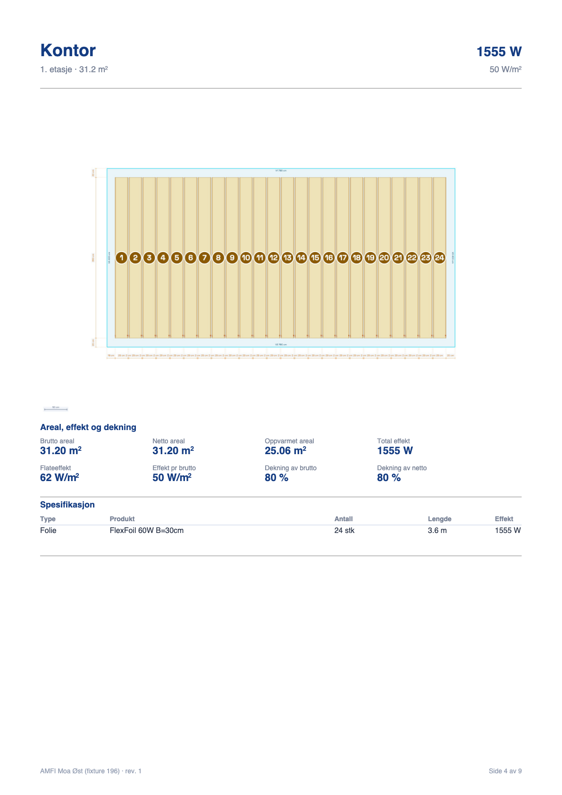
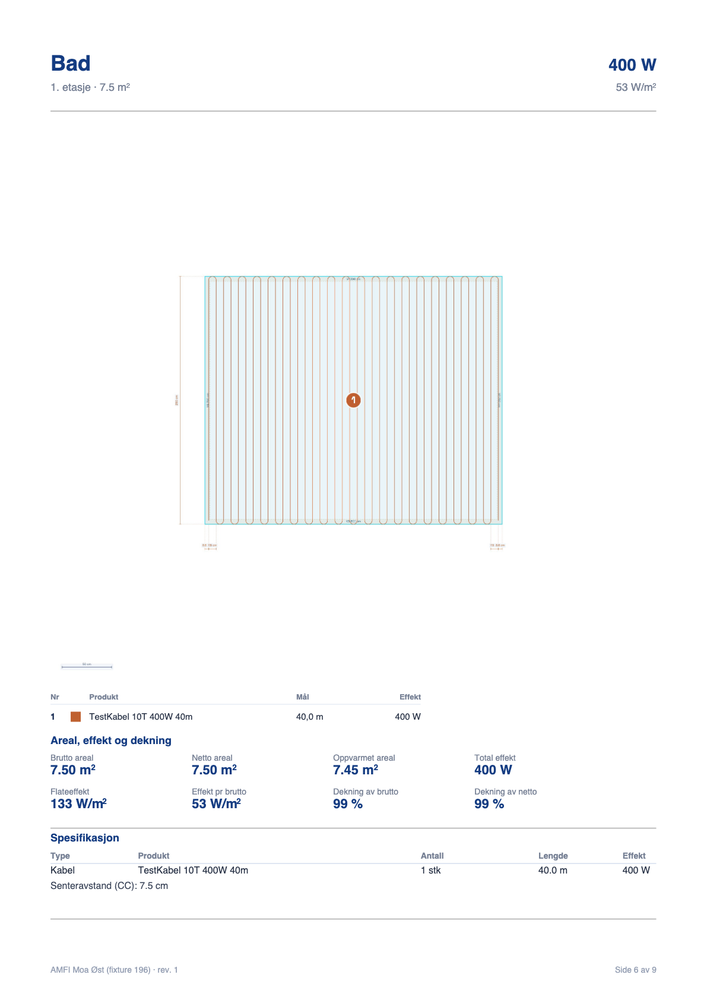
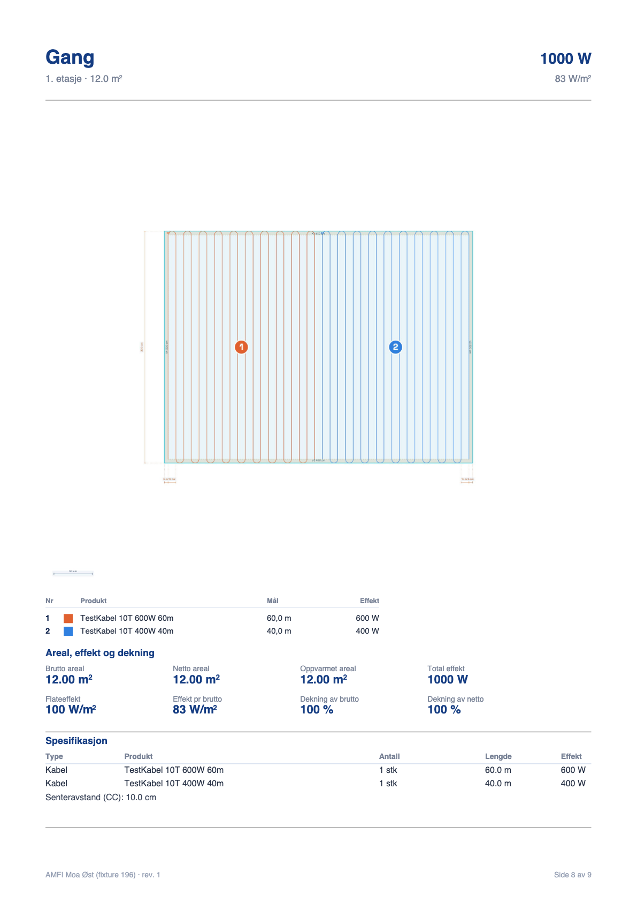

# 196 · PDF: «Label» eller «Nummer» på romsidene — rapport

06.11.2026 · `main` · committet, **ikke pushet**

## Kort fortalt

PDF-dialogen har fått et nytt valg, **«Merking på tegningen»: Label / Nummer**.

- **Label** (standard): nøyaktig som før. PDF-en er byte-for-byte lik den HEAD lager (målt, se «Label-modus er uendret»).
- **Nummer**: de store labelene tegnes ikke. Hver matte, kabel og foliebane får et nummer i en liten, fylt
  sirkel midt på elementet, i elementets egen farge. Ved siden av (eller under) tegningen står en
  forklaring — Nr · farge · Produkt · Mål · Effekt — som **ekte PDF-tekst**, ikke som en del av bildet.
  Den er derfor skarp uansett zoom, og kan markeres og kopieres.
- Valget huskes per bruker til neste eksport, og forhåndsvisningen i dialogen viser samme modus som PDF-en.

Nedkjøringen med 7 matter, de to modusene side om side:

| Label (som før) | Nummer (ny) |
|---|---|
|  |  |

Hele eksempel-PDF-en i Nummer-modus (9 sider) ligger i `docs/196/eksempel-nummer.pdf`.

---

## STEG 0 — målt før noe ble endret

### 0.1 Hvem tegner labelene, og hvordan kommer de inn i PDF-en

| Produkttype | Funksjon som tegner labelen | Linje (nå) |
|---|---|---|
| Folie (baner) | `drawStrips` samler jobber → `_drawStripLabel` | 45242 / 45694 |
| Fri folie | `drawFoilFree` → `_drawFoilFreeLabel` | 45456 / 45494 |
| Kabel | rett i `drawCables`; «kun label»-kabel: `_drawCableLabelOnly` | 46212 / 46106 |
| Matte (rektangulær, `S.mats`) | label-blokken i `drawMats` → `_drawStripLabel` | 46836 |
| Frihåndsmatte (`S.matPaths`) | `_drawMatPathObj` → `_drawStripLabel` | 24125 |
| Plate | liten tekst i `drawPlates` (ingen label-boks) | 47472 |
| Aluboard | ingen label | 47429 |
| Trapp | egne sider, `_renderStairPrintImages` (K1/K2 og sonenavn fra før) | 90329 |

**Veien inn i PDF-en:** labelene er ikke PDF-tekst. `exportPDF` (86665) kaller `_renderRoomToImage` (89390),
som tegner rommet på hovedlerretet i 300 DPI med `S.ui._pdfMode = true`, og legger resultatet inn som ett
JPEG-bilde. Labelene er altså piksler i bildet — derfor blir de uleselige når bildet er lite (nedkjøringen:
81,5 mm bredt, 963 px). Skriftstørrelsen på papiret er `LABEL_PDF_MM = 2,2` mm × brukerens labelstørrelse.

### 0.2 Farger og nummerering fra før

| Element | Farge | Fast eller per element |
|---|---|---|
| Folie | oransje (fyll gul, kant `rgb(140,90,0)`) — eller egen `fillColor` på banen / i innstillingene | fast for alle baner (med mindre brukeren har valgt farge) |
| Kabel, én i rommet | `#c06030` | fast |
| Kabel, flere i samme gruppe | `INDOOR_CABLE_COLORS[n]` (46080) | per kabel |
| Matte, én i rommet | blå | fast |
| Matte, flere i rommet | `MAT_COLORS[n]` (14575) via `_matColor` / `_matPathSegColor` | **per fysisk matte**, ikke per produkt |
| Trappekabel | `STAIR_CABLE_COLORS[n]` (54204) | per kabel |

Eksisterende nummerering: bare **K1/K2** (flerkabel-grupper og trapper). Matter og folie har ingen.

### 0.3 Hvor bildet står på romsiden (A4 stående, marg 15 mm, 180 mm bredt felt)

Bildet starter 38 mm fra toppen. `_pdfRoomImgLayout` (88761) gir det hele bredden, men aldri høyere enn det
som er igjen når nøkkeltall, spesifikasjon og merknader har fått sin plass (minst 40 mm). Blir bildet
begrenset av høyden, midtstilles det.

| Rom (cm) | Bilde b × h (mm) | x (mm) | Ledig til høyre | Ledig hvis bildet stilles til venstre | Piksler |
|---|---|---|---|---|---|
| Nedkjøring 570 × 1600 (høyt, smalt) | 81,5 × 178,0 | 64,2 | 49,2 mm | **98,5 mm** | 963 |
| Lager 1400 × 500 (bredt) | 180 × 84,7 | 15 | 0 | 0 | 2126 |
| Kontor 780 × 400 | 180 × 116,7 | 15 | 0 | 0 | 2126 |
| Stue 800 × 400 | 180 × 114,5 | 15 | 0 | 0 | 2126 |
| Bad 300 × 250 | 180 × 165,0 | 15 | 0 | 0 | 2126 |
| Gang 400 × 300 | 180 × 154,3 | 15 | 0 | 0 | 2126 |

Konklusjonen av målingen: **høye, smale rom har nesten 10 cm ledig bredde; brede rom har ingen, men ofte
ledig høyde under bildet.**

### 0.4 Valgene i PDF-dialogen, og hvordan de huskes

`_showExportDialog` (84041) bygger dialogen, `_runExportPDF` (84701) leser avkrysningene og sender dem til
eksporten. To slags hukommelse fantes:

- **per bruker**: `profiles.prefs` (labelstørrelse `pdfLabelScale`, «Velg navn og mappe» `pdfSavePicker` fra 195),
  med `localStorage` som reserve når man ikke er innlogget;
- **per prosjekt**: rabatter og tilleggstekst (`S.project.pricing`, `S.project.freeText`).

Det nye valget følger 195-mønsteret: `profiles.prefs.pdfMarkMode` (`'label'` | `'number'`), reserve i
`localStorage` (`varmeplan_pdf_mark_mode`), standard `'label'`. Ingenting nytt lagres i prosjektet.

---

## Hva som er bygget

Alt ligger i `index.html`, i blokken **«196 · PDF: MERKING «LABEL» ELLER «NUMMER» PÅ ROMSIDENE»** rett foran
`_renderRoomToImage`. All ny oppførsel står bak ett flagg (`S.ui._pdfNumberMode`) som bare settes når
eksporten ber om Nummer — uten det er tegnekoden urørt.

**Én liste, to forbrukere.** `_pdfNumberItems(room)` lager lista over det som skal nummereres. Både sirklene
på tegningen (`_drawPdfNumberBadges`) og radene i forklaringen (`_pdfLegendRows`) leser den samme lista, så
nummer og rad kan ikke komme i utakt.

**Hva som får nummer** — én rad per ting montøren legger:

| Element | Mål i tabellen | Effekt |
|---|---|---|
| Matte (`S.mats`) | bredde × lagt lengde, f.eks. `0,5 × 16,0 m` | mattens merkeeffekt |
| Frihåndsmatte | én rad per rull i banen | rullens effekt |
| Foliebane og fri folie | bredde × lengde, f.eks. `0,59 × 4,6 m` | banens effekt |
| Kabel | lengde, f.eks. `40,0 m` | kabelens merkeeffekt |
| Reservekabel | egen rad, «Reserve · …» | — |

Plater og Aluboard nummereres ikke (de har ingen label i dag heller). Produktnavnet er `product.name`,
det samme som står i materiallista.

**Rekkefølgen.** Venstre → høyre, deretter topp → bunn, og starter på 1 i hvert rom. Elementer som står
over hverandre (overlapper mer enn halve bredden) regnes som samme kolonne og telles ovenfra og ned før
neste kolonne. Lagringsrekkefølgen spiller ingen rolle — testrommet har mattene lagt inn i stokket rekkefølge.

**Sirkelen.** 4,6 mm i diameter og 8 pt fete tall **på ferdig papir**, uansett hvor stort rommet er: størrelsen
regnes fra hvor mange millimeter ett verdens-cm blir i akkurat dette bildet (`_pdfScaleMmPerCm`, samme tall
labelene bruker). Fylt med elementets egen farge, hvit ring rundt, hvitt tall (mørkt tall på lyse farger).
Standardfolien er lys gul, så der brukes kantfargen (mørk rav) for at sirkelen skal synes.
Står to sirkler for tett, skyves de i sikksakk langs elementet (`_pdfNumberPlace`) i stedet for å overlappe.

**Målkjedene** tegnes som før i begge moduser — de er ikke rørt.

**Forhåndsvisningen** i dialogen bruker samme kall som PDF-en. Bytter du mellom Label og Nummer, tegnes
rommet på nytt med én gang, og forklaringen vises under bildet (med «egen side i PDF-en» når den er lang).

---

## Hvor tabellen står — og hvorfor

**Regelen: den plasseringen som gir størst tegning vinner. Står det likt, settes tabellen øverst til høyre.**
(`_pdfNumberLayout`, 89115.) Begrunnelsen kommer rett fra målingen i 0.3:

| Plassering | Når | Hvorfor |
|---|---|---|
| **Øverst til høyre**, tegningen til venstre | høye, smale rom (bildet er begrenset av høyden) | Bildet har ledig bredde som ellers er hvitt papir. Tabellen får 70–92 mm. Tegningen krymper ikke. |
| **Rett under tegningen** (to spalter fra 5 rader) | brede rom (bildet fyller bredden) | Til høyre er det 0 mm ledig; å lage plass der ville krympe tegningen med over en tredel. Under er det oftest ledig høyde. |
| **Egen side** «<rom> – forklaring» rett etter romsiden | flere enn 15 rader | Tegningen skal ikke krympe for en lang tabell. To spalter, ny side når den er full. |
| Ingen tabell | rommet har ingen elementer | — |

Målt på testprosjektet (bildets størrelse i mm):

| Rom | Rader | Plassering | Label-modus | Nummer-modus | Krymper |
|---|---|---|---|---|---|
| Nedkjøring | 7 | øverst til høyre (x 103, 92 mm bred, 36 mm høy) | 81,5 × 178,0 | 81,5 × 178,0 | nei |
| Stue | 6 | under, to spalter | 180 × 114,5 | 180 × 114,5 | nei |
| Bad | 1 | under | 180 × 165,0 | 176,5 × 161,8 | 3,5 mm (2 %) |
| Gang | 2 | under | 180 × 154,3 | 178,0 × 152,6 | 2,0 mm (1 %) |
| Lager | 22 | egen side | 180 × 84,7 | 180 × 84,7 | nei |
| Kontor | 24 | egen side | 180 × 116,7 | 180 × 116,7 | nei |

Bad og Gang krymper et par millimeter fordi bildet der allerede bruker hele høyden på siden; tabellen
trenger 11–15 mm. I Nedkjøringen flyttes tegningen fra midten til venstre kant for å gi tabellen plass —
størrelsen er den samme.

| Bredt rom — tabell under | 22 baner — tegning | 22 baner — forklaring på egen side |
|---|---|---|
|  |  |  |

| 24 smale baner (30 cm) | Én kabel | To kabler i gruppe |
|---|---|---|
|  |  |  |

---

## Testene fra oppgaven

| # | Test | Resultat |
|---|---|---|
| 1 | Nedkjøring med 7 matter | **7 sirkler 1–7 og 7 tabellrader.** Produkt og effekt er sammenlignet med materiallista (`_collectMaterialItems`) og stemmer: 4 × InSnow 300T 0,5x16m à 2400 W + 3 × 1x16m à 4800 W. Bilde øverst i rapporten. |
| 2 | Folierom med 20+ baner | Lager (22 baner à 60 cm): minste luft mellom to sirkler 2,05 mm. Kontor (24 baner à 30 cm, 5,2 mm mellom sentrene): 0,57 mm luft, ingen overlapp. Begge får forklaringen på egen side. |
| 3 | Kabelrom | Bad (én kabel) og Gang (to kabler i gruppe, hver sin farge): nummer midt på kabelen + tabell under. **Trapp: venter** — se SPØRSMÅL 1. |
| 4 | Label-modus identisk | **Ja, byte for byte** — se under. |
| 5 | Valget huskes | Ekte klikk i dialogen: Nummer → «Generer PDF» → åpne dialogen på nytt → Nummer står valgt; også etter at siden er lastet inn på nytt. Tilbake til Label huskes likt. Innlogget skrives `profiles.prefs.pdfMarkMode`, og de andre valgene (`pdfLabelScale`, `pdfSavePicker`) beholdes. |
| 6 | Eksisterende tester + ny | Se tabellen under. |

### Regresjonstester

Ny: **`_pdfNumberModeRegressionTest`** (47 kontroller). Den bygger et eget lite prosjekt, kjører den ekte
`exportPDF` med et jsPDF som logger hver tekst og hvert bilde per side, og rydder opp etter seg. Den sjekker
blant annet:

- antall nummer = antall elementer = antall tabellrader (7 = 7 = 7), i riktig rekkefølge;
- **tabellen er tekst**: radene finnes som `doc.text`-kall, og romsiden har nøyaktig ett bilde (tegningen);
  forklaringssiden har null bilder;
- sirkel ≥ 4 mm og tall ≥ 7 pt på ferdig side, ingen overlapp, hver sirkel står på sitt eget element;
- plasseringsregelen (til høyre / under / egen side / ingen), og at tegningen ikke krymper for en lang tabell;
- Label-modus = eksport uten valget (samme tekster og bilder på samme plass), ingen forklaring, ingen ekstra side;
- valget huskes (nettleser og profil), kundelenka sender ikke valget, forhåndsvisningen følger valget.

| Test | Etter 196 | HEAD (før) |
|---|---|---|
| `_pdfNumberModeRegressionTest` (ny) | 47/47 | — |
| `_pdfExportSmokeTest` | 55/55 | 55/55 |
| `_pdfPreviewRegressionTest` | 96/96 | 96/96 |
| `_pdfSavePickerRegressionTest195` | 43/43 | |
| `_prefsRegressionTest` | 47/47 | |
| `_profileNameRegressionTest` | 15/15 | |
| `_cableOverviewRegressionTest` | 33/33 | |
| `_foilResistanceRegressionTest` | 52/52 | |
| `_foilEffectRegressionTest` | 32/32 | |
| `_accessoryFoilQtyRegressionTest` | 105/105 | |
| `_matDimChainRegressionTest` · `_dimChainEdgeRegressionTest` | 35/35 · 28/28 | |
| `_matFreeRegressionTest` · `_matChapterRegressionTest` | 65/65 · 25/25 | |
| `_foilRegressionTest` · `_matRegressionTest` | 9/9 · 2/2 | |
| `_stairRegressionTest` · `_stairSideRegressionTest` | 45/45 · 25/25 | |
| `_reserveCableRegressionTest` | 61/64 | 61/64 (samme tre rader) |
| `_listevisningRegressionTest`, `_kundeforslagRegressionTest`, `_matArrangementRegressionTest` | stopper på «produktkatalogen er ikke lastet» | samme |

Tom rute i HEAD-kolonnen = ikke kjørt mot HEAD i denne økten. PDF-/profil-testene hadde de samme tallene
i 195 (`docs/195/probe/etter.json`); tegnetestene (målkjeder, matter, folie, trapp) er grønne nå, men er
ikke sammenlignet tall for tall med HEAD.

De fire nederste er røde **også på HEAD**, med nøyaktig samme rader: testnettleseren er ikke innlogget, så
produktkatalogen er tom. De er ikke berørt av 196. (HEAD ble målt ved å skrive `git show HEAD:index.html` til
en midlertidig fil og kjøre testene mot den.)

### Label-modus er uendret

Samme testprosjekt (seks rom + materialliste, låst dato og fil-ID) bygget fire ganger:

| Bygg | Sider | Bytes | sha256 |
|---|---|---|---|
| HEAD (før 196) | 7 | 1 403 818 | `e17435f0…5f22150` |
| Etter 196, `marking: 'label'` | 7 | 1 403 818 | `e17435f0…5f22150` |
| Etter 196, uten feltet (kundelenka, gamle kall) | 7 | 1 403 818 | `e17435f0…5f22150` |
| Etter 196, `marking: 'number'` | 9 | 1 072 039 | `56bae630…b5971d8` |

De tre første er identiske ned til siste byte. Nummer-PDF-en har to sider mer (forklaring for Lager og
Kontor) og er likevel mindre — trolig fordi bilder uten labelbokser komprimeres bedre (ikke undersøkt nærmere).

Ikke rørt, slik oppgaven sa: oppløsning og bildeformat (197), farger, beregninger, og hva som lagres i
prosjektet.

---

## Kjente begrensninger (alle står også i SPØRSMÅL)

- **Trapper** har egne sider og er ikke med — de har allerede farge per kabel, K1/K2 og egen tabell.
- **Plantegningen per etasje** (154) bruker fortsatt labels også når Nummer er valgt.
- **Kundelenka** («Last ned PDF» for kunden) lager alltid Label-PDF — den har ingen dialog.
- I Nummer-modus tegnes ingen labels i **naborom** som stikker inn i bildet heller (og de får ikke nummer).
- Knappen «Labels til auto» og teksten «dra labels» står fortsatt over forhåndsvisningen i Nummer-modus,
  der det ikke finnes labels å dra.
- `_pdfPreviewRegressionTest` (gammel, urørt) drar i labels i dialogen. Kjøres den i en nettleser der det
  lagrede valget er Nummer, vil de radene feile. Testen selv er ikke endret.

## Slik prøver du selv (to minutter)

1. Åpne et prosjekt med flere matter eller foliebaner i ett rom → **Eksporter PDF**.
2. Nederst til venstre: **Merking på tegningen** → velg **Nummer**.
3. Klikk et romnavn i lista — forhåndsvisningen viser sirkler og forklaringen under.
4. **Generer PDF**. Zoom inn på forklaringen: teksten er skarp, og kan markeres.
5. Åpne dialogen igjen: Nummer står fortsatt valgt.

## Filer

- `index.html` — eneste kodefil som er endret.
- `docs/196/eksempel-nummer.pdf` — testprosjektet i Nummer-modus.
- `docs/196/probe/` — verktøyene bak målingene: `fixture.mjs` (testprosjektet), `bygg.mjs` (bygg + sha),
  `vis.mjs` (PDF-side → bilde + tekst), `oppsett.mjs` (plassering og sirkelmål), `dialog.mjs` (ekte klikk i
  dialogen), `tester.mjs` (alle testene, hver i sin fane); resultatene ligger som `.json` samme sted.
