# 200 · PDF Label/Nummer: svar på 196 — rapport

07.11.2026 · `main` · committet, **ikke pushet**

## Kort fortalt

Tre endringer i PDF-en, alle etter svarene dine på 196:

1. **Forklaringen står under tegningen når den får plass** (spm 2). Grensen på 15 rader er borte. Tegningen
   er nå **alltid like stor som i Label-modus**. Den krympes aldri for å gi tabellen plass. Får ikke hele
   tabellen plass, står hele tabellen på egen side som før (aldri delt).
   → **Lager (22 baner) har nå alt på én side.** Det samme gjelder Kontor (24 baner).
2. **Spesifikasjon uten dobbeltlinjer i Nummer-modus** (spm 8). Rader som sier nøyaktig det samme som en rad
   i forklaringen, tas bort. Summer (flere stk) blir stående. Blir Spesifikasjon tom, er overskriften borte.
   **Komma i Spesifikasjon i begge moduser** (`7,6 m`, også CC: `7,5 cm`).
3. **Dialogen** (spm 10): «Labels til auto» og «dra labels» vises bare i Label-modus.

Label-modus er ellers uendret. Målt: 399 tekst- og bildekall, de samme som HEAD. Bare 16 tekster er
endret, og alle er kommaet i Spesifikasjon. Alle bilder er byte-like.

| Lager før (2 sider) | Lager etter (1 side) |
|---|---|
| 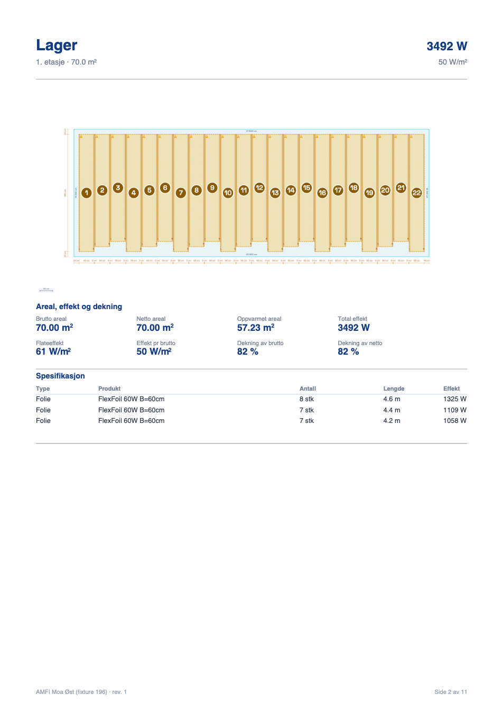 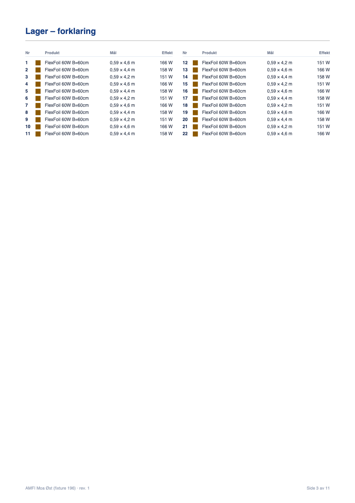 | 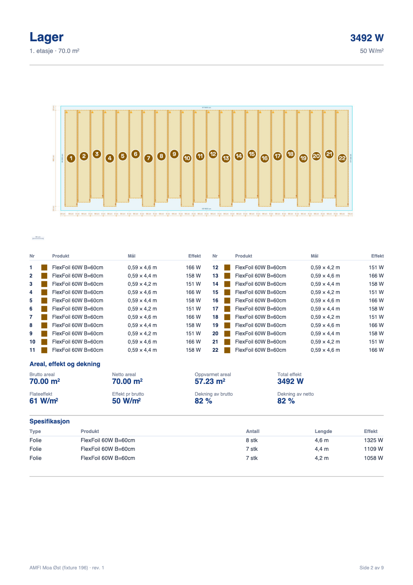 |

---

## STEG 0 — hva Spesifikasjon og forklaringen viser (målt på HEAD, før endring)

Testprosjektet fra 196 (`docs/200/probe/fixture.mjs`). «I forklaring?» = finnes det en forklaringsrad med
nøyaktig samme produkt, lengde og effekt.

### Stue (6 foliebaner, ulik lengde)

| Linje i Spesifikasjon (HEAD) | Står i forklaring? | Står i Spesifikasjon? | Etter 200 (Nummer) |
|---|---|---|---|
| Folie · FlexFoil 60W B=60cm · 1 stk · 7.6 m · 274 W | ja, nr 1 (`0,59 × 7,6 m · 274 W`) | ja | **fjernet** |
| … · 1 stk · 7.3 m · 263 W | ja, nr 2 | ja | **fjernet** |
| … · 1 stk · 7.0 m · 252 W | ja, nr 3 | ja | **fjernet** |
| … · 1 stk · 6.7 m · 241 W | ja, nr 4 | ja | **fjernet** |
| … · 1 stk · 6.4 m · 230 W | ja, nr 5 | ja | **fjernet** |
| … · 1 stk · 6.1 m · 220 W | ja, nr 6 | ja | **fjernet** |
| Bredde 0,59 m per bane | ja (alle) | nei | — |
| Total effekt 1480 W | nei | nei | står i «Areal, effekt og dekning» |

→ Spesifikasjon blir tom, og overskriften er borte. Ingen opplysning er tapt: alt står i forklaringen.

### Lager (22 foliebaner, tre lengder)

| Linje i Spesifikasjon (HEAD) | Står i forklaring? | Står i Spesifikasjon? | Etter 200 (Nummer) |
|---|---|---|---|
| Folie · FlexFoil 60W B=60cm · **8 stk** · 4.6 m · **1325 W** | hver bane ja (nr 1, 4, 7 … 22 à 166 W), men **ikke antallet og summen** | ja | **står** (`4,6 m`) |
| … · **7 stk** · 4.4 m · **1109 W** | som over (nr 2, 5 … 20 à 158 W) | ja | **står** |
| … · **7 stk** · 4.2 m · **1058 W** | som over (nr 3, 6 … 21 à 151 W) | ja | **står** |

### Nedkjøring (7 matter)

| Linje i Spesifikasjon (HEAD) | Står i forklaring? | Står i Spesifikasjon? | Etter 200 (Nummer) |
|---|---|---|---|
| Matte · InSnow 300T 1x16m · **3 stk** · — · **14400 W** | hver matte ja (nr 5–7 à 4800 W), ikke summen | ja | **står** |
| Matte · InSnow 300T 0,5x16m · **4 stk** · — · **9600 W** | hver matte ja (nr 1–4 à 2400 W), ikke summen | ja | **står** |
| Mål `0,5 × 16,0 m` / `1,0 × 16,0 m` | ja | nei (Lengde = «—») | — |

### Kabelrommene (Bad og Gang)

| Linje i Spesifikasjon (HEAD) | Står i forklaring? | Etter 200 (Nummer) |
|---|---|---|
| Kabel · TestKabel 10T 400W 40m · 1 stk · 40.0 m · 400 W (Bad) | ja, nr 1 | **fjernet** |
| Senteravstand (CC): 7.5 cm | nei | **står**, nå `7,5 cm`, under overskriften «Spesifikasjon» |
| Gang: to kabler à 1 stk | ja, nr 1 og 2 | **fjernet**. CC `10,0 cm` står |

**Regelen som følger av tabellen** (`_pdfSpecRows`): en Spesifikasjon-rad tas bort når den har «1 stk» og
forklaringen har en rad med samme produkt, type og effekt (og samme lengde for folie og kabel). Hver
forklaringsrad kan bare fjerne én Spesifikasjon-rad. Det som ikke står i forklaringen, blir alltid stående:
summer, plater, Aluboard, «kun label»-matter, CC-linja og advarselen om flateeffekt. Spm 2 i SPØRSMÅL
handler om sumradene.

---

## Spm 2 — hvor forklaringen står nå

`_pdfNumberLayout` (index.html, blokken «196 · PDF: MERKING»):

1. Tegningen får **samme størrelse som i Label-modus** (`_pdfRoomImgLayout`).
2. Ledig høyde = sidebudsjettet minus tegningen. Spesifikasjon-radene som ikke skrives i Nummer-modus, regnes
   som ledig plass. Der regnes de radene som faktisk skrives (SPØRSMÅL 4).
3. **Ved siden av** (høye, smale rom) når tegningen beholder bredden og tabellen får plass. Vinner ved likt,
   som før.
4. Ellers **under tegningen** når hele tabellen får plass (to spalter fra fem rader).
5. Ellers **hele tabellen på egen side** «<rom> – forklaring».

Målt på testprosjektet (bildet i mm; «Label» = tegningen i Label-modus):

| Rom | Rader | HEAD (196) | Etter 200 | Tegning HEAD Nummer | Tegning nå = Label |
|---|---|---|---|---|---|
| Nedkjøring 570 × 1600 | 7 | ved siden av | ved siden av | 81,5 × 178,0 | 81,5 × 178,0 |
| Lager 1400 × 500 | 22 | egen side | **under** | 180 × 84,7 | 180 × 84,7 |
| Kontor 780 × 400 | 24 | egen side | **under** | 180 × 116,7 | 180 × 116,7 |
| Stue 800 × 400 | 6 | under | under | 180 × 114,5 | 180 × 114,5 |
| Bad 300 × 250 | 1 | under, **krympet 2 %** | under, **ikke krympet** | 176,5 × 161,8 | 180 × 165,0 |
| Gang 400 × 300 | 2 | under, **krympet 1 %** | under, **ikke krympet** | 178,0 × 152,6 | 180 × 154,3 |
| Sal 1300 × 1200 (ny i fixturet) | 20 | egen side | egen side | 180 × 168,8 | 180 × 168,8 |

PDF-en går fra 11 til 9 sider (Lager og Kontor mister forklaringssiden). Bad og Gang fikk plass uten å krympe,
fordi kabelraden i Spesifikasjon nå er borte. Se SPØRSMÅL 1 om rom der det mangler noen få millimeter.

| Bad: tabell under, tegningen ikke krympet | Sal: får ikke plass, tegningen fyller siden | Sal – forklaring (hele tabellen) |
|---|---|---|
| 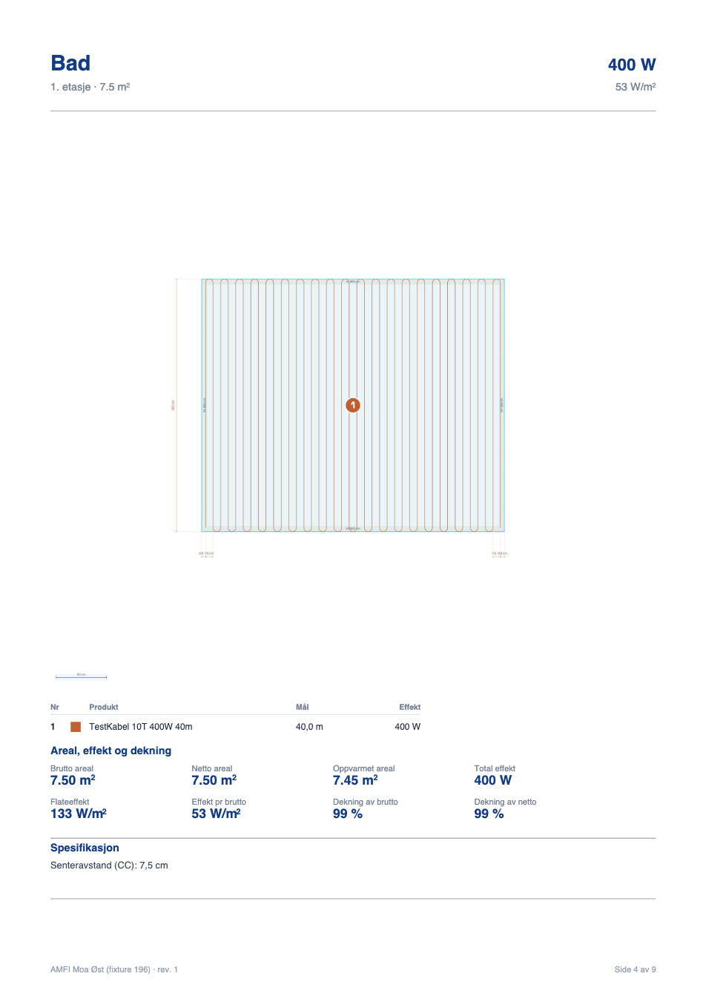 | 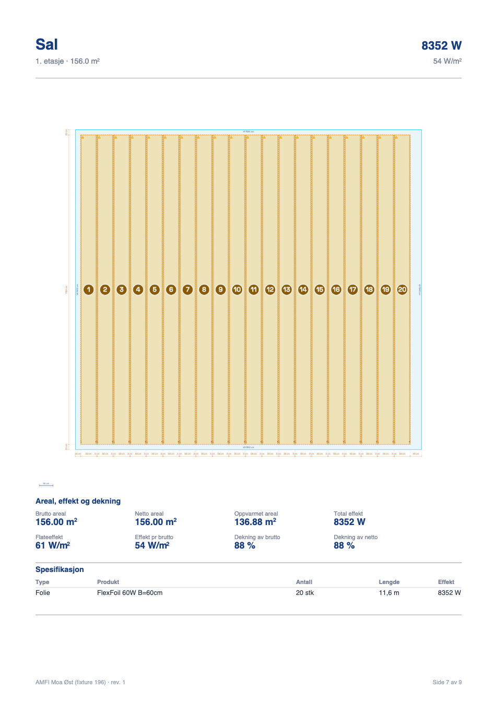 | 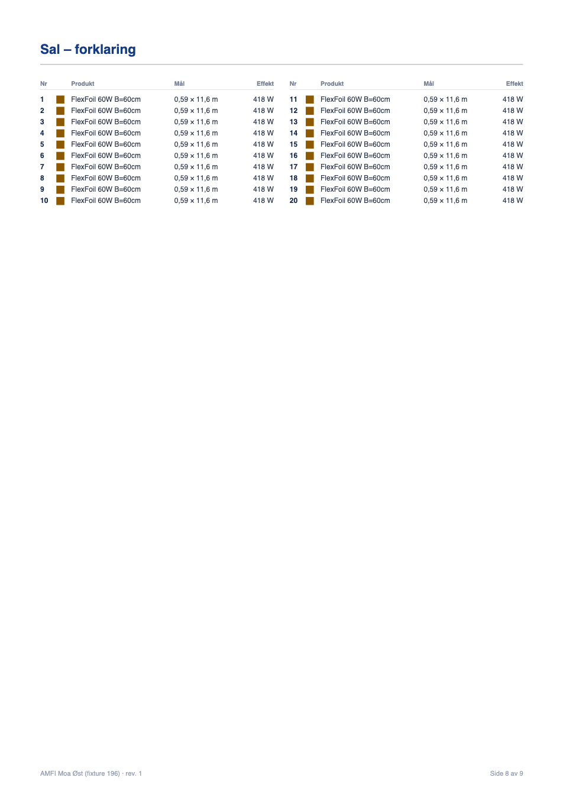 |

## Før / etter i Nummer-modus

| | Før (HEAD) | Etter |
|---|---|---|
| Stue | 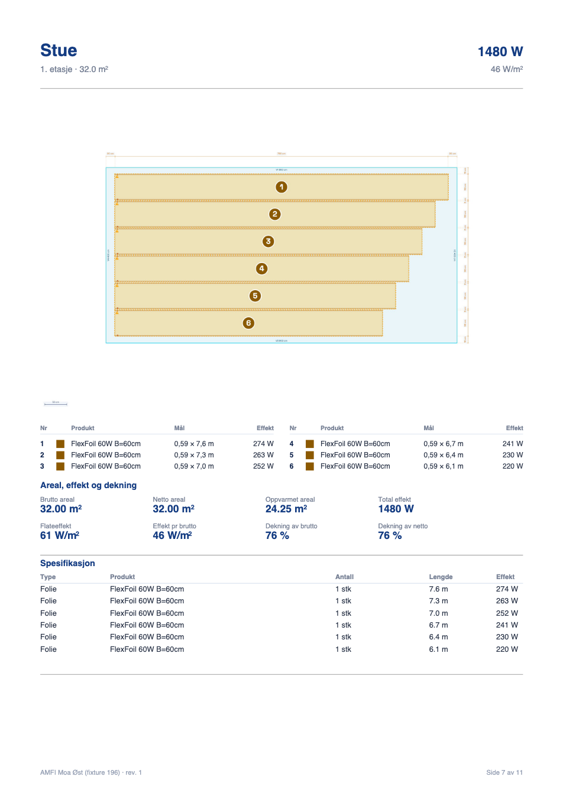 | 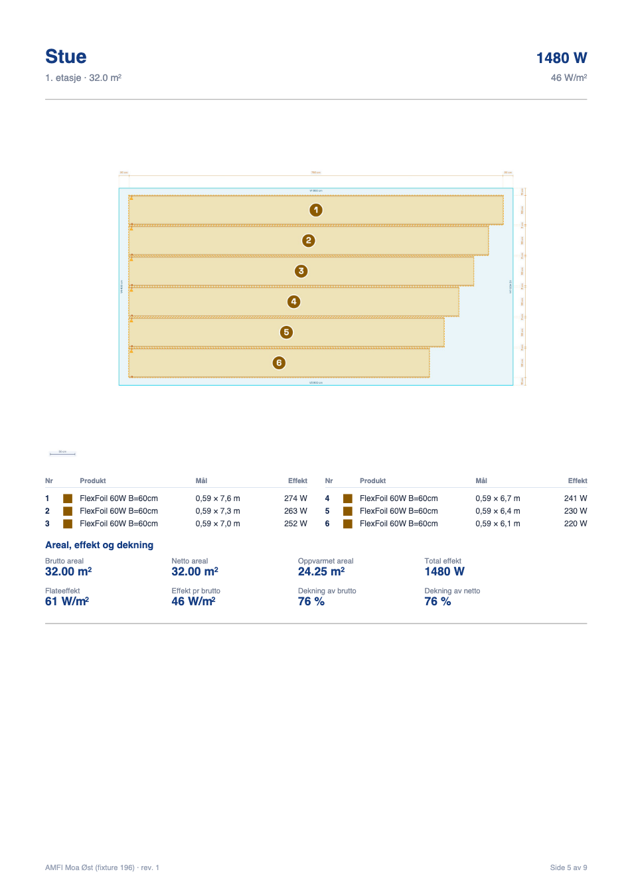 |
| Nedkjøring |  | 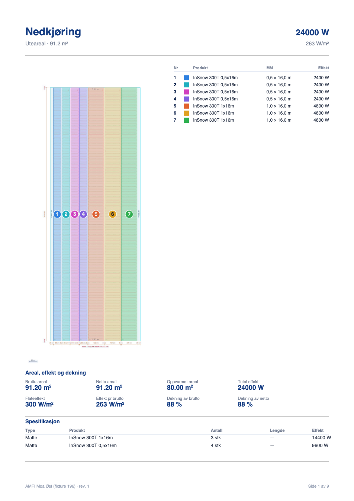 |

Stue: Spesifikasjon er borte (alle 6 radene sto i forklaringen). Nedkjøring: uendret plassering, men
Spesifikasjon står fordi radene er summer.

Hele eksempelet i Nummer-modus (9 sider): `docs/200/eksempel-nummer.pdf`.

## Spm 10 — dialogen

| Label | Nummer |
|---|---|
| 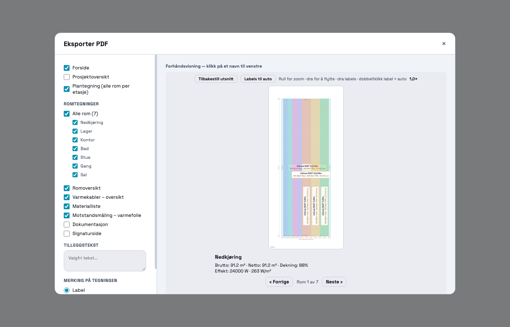 | 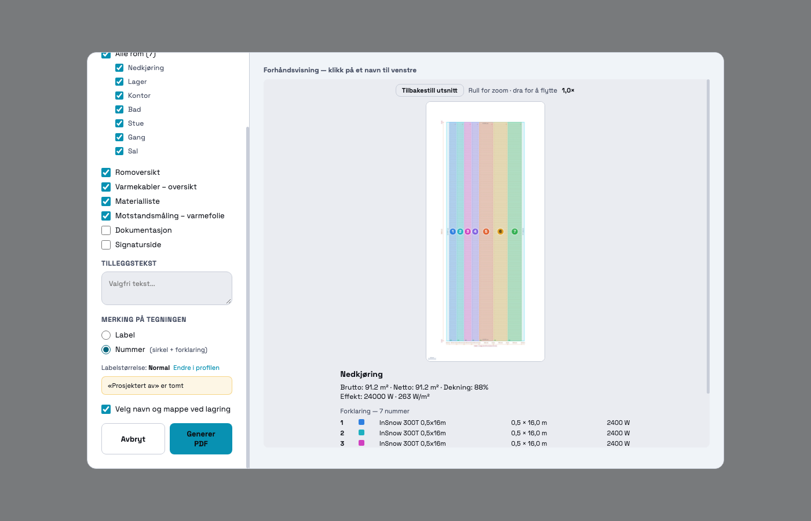 |

I Nummer-modus står bare «Tilbakestill utsnitt» og «Rull for zoom · dra for å flytte». Plantegningen per etasje
(som har labels også i Nummer-modus, 196 spm 3) viser fortsatt knappen. Forhåndsvisningens merknad
«(egen side i PDF-en)» følger nå samme regel som PDF-en, altså ikke lenger «over 15 rader».

---

## Testene fra oppgaven

| # | Test | Resultat |
|---|---|---|
| 1 | Lager i Nummer-modus | **Tabellen under tegningen, alt på én side.** Tegningen er 180 × 84,7 mm, som før og som i Label-modus. |
| 2 | Et rom der tabellen ikke får plass | Sal (1300 × 1200, 20 baner): tegningen fyller siden, og **hele** tabellen står på «Sal – forklaring» (20 rader, 0 bilder). Testens «Blandet» (6 rader) går samme vei, se SPØRSMÅL 1. |
| 3 | Stue: ingen dobbeltlinjer, ingen informasjon borte | Alle 6 Spesifikasjon-radene sto i forklaringen og er fjernet. Testen sjekker at hver fjernet rad står i forklaringen med samme navn, lengde og effekt (D1–D2). Summene i Lager/Nedkjøring står (D3). |
| 4 | Label-modus = HEAD bortsett fra komma | 399 kall, samme rekkefølge og plass. 16 tekster endret, alle er komma i Spesifikasjon (14 lengder, 2 CC-linjer). Alle bilder er byte-like (`sig.mjs`). |
| 5 | Dialogen | Ekte klikk (`dialog.mjs`, 11/11): Label viser knapp og «dra labels», Nummer skjuler dem, og tilbake til Label viser dem igjen. |
| 6 | Eksisterende tester | Se under. |

### Regresjon (hele settet, HEAD mot nå, hver test i egen fane)

| | HEAD | Nå |
|---|---|---|
| Tester | 69, hvorav 62 grønne | 69, hvorav 62 grønne |
| Samme tall som HEAD | — | **68 av 69** |
| `_pdfNumberModeRegressionTest` (196, utvidet) | 47/47 | **59/59** |
| `_pdfExportSmokeTest` | 55/55 | 55/55 |
| `_pdfSavePickerRegressionTest195` | 43/43 | 43/43 |
| `_pdfPreviewRegressionTest` | 96/96 | 96/96 |
| Trapptestene (11 stk, bl.a. `_stairRegressionTest` 45/45, `_stairHorseshoeRegressionTest` 274/274) | grønne | uendret, samme tall |

De sju røde er røde **også på HEAD**, med samme rader. De krever innlogging eller kart: `_prosjektlaasRegressionTest`
66/67, `_kundeforslagRegressionTest` 270/271 og fem `_geo*`-tester som kaster når de kjøres alene.

Nye kontroller i `_pdfNumberModeRegressionTest`:
- C6: 22 rader står under tegningen, og det finnes ingen forklaringsside.
- C9 og C10b: tabellen får ikke plass og havner derfor samlet på egen side.
- C10c og C10d: ingen tegning er mindre eller større enn i Label-modus.
- D1–D6: Spesifikasjon (dobbeltlinjer bort, summer står, komma i begge moduser).
- I7, I7b, I8 og I9: forhåndsvisningen («egen side» etter den nye regelen) og label-tekstene.

## Filer

- `index.html`: eneste kodefil som er endret. Nytt: `_pdfSpecRows`. Endret: `_pdfNumberLayout`,
  Spesifikasjon-blokken i `exportPDF`, `_expPreviewLive`, `_pdfLegendHtml` og `_pdfNumberModeRegressionTest`.
  `PDF_LEGEND_MAX_ROWS` er fjernet.
- `docs/200/eksempel-nummer.pdf` og bildene i `docs/200/`.
- `docs/200/probe/`: `steg0.mjs` (STEG 0-tabellen), `sig.mjs` (alle tekst-/bildekall HEAD mot nå),
  `bygg.mjs`/`vis.mjs` (PDF og side → PNG), `blandet.js` (SPØRSMÅL 1-tabellen), `dialog.mjs` (ekte klikk),
  `alle.mjs`/`sammenlign.js` (hele regresjonssettet mot HEAD), med resultatene som `.json`.
