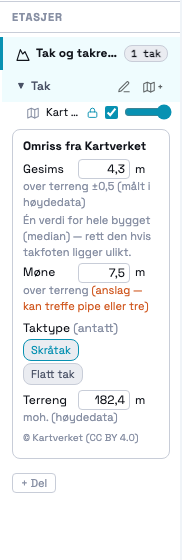
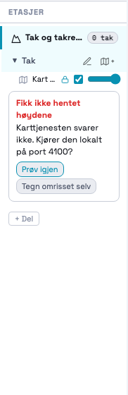
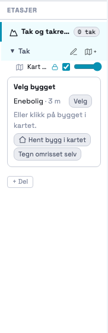

# 204 · Tak-modulen slås på — rapport

07.11.2026 · `main` · én commit, ikke pushet · ingen SQL, ingen migrasjon · `varmeplan-roof` ikke rørt.

## Kort

- **Tak og takrenner er en modul man kan velge.** Flisa står på dashbordet under Prosjektering.
  For kundebedrifter er den låst med hengelås, som de andre utemodulene (170).
- **Tak-delen får én etasje, «Tak».** I sidepanelet ligger én blokk: finn bygget → velg bygget →
  statuskort. I verktøylinja er rom-verktøyene byttet ut med «Tegn omrisset selv».
- **Velger du et bygg, hentes `/roof/model?level=quick`.** Det skjer fra lista i kortet, fra
  «Hent bygg» i kartet (201) eller fra «Bytt bygg» i ⋯-menyen. Statuskortet viser omriss, gesims,
  møne, taktype og terreng. Hver verdi har referansepunkt og opphav, og alt kan redigeres.
- **`S.tak[floorId].surfaces` er en liste fra første linje.** Grensesnittet viser bare flate 0.
- **Et prosjekt uten tak er uendret.** Det får ingen `tak`-nøkkel. Samme prosjektdata åpnet og
  lagret i gammel og ny kode gir samme hash (5 106 B). Innendørs- og snødelene er uendret.
- **Når tjenesten feiler**, viser kortet feilen med «Prøv igjen» og «Tegn omrisset selv».
  Manuell tegning virker uten tjeneste og uten kart.

## Skjermbilder

| Statuskort (stubbet svar, Steinliveien-tall) | Tjenesten svarer ikke | Velg bygget |
|---|---|---|
|  |  |  |

Hele vinduet ligger i `statuskort-ok.png`, med takflaten i oransje og verktøylinja «Tak · Tegn
omrisset selv». Kartflisene vises ikke, fordi headless Chrome her ikke har nett mot Kartverket.
Bildene er tatt ved sidepanelets minste bredde (180 px), som er det trangeste tilfellet.

## STEG 0 — hva jeg fant

### 1. `MODULE_TYPES.roof` og hva `available:false` filtrerte bort

`MODULE_TYPES` står på :3530, og roof-linja var `{ id:'roof', … available:false, kind:'room' }`.

Kommentaren ved `_renderDashModules` (nå ca. :103 500) stemmer for dashbordet. Flisene filtreres
gjennom `_moduleAvailable(id, true)`, som leser flagget, og ingenting er hardkodet der. Snus flagget,
dukker «Tak & renner» opp som en vanlig flis.

**Men to andre lister har hardkodet tak bort, uavhengig av flagget:**

| Liste | Hvor | Hva den gjør | Endret? |
|---|---|---|---|
| `MODULE_SCREEN_ORDER` | «Hva ønsker du å prosjektere?» (`+ Del`) | `['indoor','snow','stair','list']`, Kenneths 066-regel: «kun fire synlige valg i denne rekkefølgen». Låst av `_moduleScreenRegressionTest`-B | **Nei** (spørsmål 3) |
| `_MOD_NAV_ORDER` | modulknappene øverst i sidepanelet | `['indoor','list','snow','stair']`, fire like brede kolonner | **Nei** (spørsmål 3) |

Tak nås derfor bare fra dashbordflisa. I et prosjekt som har en tak-del, står delen også i
sidepanelets delliste. 170-testen B3 («roof er fortsatt skjult for alle») er snudd til «roof vises,
låst for kunden».

**`_enterPart` hadde ingen gren for `roof`.** En tak-del ville åpnet et tomt lerret uten etasje.
Den deler nå snøgrenen, men etasjen heter «Tak».

**`_roofOpenDialog` nektet alt utenom snø** («finnes bare i snø/utendørs»). Nå slipper den også tak
gjennom. Innendørs nektes fortsatt (låst i testen).

### 2. `_roofApi.modelQuick` var ikke i bruk

Bekreftet. Den er definert ved `_roofApi` (:80 677) og hadde null kallere. Nå kalles den fra
`_takFetchModel`, uendret, med `{ footprint, epsg: 25833 }`.

### 3. Hva quick-nivået lover (`varmeplan-roof/docs/roof-contract.md` og `app/api/roofmodel.py`)

| Felt | Lover | Conf | Merknad | Slik viser appen det |
|---|---|---|---|---|
| `heights.eave_m` | ✅ ±0,5 m | 0,6 | median(DOM1 − DTM1) innenfor omrisset. **Over terreng.** Én verdi for hele bygget | «Gesims 4,3 m · over terreng ±0,5 (målt i høydedata)» + «Én verdi for hele bygget (median) — rett den hvis takfoten ligger ulikt.» |
| `heights.ridge_m` | ⚠️ **anslag** | 0,4 | maks DOM over terreng, kan treffe pipe eller tre | «Møne 7,5 m · over terreng (anslag — kan treffe pipe eller tre)», i oransje |
| `roof.roof_type` | flat / pitched / unknown | 0,5 | terskel 0,8 m på DOM-maks − DOM-median | «Taktype (antatt)» med valgt knapp. `unknown` forvelger ingenting |
| `origin.ground_z` | ✅ | 0,8 | DTM1-median under omrisset, **meter over havet** | «Terreng 182,4 m · moh. (høydedata)» |
| `roof.planes` | ❌ **tom** | — | krever punktsky | ikke brukt |
| `roof.edges` | delvis | 0,6 | **alle** omrisskanter blir `eave`, z = gesims | **ikke tatt inn** (se under) |
| møner, gradrenner | ❌ | — | DOM1 er 1 m og «Bin with Maximum Value» | — |

Jeg har ikke tatt tjenestens `roof.edges` inn i `surfaces[0].edges`. Prompten sier at kantene skal
være tomme til 205, og «alle kanter er takfot» er ikke et forslag 205 bør arve uten videre: på et
saltak er to av fire kanter gavl.

**Live røyktest** mot Fly (07.11, manuell, ikke i testene), bygg 159278689 (enebolig, Hønefoss) fra
201-fixturen: HTTP 200 på 6,3 s (kald). Gesims 4,07 m (0,6), møne 7,31 m (0,4), `pitched` (0,5),
terreng 227,47 moh (0,8), `planes` 0, `edges` 8 × `eave`, `dom_nodata_frac` 0. Svaret ligger i
`probe/model-live.json`.

### 4. Lokale meter → verdens-cm

Tjenesten regner sentroiden `(cx, cy)` av omrisset vi sender, og gir tilbake `origin = {east: cx,
north: cy}` og `footprint.polygon = [(x − cx, y − cy)]` i meter, avrundet til 3 desimaler. Verdens
(0,0) er derimot kartvinduets **sørvestre hjørne** (`bg.geo.east0/north0`), og verdens-y vokser
nedover. Derfor:

```
east  = origin.east  + x
north = origin.north + y
verden = _geoToWorld(bg, east, north)   // { x: (east − east0)·100, y: −(north − north0)·100 }
```

`x·100` rett ville plassert bygget rundt verdens origo (kartets SV-hjørne, 100 m unna) og speilvendt
det nord–sør.

- **Kontrollert i test:** SV-hjørnet (574 210, 6 670 320) havner på `((574210 − east0)·100,
  −(6670320 − north0)·100)`, og tur-retur tilbake til UTM er under 1 mm.
- **Kontrollert live:** origin + lokale meter gir nøyaktig ringen vi sendte, i samme rekkefølge.
  Største avvik er 9 × 10⁻¹⁰ m. Avrundingen til 3 desimaler gir høyst 1 mm per hjørne.
- Sluttpunktet i ringen (shapely gjentar det første) fjernes, så omrisset lagres med n hjørner.

### 5. Hvordan et bygg velges i dag, og om 201 er kjørt

- **201 er kjørt** (2da1ec1). «Hent bygg» legger bygget man klikker i inn i
  `S.geo[fid].candidates`, men rører **aldri** `g.chosen`.
- Etter 142 er `g.chosen = null` etter adressesøket. Det eneste som setter `chosen` er
  `_geoChooseCandidate` (⋯-menyen på kartet → «Bytt bygg»), som kopierer omrisset (`footprintWorld`,
  verdens-cm), kilde og sikkerhet fra kandidaten.
- **I tak-modulen er det å klikke på bygget det samme som å velge det.** `_geoPickAt` kaller
  `_takChooseBuilding` etter et treff når etasjen hører til en tak-del. Snø er uendret: der rører
  klikket fortsatt ikke `chosen` (201-testen 34/34).
- Kandidatene lagrer bare verdens-cm, ikke UTM. Omrisset til tjenesten regnes tilbake med
  `_worldToGeo`. Det er eksakt, fordi det er inversen av samme lineære avbildning.
- Feltkopieringen i `_geoChooseCandidate` er løftet ut i `_geoSetChosen`, slik at tak og snø setter
  `chosen` likt. Oppførselen er uendret.

### 6. Andre funn (ikke endret)

- **`_resetProjectState` nullstiller ikke `S.geo`.** Et nytt prosjekt arver forrige prosjekts
  `S.geo` til `_restoreProject` overskriver den. Det er harmløst så lenge `_activeGeo` krever en
  geo-bakgrunn, og `S.bgs` nullstilles. `S.tak` nullstilles der fra nå. Spørsmål 9.
- **Første åpning legger til `project._customerDeleted: false`**, også på HEAD. Et prosjekt blir
  derfor 6 B større første gang det åpnes og lagres. Fra og med andre gang er rundturen
  byte-identisk. Det samme gjelder tidsstemplene `project.savedAt` og `rooms[].computed.stampedAt`,
  som endres ved hver lagring.

## Hva som er bygget

Alt ligger i blokka «204 · TAK-MODULEN» rett etter 201 (ca. :81 200), med prefikset `_tak*`.
`_roofApi` gjenbrukes som den er.

### State (`S.tak[floorId]`)

```js
{
  v: 1,
  building: { bygningsnr, type, origin: { epsg: 25833, east, north } } | null,  // null = tegnet for hånd
  surfaces: [{
    id: 'f1',
    roof_type: { value: 'pitched'|'flat'|null, prov|null, service? },          // service = tjenestens gjetning
    footprint: { world: [{x,y}], prov },                                        // verdens-cm
    heights: {
      eave_m:   { value, height_ref: 'terreng', prov },
      ridge_m:  { value, height_ref: 'terreng', prov },
      ground_z: { value, height_ref: 'moh',     prov },
    },
    edges: [],                                                                  // 205
  }],
  features: [],                                                                 // 206–209
  model: { level: 'quick', fetchedAt, warnings, dom_nodata_frac, attribution } | null,
}
```

- **Nøkkel per etasje**, som `S.geo` og `S.bgs`. Taket ligger i samme verdens-cm som kartet på
  etasjen. `delFloor` rydder `S.tak[id]`, og «flytt plantegning til etasje» flytter taket sammen med
  kartet.
- **Opphav** (`prov = {source, confidence, note}`) bruker kildene fra kontrakten. Omrisset fra
  INSPIRE får `FKB`, DOM1-omriss får `DOM_RASTER` og et omriss tegnet for hånd får `USER_DRAWN`.
  Høydene beholder tjenestens `DOM_RASTER`. Taktypen får `ESTIMATE` (prompten).
- **Retting** setter `prov = { source: 'USER_CONFIRMED', confidence: 1, note: 'rettet fra 4,3
  (DOM_RASTER)' }`. Den gamle verdien står altså i notatet. `height_ref` beholdes.
- **Lagring:** `data.tak` skrives bare når minst ett tak finnes (`_takHasAny`). `_restoreProject`
  setter `S.tak = data.tak || {}` og oppretter ingenting. Angre tar med `S.tak`. Hentestatus og
  tegning (`_takFetchState`, `_takDraw`) lagres aldri.

### Henting

`_takChooseBuilding(fid, bygningsnr)` setter `g.chosen` og kaller `_takFetchModel(fid)`. Den binder
etasje, bakgrunn og `chosen` **før** await (162-lærdommen). Har brukeren byttet bygg, kart eller
etasje når svaret kommer, kastes svaret (`gone`, låst i test F). Har taket rettede verdier eller
merkede kanter og brukeren bytter bygg, spør appen først.

### Taktypen (seksjon E)

- **Gjettet** (`flat`/`pitched`): knappen er forvalgt med «(antatt)» og `ESTIMATE`. Det kommer ingen
  dialog og ingen sperre. Trykker man på en knapp, også den som alt er valgt, blir verdien
  `USER_CONFIRMED` og teksten «(valgt)».
- **`unknown` eller tegnet for hånd:** ingenting er forvalgt, og kortet sier «⚠ Velg taktype — den
  styrer hvilke kanter som får renne.» `_takRoofTypeReady(surface)` er porten 205 skal spørre.
- **Byttes taktypen etter at kanter er merket**, spør appen før kantene nullstilles. «Nei» endrer
  ingenting (låst i test D).
- Valget står på `surfaces[0].roof_type`, ikke på prosjektet.

### Tegn omrisset selv

Dette er en egen modus (`_takDraw`) etter samme mønster som 201 og ikke et lag i klikk-kaskaden.
Det er fire kroker øverst i håndtererne for mousedown, mousemove (uten `return`, så panorering virker),
dblclick og keydown. Klikk setter et hjørne, og geo-snapping mot omrissene i kartet virker. Klikk på
første punkt, dobbeltklikk eller Enter lukker. Backspace angrer siste punkt, og Esc avbryter.
Tegningen virker uten kart og uten tjeneste. Resultatet er `USER_DRAWN` uten høyder og uten taktype.

Rom-verktøyene (R/M/P/L/W) finnes ikke i tak-delen. Verktøylinja viser «Tak · Tegn omrisset selv»,
og `createRoom` avviser et rom i tak-delen med en melding.

## Tester

### Ny: `_takRegressionTest204` — 64/64

Testen bruker stubbet `fetch` og gjør ingen eksterne kall. Den har ti grupper:

| | Hva |
|---|---|
| A | `roof.available`, flisa på dashbordet, 066-dialogen og modul-navet uendret |
| B | innendørs → «1. etasje», snø → «Uteareal». Lagret uten tak har ingen `tak`-nøkkel. Åpne → lagre → åpne → lagre er byte-identisk. Åpning oppretter ingenting. Kartdialogen nekter fortsatt innendørs |
| C | tak-del → «Tak». Kortet ber om kart og lister bygg. Kallet går til `/roof/model?level=quick` med omrisset i 25833. **SV-hjørnet havner riktig i verden** og tur-retur er under 1 mm. Høydene har `height_ref` og `prov`, taktypen er `ESTIMATE` og kantene er tomme. Kortet viser alle tekstene. Lagring og rundtur fungerer |
| D | retting gir `USER_CONFIRMED`/1, «(rettet)», og ±0,5 forsvinner. Møne-anslaget forsvinner ved retting, og ugyldig tall avvises. Bytte av taktype med kanter spør, og «nei» endrer ingenting |
| E | tjenesten nede og 502 gir melding, «Prøv igjen» og «Tegn omrisset selv». Ingen tak lagres ved feil, og «Prøv igjen» lykkes. Feilstatus lagres aldri |
| F | «Henter bygningsmodell …» vises mens kallet pågår. Et svar som kommer etter bytte av bygg forkastes |
| G | `unknown` forvelger ingenting og er ikke klar for kanter. Når brukeren velger, blir det `USER_CONFIRMED` |
| H | angre etter henting fjerner taket |
| I | manuell tegning med musehåndtereren (syntetiske hendelser). Klikk ved første punkt lukker. Resultatet er `USER_DRAWN` uten høyder, høyder kan settes, og Esc avbryter |
| J | et skrivebeskyttet vindu (060) endrer ingenting |

### Prosjekt uten tak mot HEAD

`probe/fixtur.js` bygger et prosjekt i HEAD-koden: innendørs med rektangel og L-rom, og snø med
flisbasert kart og et område. `probe/rundtur.js` åpner og lagrer det to ganger, i HEAD og i ny kode,
uten tidsstemplene `savedAt`/`stampedAt`:

| | lengde | hash | stabil | `tak` |
|---|---|---|---|---|
| HEAD | 5 106 | 2977319038 | ja | nei |
| ny | 5 106 | 2977319038 | ja | nei |

### Hele regresjonssettet mot HEAD

`probe/alle.mjs` kjørte alle `_xxxRegressionTest*` hver i sin fane, mot HEAD-kopien og mot den nye koden
(`probe/alle-head.json`, `probe/alle-etter.json`, `probe/sammenlign.js`):

```
HEAD: 70 tester, 63 grønne, 3155 deltester
NÅ:   71 tester, 64 grønne, 3219 deltester
like med HEAD: 70 · ulike: 0 · nye: 1  (_takRegressionTest204 64/64)
```

De 7 røde er de samme som på HEAD uten innlogging: `_prosjektlaasRegressionTest` 66/67,
`_kundeforslagRegressionTest` 270/271 og fem `_geo*`-tester som kaster når de kjøres alene. De har
samme feil før og etter. 170-testen (`_moduleAllowedRegressionTest`) er grønn med den snudde B3.

## Kenneth sjekker

1. Åpne et **innendørsprosjekt** og et **snøprosjekt**. De skal se ut og oppføre seg som før.
2. Dashbord → **Tak & renner**. Hent kart for en adresse og klikk på bygget (eller «Velg» i kortet).
   Statuskortet skal komme etter noen sekunder.
3. Rett gesimsen, og se at «(målt i høydedata)» blir «(rettet)». Trykk «Flatt tak», og se
   «(valgt)».
4. Stopp karttjenesten (eller bruk en adresse uten bygg), og prøv «Tegn omrisset selv».

## Filer

- `index.html`: blokka «204 · TAK-MODULEN» og testen, pluss små kroker i `MODULE_TYPES`,
  `_enterPart`, `renderSidebar`, `_partEntityCount`, `_roofOpenDialog`, `_buildSaveData`,
  `_restoreProject`, `pushUndo`/`undo`, `delFloor`, bg-flytting, `render`, mus/tast-håndtererne,
  `_geoChooseCandidate`, «Bytt bygg»-menyen, `_geoPickAt`, `fitAll`, `_ctxBarItems`, `createRoom`,
  `_resetProjectState` og 170-testen B3.
- `docs/204/`: rapport, spørsmål, skjermbilder og `probe/` (CDP-verktøy, fixtur, live-svar,
  testresultater).
