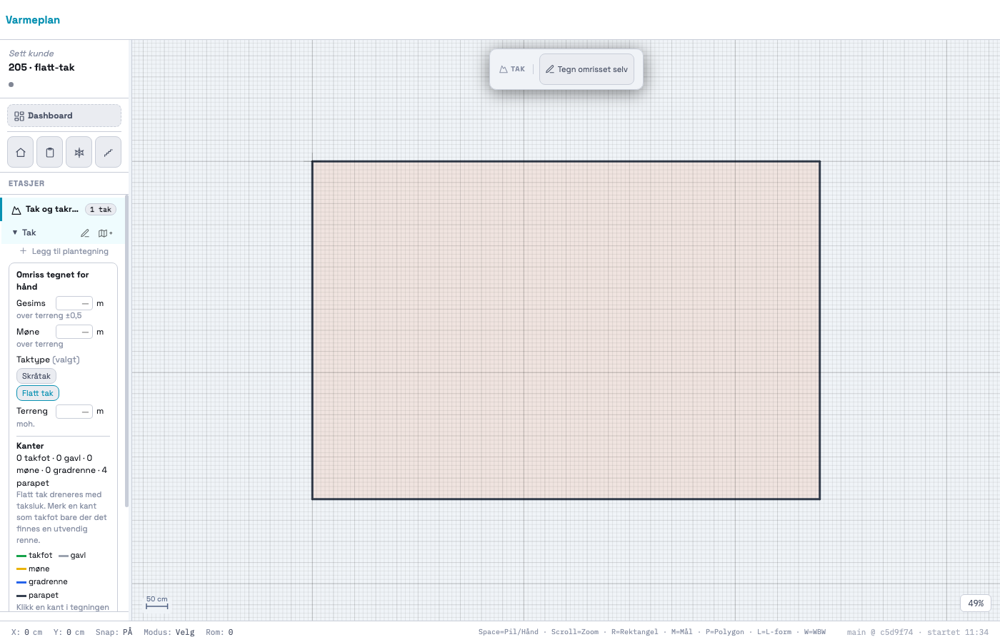
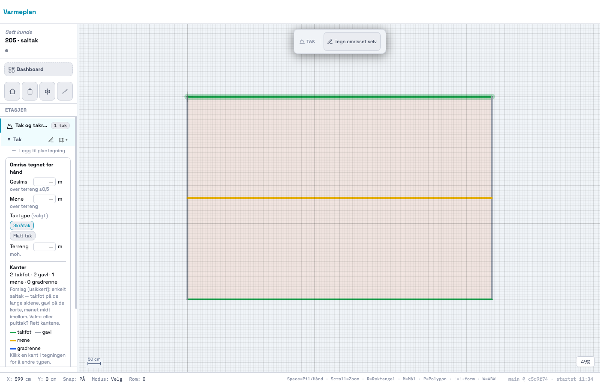
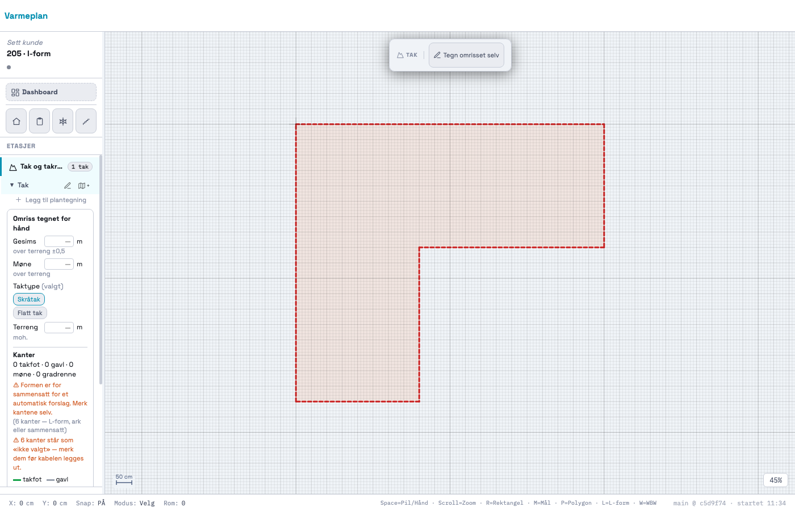
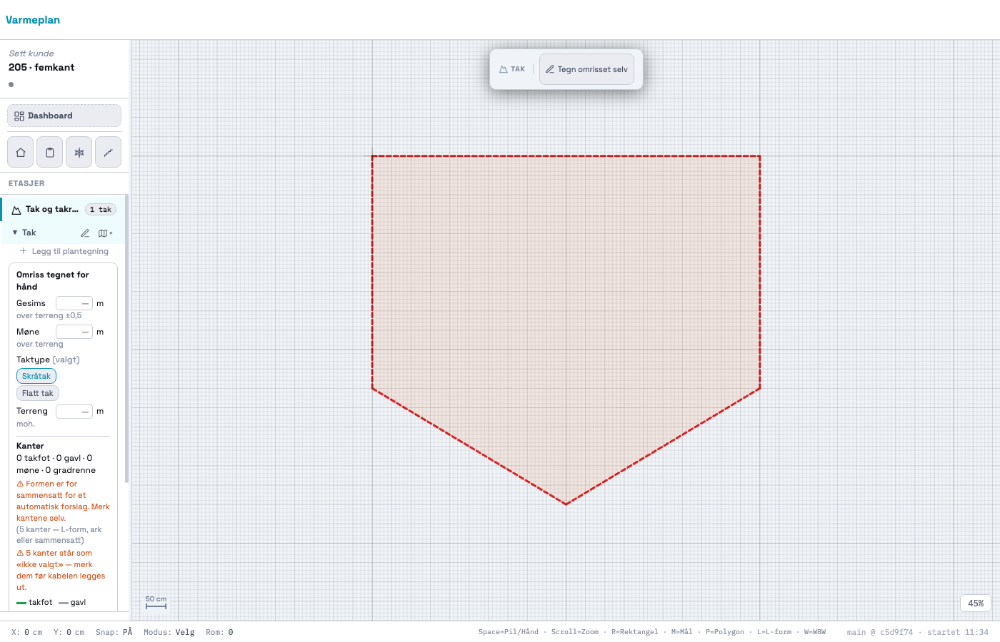

# 205 · Kantene: fargekode, forslag til type, og brukeren retter — rapport

07.11.2026 · `main` · én commit, ikke pushet · ingen SQL · `varmeplan-roof` ikke rørt.

## Kort

- **Hver kant av omrisset har nå en type med egen farge:** takfot (grønn), gavl (grå), møne (gul),
  gradrenne (blå), parapet/takkant (mørk grå strek), og «ikke valgt» (rød, stiplet).
- **Appen foreslår kantene så snart taktypen er kjent.** Det skjer når modellen hentes, og når du
  velger eller bytter taktype. Forslaget er `AI_SUGGESTION` med lav confidence: 0,5 for flatt tak,
  0,4 for saltak, 0,3 for mønet og 0 når appen er usikker.
  - **Flatt tak:** alle kanter blir parapet, uansett form. Ingen takfot og ingen møne.
  - **Skråtak med omtrent rektangulært omriss:** de lange sidene blir takfot og de korte gavl.
    Mønet er en ny linje fra midten av den ene gavlen til midten av den andre.
  - **Alt annet** (L-form, femkant, skjeve vinkler, nesten kvadratisk): appen gjetter ikke. Alle
    kanter blir «ikke valgt», og kortet sier «Formen er for sammensatt for et automatisk forslag.
    Merk kantene selv.»
- **Du retter ved å klikke på en kant.** En liten meny med typene, farge og betydning åpnes ved
  kanten. Valget gir `USER_CONFIRMED`/1, og notatet sier hva kanten var før («rettet fra takfot»).
  Velger du samme type som forslaget, blir den `USER_CONFIRMED` med notatet «bekreftet forslag».
- **Panelet har en teller og fire knapper.** Telleren viser for eksempel «2 takfot · 2 gavl · 1 møne
  · 0 gradrenne», med parapet i tillegg på flatt tak. Kortet advarer så lenge noen kant står som
  «ikke valgt». Knappene er «Merk alle som takfot», «Merk alle som parapet», «Nullstill» og
  «Foreslå på nytt».
- **Kantklikk virker bare i tak-modulen.** Klikk utenfor tak-modulen er uendret, og det er låst i
  testen med ekte lerretshendelser.

## Bilder

| Flatt tak — parapet | Saltak — forslag (musa over øverste takfot) |
|---|---|
|  |  |
| **L-form — ikke gjettet** | **Femkant — ikke gjettet** |
|  |  |

Typemenyen etter klikk på nederste takfot ligger i `saltak-meny.png`. Bildene er tegnet som omriss
uten kart, fordi headless Chrome her ikke når Kartverket, og sidepanelet har sin minste bredde
(180 px). Knappene ligger under telleren og nås ved å rulle i panelet.

## STEG 0 — hva jeg fant

1. **`S.tak` fra 204 finnes, og `edges` er tom.** 204 la den på flaten (`surfaces[0].edges = []`).
   Ingen kode skrev til den, utenom en test som satte en kunstig kant. Jeg fortsatte derfor.
2. **`roof.edges` fra tjenesten er alle omrisskanter som `eave`.** Det står i
   `varmeplan-roof/docs/roof-contract.md` (linje 33: «alle omrisskanter blir `eave`; editoren lar
   brukeren endre»). Det live-svaret 204 lagret (`docs/204/probe/model-live.json`) har 8 × `eave`.
   Det er en liste og ikke et forslag, så den tas ikke inn (låst i test, STEG 0).
3. **`roof.planes` er tom.** Kontrakten sier at planes krever punktsky, og live-svaret har 0.
   Forslaget bygger derfor bare på omriss og taktype (`_takSuggest`). Flategeometri brukes ikke.

**Avvik fra prompten.** Prompten vil ha `RoofEdge` «med referanse til hvilke flater kanten deler».
Vi har ingen takflater fra tjenesten. Derfor er fall-sidene som et saltak-forslag *innebærer*, lagt
inn som `surfaces[i].planes = [{ id: 'f1.a', eaves: ['k1'] }, { id: 'f1.b', eaves: ['k3'] }]`. Mønet
peker på begge. Det er en side av taket, ikke en flate med helning: `polygon`, `normal` og
`slope_deg` fra §6.3 er ikke fylt ut, fordi tallene ikke finnes (spørsmål 2).

## Hva som er bygget

Blokka «205 · KANTENE» ligger rett etter 204-kortet. Prefikset er `_tak*`.

### Modellen

Kantene er flyttet opp fra flaten til taket, slik 204-spørsmål 6 foreslo:

```js
S.tak[fid].edges = [{
  id,            // 'k<i+1>' = omrisskant i, 'm1' = mønet
  kind,          // 'outline' | 'line'  (mønet er en NY linje, ikke en omrisskant)
  i?,            // omrisskantens indeks
  a, b,          // {x,y} verdens-cm, som omrisset
  type,          // 'eave'|'rake'|'ridge'|'valley'|'parapet' | null = «ikke valgt»
  surface,       // TakFlate.id
  planes,        // fall-sidene kanten grenser mot — mønet: ['f1.a', 'f1.b']
  prov,          // AI_SUGGESTION → USER_CONFIRMED. null etter «Nullstill»
}]
surfaces[i].planes = [{ id, eaves?, prov }]   // fall-sidene ut fra forslaget, kan være tom
surfaces[i].edge_suggestion = { kind: 'flat'|'gable'|'complex'|'square'|'user'|'reset', reason? }
```

- **Delte kanter lagres én gang.** Mønet ligger én gang i `t.edges` med `planes: [a, b]`. Ingen
  flate har en egen kantliste. Testen summerer mønet over flatene og får 12 m, ikke 24.
- **Typenavnene** følger §6.3 (`eave`, `rake`, `ridge`, `valley`). `parapet` er nytt, fordi §6.3
  ikke har en kanttype for flatt tak. Høyde per kant (z) er ikke med. Den kommer i 206 sammen med
  `height_ref`.
- **ID-ene er stabile.** `k1…kn` følger omrisset, og `m1` er mønet. Nytt forslag gir samme ID-er,
  så 206 kan peke på `on_edge: 'k1'`.
- **Tak lagret av 204** hadde `surfaces[i].edges = []`. Når de åpnes, flyttes listen ett nivå opp
  (`_takNormalize`), og ingenting annet endres. Det lages ikke noe forslag av seg selv. Kortet
  tilbyr «Foreslå kanttyper».
- **Prosjekter uten tak** berøres ikke. `_takNormalize` kjøres bare når `data.tak` finnes. 204-testen
  B (lagring uten tak er byte-identisk med HEAD) og 205-testen er grønne.

### Forslaget (`_takSuggest`, `_takShape`), rene funksjoner

- **Formen:** nesten rette hjørner slås sammen først. En retningsendring under 5° og dobbeltpunkter
  under 1 cm regnes som samme side, slik at et ekstra punkt midt på en langside ikke gjør
  rektangelet til en femkant. Rektangel betyr 4 sider der alle hjørnene er 90° ± 5°.
- **Nesten kvadratisk** (lang/kort < 1,05) gjettes heller ikke. Da er mønets retning ukjent, og
  kortet sier det med egen melding (spørsmål 4).
- **Flatt tak** får parapet på alle kanter, uansett form. Det er ingenting å gjette på: ingen
  takfot og ingen møne.
- **Valm er umulig å se fra omrisset.** Et valmtak på et rektangulært bygg får derfor
  saltak-forslaget, og teksten i kortet sier «Valm- eller pulttak? Rett kantene.» (spørsmål 1).

### Rennestrekket i 206: `_takEdgeTakesGutter(t, edge)`

Funksjonen svarer sant bare for **takfot**. På et flatt tak må takfoten i tillegg være
`USER_CONFIRMED`, altså at brukeren selv har sagt at det finnes en utvendig renne. Et antatt
«takfot» på et flatt tak gir aldri renne, og det er låst i testen. 206 skal spørre her før et
rennestrekk legges.

### Retting

- **Klikk på en kant** gir en meny med alle fem typene. Hver type har farge og betydning, og
  gjeldende type er markert. På flatt tak heter takfot «Takfot (utvendig renne)». Mønelinja har bare
  Møne/Gradrenne og «Fjern linjen».
- **«Merk alle som takfot/parapet»** setter alle omrisskantene og fjerner mønelinja, fordi den
  forutsetter to gavler (spørsmål 3).
- **«Nullstill»** setter alle kantene til «ikke valgt» med `prov: null` og fjerner mønet.
- **«Foreslå på nytt»** spør først hvis du har merket kanter selv.
- **Byttes taktypen,** lages et nytt forslag for den nye typen. Appen spør bare hvis noen kant er
  `USER_CONFIRMED`. Et forslag er ikke arbeid som går tapt, så `_takHasWork` teller bare kantene
  brukeren har merket.
- Alt går gjennom `pushUndo` og kan angres. Et skrivebeskyttet vindu (060) endrer ingenting.

### Klikk-kaskaden

Advarselen fra 007 gjelder: rom tegnes oppå bygget, og et nytt lag er en regresjonsrisiko. Derfor:

- Kroken `_takEdgeMouseDown` står øverst i mousedown, etter 201 («Hent bygg») og 204 («Tegn
  omrisset selv»). Den svarer bare når **alt** dette stemmer: etasjen er en tak-del, taket har
  kanter, og verken `_takDraw`, `_geoPick` eller en `drawMode` står på. Den første sjekken er
  `S.tak[aktiv etasje]`. Uten tak på etasjen returnerer den før den regner noe.
- Bommer klikket på kantene (mer enn 8 px unna), går det videre i kaskaden som før.
- Menyen åpnes på **klikket** (`click`, capture-fasen), ikke på mousedown. Ellers lukker den
  eksisterende «klikk utenfor lukker menyen» den med en gang.
- Hover (pekefinger og glorie i kantens farge) bruker samme sjekk i mousemove.

**Testen:** en innendørs etasje med et rom på 12 × 8 m. Tre klikk (midt i rommet, på veggen og på
den andre veggen) gjøres to ganger med ekte `MouseEvent`-er på lerretet: først uten tak, så med et
kunstig tak hvis kanter ligger nøyaktig på rommets vegger i samme etasje. Alt i `S.ui` som har med
valg, hover, drag og modus å gjøre, og om menyen vises, er likt i begge rundene. Testen sjekker også
at klikket faktisk valgte rommet, ellers ville den målt ingenting.

### Tegneflaten

`_takDrawCanvas` tegner kantene oppå omrisset. Har taket kanter, er det kantene som *er* omrisset,
så den oransje omrisstreken tegnes ikke under dem. Mønet tegnes over omrisskantene. Glorien og
markeringen tegnes ikke i PDF-modus.

## Tester

### Ny: `_takRegressionTest205` — 63/63

| | Hva |
|---|---|
| STEG 0 | ingen kanter før taktypen er valgt. Tjenestens `edges` (4 × `eave`) tas ikke inn, og flatt tak gir parapet. Forslaget er `AI_SUGGESTION`, og flaten har ingen `edges` |
| Flatt | 4 parapet, ingen takfot og ingen møne, conf ≤ 0,5. **Ingen kant tar renne**, heller ikke en antatt takfot. Telleren og teksten om taksluk vises. Brukeren merker takfot, og da tar den kanten renne (USER_CONFIRMED). De andre gjør det fortsatt ikke |
| Saltak | 12 × 8: k1/k3 takfot og k2/k4 gavl. Ett møne som ny linje, **endepunkter (1200,400)→(0,400)**, 12 m. Telleren viser «2 takfot · 2 gavl · 1 møne · 0 gradrenne». 6 × 10 gir loddrett møne (300,0)→(300,1000). Rotert 30° gir møne på midtlinja. Et kolineært ekstrahjørne gir fortsatt rektangel |
| Sammensatt | L-form gir 6 × «ikke valgt», ingen møne, meldingen og «6 kanter står som «ikke valgt»», og conf 0 med «usikker». Femkant og skjeve vinkler gir det samme. Nesten kvadratisk gir egen melding. Et sammensatt flatt tak gir parapet |
| Retting | ekte mousemove/mousedown/mouseup/click på lerretet. Hover gir k1, og klikket åpner menyen med 5 typer. Gavl gir `USER_CONFIRMED`/1, **farge grønn → grå**, menyen lukkes og notatet sier «rettet fra takfot». Angre fungerer. Mønet har 2 typer + «Fjern linjen». Klikk midt i flaten gir ingen meny. Samme type som forslaget gir «bekreftet forslag» |
| Delt kant | mønet ligger én gang i lagret data med `[f1.a, f1.b]`. Ingen flate har kantliste, og summen over flatene er 12 m |
| Knapper | merk alle takfot/parapet, nullstill (advarsel vises), telleren etter én retting, «Foreslå på nytt» spør. Bytte taktype med bare forslag spør ikke |
| readOnly | retting og knapper avvises |
| Lagring | rundturen med kanter er byte-identisk, og kantene overlever. Et 204-tak åpnes med edges flyttet opp og uten forslag. Et prosjekt uten tak har fortsatt ingen tak-nøkkel |
| Kaskaden | innendørs: rommet blir valgt, og tre klikk gir lik tilstand med og uten tak-kanter i etasjen. Kroken svarer ikke |

### Endret: `_takRegressionTest204` — 64/64

Tre sjekker er skrevet om, fordi 205 bevisst endrer det de låste:

- **C** sa før «kantene er tomme». Nå sjekker den at kantene ligger på taket og ikke på flaten, og at
  et kjent skråtak gir forslaget med 4 kanter og møne.
- **D** satte en kunstig kant på flaten. Nå merker den en forslagskant som `USER_CONFIRMED`. «Nei»
  gir uendret resultat og fortsatt 4 kanter. «Ja» gir ny type og nytt forslag, ikke null kanter.

### Hele regresjonssettet

`probe/alle.mjs` kjørte alle `_xxxRegressionTest*`, hver i sin fane. HEAD-tallene er 204-kjøringen av
nøyaktig koden som ble commit c5d9f74 (`probe/alle-head.json` = `docs/204/probe/alle-etter.json`):

```
HEAD: 71 tester, 64 grønne, 3219 deltester
NÅ:   72 tester, 65 grønne, 3282 deltester
like med HEAD: 71 · ulike: 0 · nye: 1  (_takRegressionTest205 63/63)
```

De 7 røde er de samme som på HEAD uten innlogging: `_prosjektlaasRegressionTest` 66/67,
`_kundeforslagRegressionTest` 270/271 og fem `_geo*`-tester som kaster når de kjøres alene. Etter
kjøringen endret jeg bare tegningen: parapet ble 3 px, glorien fikk kantens farge, og den oransje
streken under kantene ble borte. 204- og 205-testen ble kjørt på nytt etterpå (64/64, 63/63).

## Kenneth sjekker

1. Tak & renner → hent et rektangulært hus. Kantene skal være grønne på langsidene og grå på
   gavlene, med gult møne i midten.
2. Klikk på en kant og velg en annen type. Fargen skal endres, og telleren i panelet skal følge med.
3. Trykk «Flatt tak». Alle kantene skal bli mørkegrå (parapet).
4. Hent et L-formet hus. Alle kantene skal være rødt stiplet, og kortet skal si at formen er for
   sammensatt.
5. Åpne et innendørsprosjekt og klikk på rom og vegger som før.

## Filer

- `index.html`: blokka «205 · KANTENE» og `_takRegressionTest205`, pluss kroker i `_takFromModel`,
  `_takManual`, `_takHasWork`, `_takSetRoofType`, `_takDrawCanvas`, `_takCardHtml`, mousedown,
  mousemove og `_restoreProject`. 204-testen C/D er skrevet om.
- `docs/205/`: rapport, spørsmål, bilder og `probe/` (`t.mjs` kjører tester, `vis.mjs` tar bilder,
  `alle.mjs` + `sammenlign.js` kjører hele settet).
