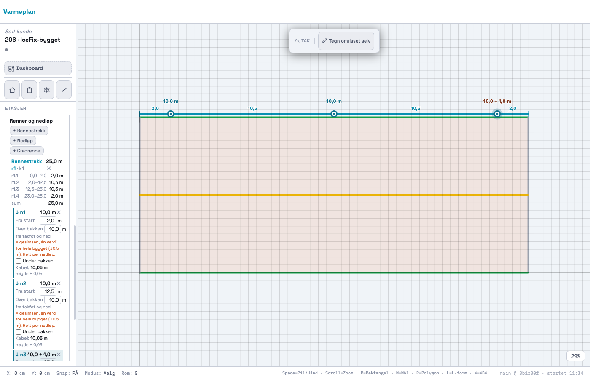
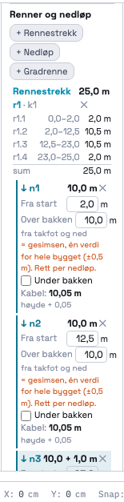
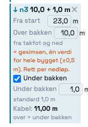

# 206 · Rennestrekk og nedløp med riktige lengder — rapport

07.11.2026 · `main` · én commit, ikke pushet · ingen SQL · `varmeplan-roof` ikke rørt.

## Kort

- **Rennestrekk** legges på en kant som er merket takfot. Du kan klikke start og slutt («Fra–til»),
  klikke én gang på kanten i verktøyet («Hele kanten»), eller klikke kanten og velge «＋ Rennestrekk
  langs hele kanten» i 205-menyen. Lengden regnes av geometrien og vises på tegningen og i panelet med
  én desimal. Flere strekk på samme kant er mulig, men de kan ikke overlappe.
- **Nedløp** settes med klikk på et rennestrekk og hører til det strekket. Nedløpene deler strekket i
  **delstrekk**, og hvert delstrekk har id og egen lengde i modellen (`segments`). Det er der 207 skal
  sette antall løp.
- **Nedløpets felt:** `above_ground_m` (standard = gesimsen, med teksten «én verdi for hele bygget
  (±0,5 m). Rett per nedløp.»), bryteren «Under bakken», og `below_ground_m` (vises bare når bryteren er
  på, standard 1,0 m). Etiketten ved symbolet viser «10,0 m» eller «10,0 + 1,0 m».
- **Kabelfelt på nedløpet** (bare et felt, ingen summering): over bakken `høyde + 0,05`, under bakken
  `høyde + under`, uten 5 cm. Begrunnelsen står i SPØRSMÅL 1.
- **Gradrenne** tegnes helt for hånd med to klikk, topp og bunn. Den lagres én gang, og lengden regnes
  i 3D (topp = mønet, bunn = gesimsen, begge kan rettes).
- **Ingen kabelsum, ingen produkter, ingen watt, ingen bokser.** Det er 207/208.

## Bilder

IceFix-bygget fra Cenika-filmen: renne 25 m, gesims 10 m, nedløp på 2, 12,5 og 23 m. Det siste går
under bakken.



Tallene over strekket er delstrekkene. Tallene over nedløpene er lengden på nedløpet. Rødbrun etikett
betyr at nedløpet går under bakken.

| Panelet: strekket og delstrekk-tabellen | Nedløpet som går under bakken |
|---|---|
|  |  |

### Delstrekk og nedløp (målt i appen, `probe/vis.mjs`)

| Delstrekk | Fra–til (m) | Lengde |
|---|---|---|
| r1.1 | 0,0–2,0 | 2,0 m |
| r1.2 | 2,0–12,5 | 10,5 m |
| r1.3 | 12,5–23,0 | 10,5 m |
| r1.4 | 23,0–25,0 | 2,0 m |
| **sum** | | **25,0 m** = kanten k1 |

| Nedløp | Fra start | Etikett | Kabelfelt |
|---|---|---|---|
| n1 | 2,0 m | 10,0 m | 10,05 m (høyde + 0,05) |
| n2 | 12,5 m | 10,0 m | 10,05 m |
| n3 | 23,0 m | 10,0 + 1,0 m | 11,00 m (over + under) |

## STEG 0 — hva jeg fant

1. **`S.tak[fid].features` fantes og var tom.** 204 la den inn med «206–209: renner, nedløp …», og
   `_takHasWork` teller den allerede. Objektene legges der, som `RoofFeature` i §6.3.
2. **`_takEdgeTakesGutter(t, e)` fra 205 er porten.** Den er sann bare for takfot, og på flatt tak bare
   når brukeren selv har merket kanten. Verktøyet, API-et og kantmenyen spør alle den.
3. **Kantene har ingen høyde (z).** 205 utsatte det til 206. Jeg har ikke lagt z på kantene, men på
   objektene: et rennestrekk får z = gesimsen. Gesimsen er én verdi for hele bygget, så z per kant
   ville bare vært samme tall på hver kant.
4. **«Fellesreglene» (`height_ref`, delte kanter én gang)** står i serieinstruksen i Cowork-mappa, som
   ikke ligger i repoet. Jeg har brukt det 204 og 205 bygde på: `height_ref` er `'terreng' | 'moh' |
   'takfot' | 'møne'`, og `prov` er `{ source, confidence, note }`.

## Modellen

Alt ligger i `S.tak[fid].features`. x/y er verdens-cm, som kantene. z er **meter over terreng**, eller
null når høyden ikke er kjent. Lengder er alltid avledet (`_takRecalc`) og skrives aldri inn.

```js
GUTTER = { id: 'r1', type: 'GUTTER', on_edge: 'k1',
  geometry: { kind: 'polyline', pts: [{x,y,z}, …] },   // z = gesimsen, følger den (z_prov.from = 'eave_m')
  z_prov, length_m,                                    // length_m AVLEDET av pts (3D)
  connects_to: ['n1','n2','n3'],                       // nedløpene sortert langs strekket (§11 vannvei)
  segments: [{ id: 'r1.1', from_m, to_m, length_m }],  // delstrekk — 207 setter løp her
  prov: { source: 'USER_DRAWN', … } }
DOWNSPOUT = { id: 'n1', type: 'DOWNSPOUT', gutter: 'r1', at_m,
  geometry: { kind: 'point', pt: {x,y,z} }, height_ref: 'takfot',
  above_ground_m: { value, prov },                     // standard: gesimsen, ESTIMATE med from: 'eave_m'
  continues_below_ground: { value: false, prov },
  below_ground_m: { value: 1.0, prov },                // brukes bare når bryteren er på
  cable_m,                                             // AVLEDET: over + 0,05 | over + under
  prov }
VALLEY_GUTTER = { id: 'g1', type: 'VALLEY_GUTTER', height_ref: 'terreng', surface, planes: [],
  geometry: { kind: 'polyline', pts: [topp, bunn] }, z_prov: [topp, bunn], length_m, prov }
```

- **Delstrekk:** grensene er strekkets ender og nedløpene. Et nedløp helt i enden gir ikke et
  delstrekk på 0 m. Sum av delstrekk = strekket, til flyttallsnøyaktighet.
- **Delt kant én gang:** gradrenna ligger én gang i `t.features`. Ingen flate har en objektliste.
- **Gesimsen rettes →** strekkenes z og nedløp som fortsatt står på standardverdien, følger med.
  Rettede nedløp og gradrennehøyder står.
- **Retting** av høyde over bakken, bryteren, under bakken, posisjon og gradrennehøyde gir
  `USER_CONFIRMED`/1 med notat («rettet fra 10,0 (ESTIMATE)»).
- **Slettes et strekk,** går nedløpene med. Alt går gjennom `pushUndo`, og et skrivebeskyttet vindu
  (060) endrer ingenting.
- **Prosjekter uten tak** berøres ikke. `features` finnes bare inne i `S.tak`, og `data.tak` skrives
  fortsatt bare når et tak finnes.

## Brukerflaten

- Kortet i sidepanelet har en ny del, «Renner og nedløp», under «Kanter». Den har knappene
  «+ Rennestrekk», «+ Nedløp» (vises når et strekk finnes) og «+ Gradrenne». Under dem står listen
  over strekk med delstrekk-tabell og nedløpene under hvert strekk, med feltene «Fra start», «Over
  bakken», «Under bakken» og «Kabel».
- **Verktøyene er en egen modus** (`_takFeat`), som «Tegn omrisset selv» i 204. De ligger ikke som et
  lag i klikk-kaskaden. Mens verktøyet står på, lyser takfotene som kan få renne, og du ser
  forhåndsvisning med lengde. Esc avbryter påbegynt strekk, og Esc en gang til avslutter verktøyet.
  Klikk på en kant som ikke er takfot, gir en melding om hvorfor, og ingenting legges.
- **Klikk utenfor verktøyene:** et nedløp, et strekk eller en gradrenne velges før kantene. Renna
  tegnes 8 px utenfor takfoten, så både kanten og renna kan klikkes. Kroken svarer bare i tak-modulen
  og bare når taket har objekter.
- Klikk rundes til 10 cm langs strekket og snappes til kantens ender og til endene av andre strekk.
  Nedløpets posisjon kan skrives inn nøyaktig.

## Tester

### Ny: `_takRegressionTest206` — 59/59

| | Hva |
|---|---|
| A. Rennestrekk | «Fra–til» med to **ekte lerretsklikk** nær endene av k1 gir 25,0 m = `_takEdgeLenM(k1)`. Polylinje med z = gesimsen og `USER_DRAWN`. «Hele kanten» med ett klikk gir kantens lengde. Klikk på gavl gir ingen renne, men en melding. Samme kant to ganger avvises (overlapp). Kantmenyen på k3 har «Rennestrekk langs hele kanten» og fortsatt 5 typer, og valget gir 25,0 m. To strekk på k3 (0–10 og 12–25) går, mens 9–13 avvises |
| B. Nedløp | Et nedløp satt med klikk på strekket havner 2,0 m fra start. **Tre nedløp gir fire delstrekk: 2,0 · 10,5 · 10,5 · 2,0, med sum 25,0 = strekket.** Id-ene er r1.1–r1.4, og `connects_to` er sortert. Panelet har tabellen med sum. Et nytt nedløp deler et delstrekk, og begge halvdelene arver `runs`. Sletting slår dem sammen igjen. Et nedløp i enden gir ikke et delstrekk på 0. Settes kanten til gavl, står strekket og panelet advarer. Posisjonen skrives inn (23 → 20 gir 2 · 10,5 · 7,5 · 5), og en posisjon utenfor strekket avvises |
| C. Kabelfelt | Standard 10,0 (ESTIMATE, `height_ref` takfot), **kabel 10,05**, etikett «10,0 m», og panelet sier «én verdi for hele bygget (±0,5 m)». Bryteren klikkes i panelet (ekte `change`): feltet vises med 1,0, **kabel 11,0** og etiketten «10,0 + 1,0 m». **Rettes høyden i panelet til 9,5, blir den USER_CONFIRMED** med notat, og kabelen 10,5. Under bakken 1,6 gir 11,1. Bryter av gir 9,55. Ugyldig tekst avvises. Gesims 10 → 11: nedløp på standardverdien følger, det rettede står, og strekkets z følger |
| D. Gradrenne | To klikk: topp = møne 13, bunn = gesims 10. Lengden ≈ 5,0 m fra klikk, og nøyaktig 5,0 m med API-et (4 m i plan, 3 m fall). Toppen rettes til 10 og blir plan 4,0 (USER_CONFIRMED) og står når mønet endres. **Lagret én gang**, og ingen flate har en objektliste |
| Resten | Klikk på nedløpssymbolet velger det og åpner ikke kantmenyen. Angre fjerner et nedløp. readOnly avviser alt. Sletting av strekket tar nedløpene med. **Rundturen er byte-identisk**, og lengder og delstrekk overlever. **Et prosjekt uten tak har fortsatt ingen tak-nøkkel.** Innendørs med et kunstig tak med renner på etasjen: klikket på veggen gir ikke tak-valg, og rommet blir valgt som før |

### Hele regresjonssettet

`probe/alle.mjs` kjørte alle `_xxxRegressionTest*`, hver i sin fane, på den endelige koden. HEAD-tallene er 205-kjøringen av nøyaktig koden i commit 3b1b30f (`probe/alle-head.json` = `docs/205/probe/alle-etter.json`).

```
HEAD: 72 tester, 65 grønne, 3282 deltester
NÅ:   73 tester, 66 grønne, 3341 deltester
like med HEAD: 72 · ulike: 0 · nye: 1  (_takRegressionTest206 59/59)
```

De 7 røde er de samme som på HEAD uten innlogging: `_prosjektlaasRegressionTest` 66/67,
`_kundeforslagRegressionTest` 270/271 og fem `_geo*`-tester som kaster når de kjøres alene. 204-testen
(64/64) og 205-testen (63/63) er uendret.

## Kenneth sjekker

1. Tak & renner → hent et hus med saltak. Trykk «+ Rennestrekk» og klikk en grønn takfot. Strekket
   skal få samme lengde som kanten.
2. «+ Nedløp» → klikk tre steder på renna. Panelet skal vise fire delstrekk som summerer til
   rennelengden.
3. Kryss av «Under bakken» på ett nedløp. Etiketten skal bli «x + 1,0 m» og kabelen x + 1,0.
4. Rett gesimsen i kortet. Nedløp du ikke har rettet, skal følge med.
5. Svar på `SPØRSMÅL.md`, særlig 1 (5 cm under bakken), 2 (utstikk forbi takfoten) og 5 (gradrennas høyde).

## Filer

- `index.html`: blokka «206 · RENNER OG NEDLØP» etter 205-panelet, og `_takRegressionTest206`. Kroker i
  mousedown, mousemove, keydown, `_takDrawCanvas`, `_takCardHtml`, `_takSetHeight` (gesimsen følger),
  `_takEdgeMenu` («Rennestrekk langs hele kanten»), `_restoreProject` og `_resetProjectState`.
- `docs/206/`: rapport, spørsmål, bilder og `probe/` (`t.mjs` kjører tester, `vis.mjs` tar bildene,
  `alle.mjs` + `sammenlign.js` kjører hele settet).
