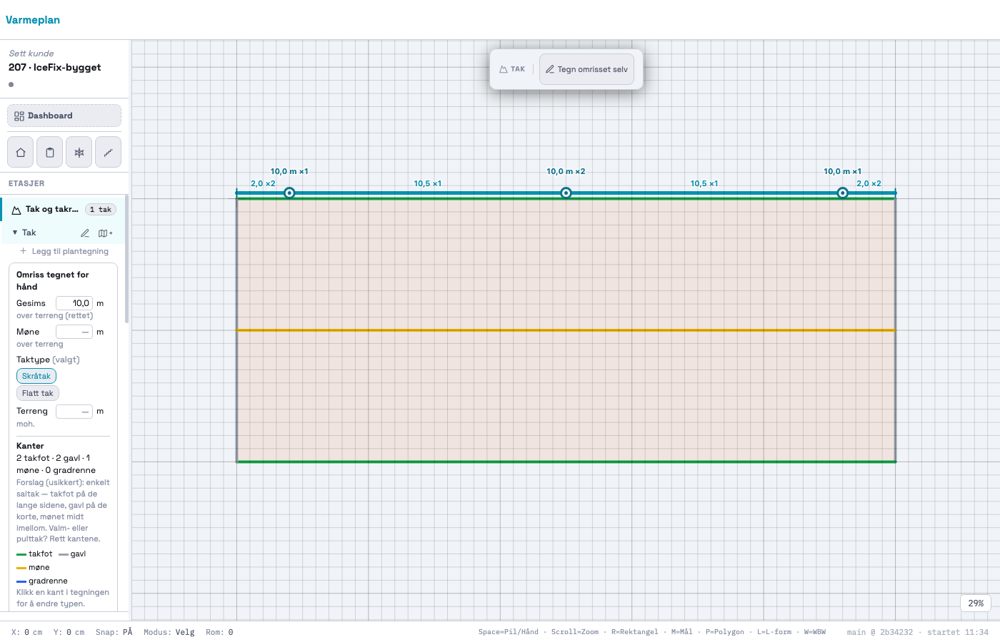
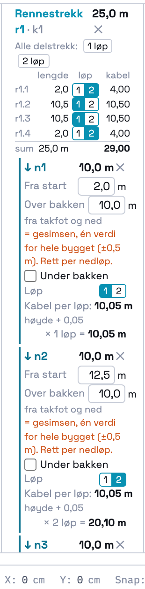
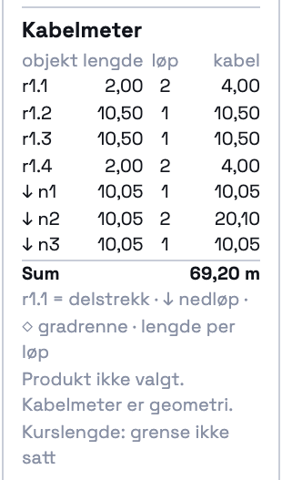

# 207 · Ett eller to løp per strekk, og kabelmeter for hele taket — rapport

07.11.2026 · `main` · én commit, ikke pushet · ingen SQL · `varmeplan-roof` ikke rørt.

## Kort

- Hvert **delstrekk**, **nedløp** og hver **gradrenne** har `runs: 1 | 2`. Standard er **2** overalt.
  Valget gjøres per objekt med en «1 | 2»-velger i panelet. Rennestrekket har hurtigvalgene «Alle
  delstrekk 1 løp» og «Alle delstrekk 2 løp».
- **Kabelmeter = lengde × løp.** Nedløpet bruker kabelfeltet fra 206 (høyde + 0,05, eller over + under)
  × løp. Panelet har en tabell «Kabelmeter» med kolonnene objekt, lengde, løp og kabel, og sum nederst.
  Tabellen regnes på nytt hver gang panelet tegnes. Den endres altså i samme øyeblikk som du legger et
  objekt eller endrer antall løp.
- **Mens du tegner** viser forhåndsvisningen hva strekket eller nedløpet gir: «+50,0 m kabel (×2) →
  160,3 m» (andre takfot på filmens bygg, med 110,3 m lagt fra før).
- **Posisjon i renna** lagres på delstrekket (`run_pos`): to løp = bunnen (90°) og opp mot hengkanten
  (40°), ett løp = bunnen.
- **Ingen produkt, watt eller kursgrense.** Strukturen for kurslengde-forbruk finnes (`_takCircuitUsage`),
  men grensen `TAK_CIRCUIT_LIMIT_M` står `null`. Panelet sier «Produkt ikke valgt. Kabelmeter er
  geometri.» og «Kurslengde: grense ikke satt».

## Kontroll mot IceFix-filmen

Bygget er det samme som i 206: renne 25 m, nedløp på 2 / 12,5 / 23 m, høyde 10 m, og nedløpene slutter
over bakken. Tallene er målt i appen (`_takRegressionTest207` og `probe/vis.mjs`).

| Oppsett | Renne | Nedløp | Appen | Prompten godtar | Filmen | Avvik fra filmen |
|---|---|---|---|---|---|---|
| Boks ved hvert nedløp = metode 1 | 2 | 1 | **80,15 m** | 80,0–80,5 ✓ | 80,3 | −0,15 m (−0,2 %) |
| To løp hele veien = metode 2 | 2 | 2 | **110,30 m** | 110,0–110,6 ✓ | 108,4 | +1,90 m (+1,8 %) |
| Ett løp i renna, ett i nedløpene | 1 | 1 | **55,15 m** | 55,15 ✓ | — | — |

**Hvorfor appen ikke treffer filmen.** Appen regner rette lengder: rennelengden × løp + (høyde + 0,05)
× løp. Filmens tall kommer fra en 3D-modell med svinger og radier. En radius i et hjørne kutter hjørnet,
så kabelen blir *kortere* enn summen av de rette beina. Dette ser vi i metode 2: der har kabelen flest
svinger (ned og opp i hvert nedløp, og overgangene renne–nedløp to ganger), og filmen ligger 1,9 m
under appen. I metode 1 er det færre svinger, og filmen ligger bare 0,15 m over. Det kan skyldes en kort
tilkoblingshale ved boksen som appen ikke har. Jeg har ikke filmens modell, så jeg kan ikke fordele
avviket på de enkelte svingene. Det jeg vet, er at appen treffer håndregningen (80 og 110) med 0,15 og
0,30 m, og at den forskjellen er de 5 cm per løp i nedløpene. Se spørsmål 2: med to løp i et nedløp
regnes 5 cm to ganger, selv om sløyfa trolig bare stikker ut én gang.

## Tabellen fra panelet

Metode 2 (standard, alt 2 løp). Kopiert fra DOM-en (`.tak-cable-table`):

| objekt | lengde | løp | kabel |
|---|---|---|---|
| r1.1 | 2,00 | 2 | 4,00 |
| r1.2 | 10,50 | 2 | 21,00 |
| r1.3 | 10,50 | 2 | 21,00 |
| r1.4 | 2,00 | 2 | 4,00 |
| ↓ n1 | 10,05 | 2 | 20,10 |
| ↓ n2 | 10,05 | 2 | 20,10 |
| ↓ n3 | 10,05 | 2 | 20,10 |
| **Sum** | | | **110,30 m** |

`r1.1` er et delstrekk, `↓` er et nedløp og `◇` en gradrenne. Lengden er per løp. Med nedløpene på
1 løp blir de tre nedløpsradene 10,05 / 1 / 10,05, og summen blir 80,15 m.

## Blandet: Kenneths rute fra 07.11

> «… fra start nede i et nedløp, opp til renne, bort til venstre som er ende, snur og går til høyre, ned
> og opp nedløp, videre til høyre og helt til enden og snur tilbake og går ned i siste nedløp med ett
> løp.»

Ruten blir to delstrekk med 1 løp og to med 2. Det er nøyaktig det blandede tilfellet prompten ber om:

| Objekt | Hva kabelen gjør | Løp | Håndregning | Appen |
|---|---|---|---|---|
| n1 | starter nede, går opp | 1 | 10,05 | 10,05 |
| r1.1 (0–2) | bort til venstre ende og tilbake | 2 | 2 × 2,0 = 4,00 | 4,00 |
| r1.2 (2–12,5) | til høyre | 1 | 10,50 | 10,50 |
| n2 | ned og opp | 2 | 2 × 10,05 = 20,10 | 20,10 |
| r1.3 (12,5–23) | til høyre, forbi n3 | 1 | 10,50 | 10,50 |
| r1.4 (23–25) | helt til enden og tilbake | 2 | 2 × 2,0 = 4,00 | 4,00 |
| n3 | ned i siste nedløp | 1 | 10,05 | 10,05 |
| **Renna** | | | 4 + 10,5 + 10,5 + 4 = **29,00** | **29,00** |
| **Nedløpene** | | | 10,05 + 20,10 + 10,05 = **40,20** | **40,20** |
| **Sum** | | | **69,20 m** | **69,20 m** |

| Tegningen | Strekket i panelet | Kabelmeter |
|---|---|---|
|  |  |  |

«×1»/«×2» ved hvert delstrekk og nedløp i tegningen er antall løp (spørsmål 8).

## STEG 0 — hva jeg fant

1. **206 hadde forberedt `segments` for løp.** Delstrekkene arver egenskaper når de deles, og det
   gjelder nå `runs`, `runs_src` og `run_pos`. Når et nedløp fjernes, slås delstrekkene sammen, og
   egenskapene til delstrekket der midtpunktet havner, beholdes (206 spm. 8).
2. **Avledede felt lagres i prosjektet og ble ikke regnet ut ved åpning.** `_restoreProject` kalte bare
   `_takNormalize`. Nå kaller den også `_takRecalc`, slik at et tak lagret av 206 (uten `runs`) får
   2 løp («standard») i det øyeblikket det åpnes. Det er testet ved å fjerne feltene fra et lagret
   prosjekt.
3. **Én 206-sjekk forutsatte at delstrekk ikke har `runs`.** Arv-testen satte `runs = 2` på ett
   delstrekk og krevde at de andre ikke hadde `runs`. Med standard 2 overalt har alle delstrekk `runs`.
   Sjekken setter nå `runs = 1` og krever 1 på begge halvdelene og 2 på resten. Den tester fortsatt
   det samme (arv ved deling). Det er den eneste endringen i en eksisterende test.

## Modellen (tillegg til 206)

```js
segments[i]  += { runs: 1|2, runs_src: 'standard'|'user',
                  run_pos: [{ at: 'bunn', deg: 90 }, { at: 'hengkant', deg: 40 }],   // ett løp: bare bunn
                  cable_total_m }                                                   // AVLEDET: length_m × runs
GUTTER       += { cable_total_m }                                                   // AVLEDET: sum av delstrekkene
DOWNSPOUT    += { runs, runs_src, cable_total_m }                                   // AVLEDET: cable_m (206) × runs
VALLEY_GUTTER+= { runs, runs_src, cable_total_m }                                   // AVLEDET: length_m × runs
```

- `_takCableSummary(t)` → `{ rows, total_m, gutter_m, downspout_m, valley_m, missing, circuit }`.
  `missing` lister objekter uten høyde. De gir «—» i tabellen og en advarsel under den.
- `_takCircuitUsage(used_m, limit_m)` → `{ product: null, limit_m: null, used_m, share: null, note }`
  så lenge grensen er tom. Det regnes ingen andel og ingen antall kurser.
- `_takSetRuns(fid, id, n)` tar et delstrekk (`'r1.2'`), et nedløp (`'n1'`) eller en gradrenne (`'g1'`).
  `_takSetGutterRuns(fid, 'r1', n)` er hurtigvalget. Begge er gatet på readOnly (060), går gjennom
  `pushUndo` og lagrer automatisk.
- Prosjekter uten tak berøres ikke. Det er testet: fortsatt ingen `tak`-nøkkel.

## Tester

### Ny: `_takRegressionTest207` — 39/39

- **Standard:** alle delstrekk og nedløp har 2 løp («standard»). Metode 2 gir **110,30** (innenfor
  110,0–110,6), og panelet viser «110,30 m». Tabellen har 7 rader. `run_pos` er bunn 90° og hengkant 40°.
- **Metode 1:** et ekte `click` på «1» ved n1 i panelet gir 100,25 i DOM-en med en gang. n2 og n3 settes
  til 1, og summen blir **80,15** (innenfor 80,0–80,5).
- **Ett løp i renna:** klikk på «Alle delstrekk 1 løp» gir **55,15**, og alle delstrekk har `run_pos` =
  bunn. «Alle delstrekk 2 løp» gir 80,15 igjen.
- **Under bakken:** n3 1,0 m under bakken med 2 løp gir **22,0** (ikke 20,1), og totalen blir 112,20.
- **Blandet (Kenneths rute):** renna 29,00, nedløpene 40,20 og sum **69,20**, også i panelet.
- **Arv:** et nytt nedløp i et delstrekk med 1 løp gir 1 løp på begge halvdelene. Det nye nedløpet
  har standard 2, og summen øker til 89,30 med en gang.
- **Gradrenne:** 5,0 m × 2 = 10,0. Den står i tabellen og summen. Med 1 løp blir det 5,0.
- **Mens du tegner:** når musa står over k3 med verktøyet, tegnes «+50,0 m kabel (×2) → …». Klikket
  legger strekket, og panelets sum øker med 50,00 med en gang. Det samme gjelder nedløpet:
  «+20,1 m kabel (×2)» og +20,10. Tegningen viser «×1» og «×2».
- **Ingen tall funnet på:** `TAK_CIRCUIT_LIMIT_M === null`, `circuit.limit_m/share/product === null`.
  Panelet har begge tekstene og ingen watt.
- **Angre** setter løpet tilbake, og readOnly avviser begge setterne. Rundturen er byte-identisk, og løpene
  overlever den. Et 206-tak uten løp åpnes med 2 overalt og 110,30. Prosjekt uten tak har ingen
  tak-nøkkel.

### Hele regresjonssettet

`probe/alle.mjs` kjørte alle `_xxxRegressionTest*`, hver i sin fane. HEAD-tallene er 206-kjøringen av
commit 2b34232 (`probe/alle-head.json` = `docs/206/probe/alle-etter.json`).

```
HEAD: 73 tester, 66 grønne, 3341 deltester
NÅ:   74 tester, 67 grønne, 3380 deltester
like med HEAD: 73 · ulike: 0 · nye: 1  (_takRegressionTest207 39/39)
```

De 7 røde er de samme som på HEAD uten innlogging: `_prosjektlaasRegressionTest` 66/67,
`_kundeforslagRegressionTest` 270/271 og fem `_geo*`-tester som kaster når de kjøres alene. Etter den
siste justeringen av panelets layout (bare HTML/stil) kjørte jeg tak-testene på nytt: 204 64/64,
205 63/63, 206 59/59 og 207 39/39.

## Kenneth sjekker

1. Tak & renner → legg et rennestrekk og tre nedløp. Tabellen «Kabelmeter» skal vise sum 110,30 m
   for 25 m og 10 m høyde.
2. Trykk «1» ved hvert nedløp. Summen skal bli 80,15 med en gang.
3. Legg ruten din (r1.2 og r1.3 = 1, n1 og n3 = 1) og se at du får 69,20.
4. Svar på `SPØRSMÅL.md`, særlig 1 (standard to løp i renna), 2 (5 cm én eller to ganger med to løp i
   nedløpet) og 6 (sjekk av at ruten henger sammen i 208).

## Filer

- `index.html`: blokka «207 · KABELLØP» ved 206-konstantene, løp og kabelmeter i `_takRecalc`,
  `_takRunsFill`, `_takCableRows`, `_takCableSummary`, `_takCircuitUsage`, `_takSetRuns`,
  `_takSetGutterRuns`, panelet (`_takFeaturesCardHtml` og `_takCableSumHtml`), etikettene og
  forhåndsvisningen i `_takDrawFeatures`, `_takRecalc` ved åpning i `_restoreProject`, og
  `_takRegressionTest207`. I 206-testen er én sjekk justert (STEG 0 punkt 3).
- `docs/207/`: rapport, spørsmål, bilder og `probe/` (`t.mjs`, `vis.mjs`, `alle.mjs` + `sammenlign.js`,
  og patch-skriptene).
