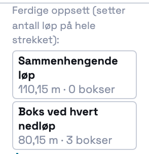
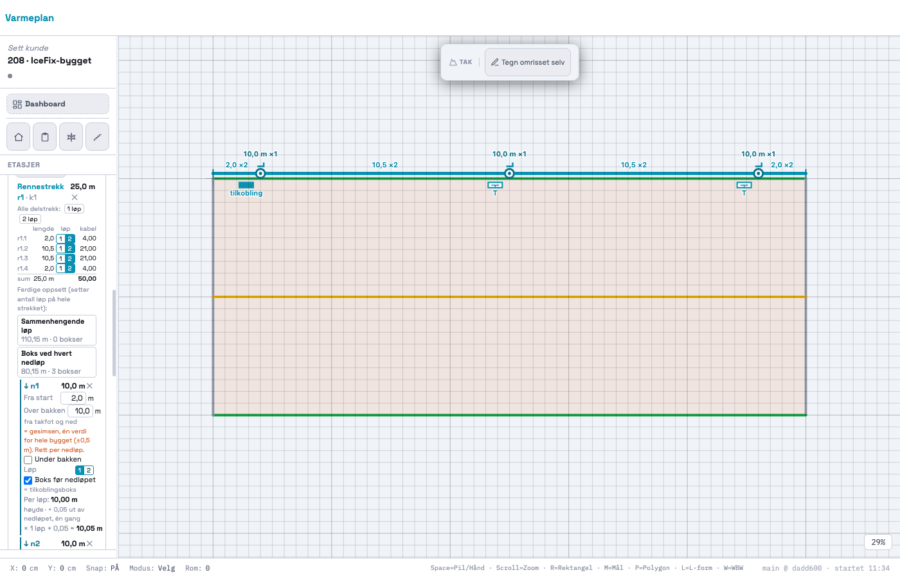
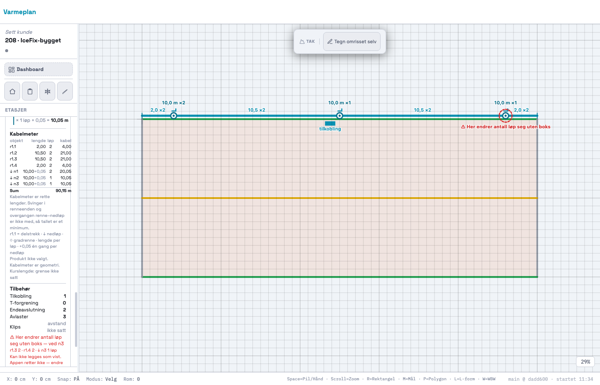
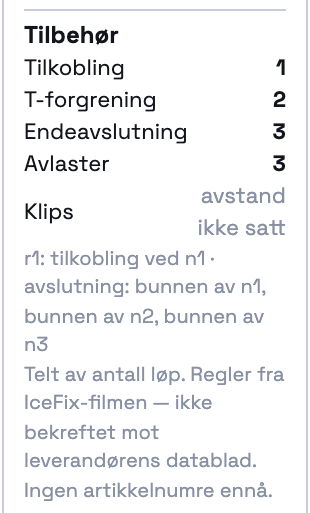
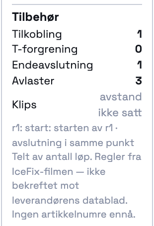
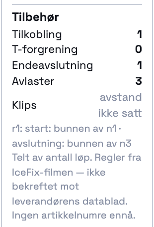

# 208 · Tilbehør telles av antall løp, to ferdige oppsett, bokser og avlastere i tegningen — rapport

07.11.2026 · `main` · én commit, ikke pushet · ingen SQL · `varmeplan-roof` ikke rørt.

## Kort

- **Regelen** (`_takAccessories`) teller tilbehøret ut fra **hvor antall løp endrer seg**, ikke ut fra hvor mange nedløp det er.
  Hvert rennestrekk og nedløpene på det er ett kabelnett. Et løp er én kabeltråd, så et delstrekk med 2 løp er to tråder.
  - I hvert **innløp** møtes trådene fra delstrekket til venstre, delstrekket til høyre og nedløpet.
  - **Partall tråder:** kabelen går gjennom. Eksempel: 2 inn, 1 videre og 1 ned (din rute).
  - **Oddetall tråder:** antall løp endrer seg uten at kabelen kan gå gjennom, og da trengs en **boks**. Eksempel: 2 inn, 2 videre og 1 ned = 5.
  - Den **første** slike overgangen langs strekket dekkes av **tilkoblingsboksen** («som uansett må være der»).
    De neste overgangene er **T-forgreninger** hvis brukeren har satt boks der. Uten boks kommer meldingen «Her endrer antall løp seg uten boks».
  - En **ende** med 1 løp (nedløpets bunn eller enden av renna) er der kabelen slutter, og den får en **endeavslutning**.
    Med 2 løp snur kabelen der.
  - **Uten noen boks** må nettet være **én kabel**. Det betyr enten 0 ender (lukket sløyfe: start og avslutning i samme punkt
    ved starten av renna) eller 2 ender (start i den ene, avslutning i den andre). Har nettet flere ender, kommer meldingen
    «Flere kabelender enn én kabel kan ha uten boks».
  - **Avlaster:** én per nedløp. **Klips:** «avstand ikke satt» (`TAK_CLIP_SPACING_M = null`).
- **Tabellen fra filmen** står som én tabell i koden (`TAK_ACCESSORY_TABLE`). Kommentaren sier at den er lest ut av
  IceFix-filmen og *ikke* bekreftet mot Cenikas datablad. Tabellen brukes **bare som kontroll** i testen. Tallene i panelet
  kommer fra regelen.
- **To knapper på rennestrekket** viser hva de gir **før** du trykker:
  - «Sammenhengende løp»: **110,15 m · 0 bokser**
  - «Boks ved hvert nedløp»: **80,15 m · 3 bokser**
- **Boks** lagres som `box: true` på nedløpet. Du setter den med avkrysningen «Boks før nedløpet» i nedløpsboksen, eller med
  knappen «Boks ved hvert nedløp». Appen setter aldri boks av seg selv.
- **Tegningen** viser bokser og avlastere i kursens farge:
  - Boksen tegnes 0,6 m før nedløpet, innenfor renna, i forholdet 190 × 70. Tilkoblingsboksen er fylt, og en T-forgrening er hvit med «T».
  - Avlasteren tegnes som en vinkel ved innløpet.
  - En melding vises som en rød stiplet ring rundt punktet, med teksten ved siden av.

## Sammenligningen



| Oppsett | Renne | Nedløp | Kabelmeter | Bokser | Tilkobling | T-forgrening | Endeavslutning | Avlaster | Klips |
|---|---|---|---|---|---|---|---|---|---|
| **Sammenhengende løp** (filmens metode 2) | 2 | 2 | **110,15 m** | 0 | 1 | 0 | 1 | 3 | avstand ikke satt |
| **Boks ved hvert nedløp** (filmens metode 1) | 2 | 1 | **80,15 m** | 3 | 1 | 2 | 3 | 3 | avstand ikke satt |

Tallene er lest fra DOM-en etter et ekte klikk på knappene (`probe/vis.mjs`, `probe/vis.json`). Forhåndsvisningen på
knappene var lik panelet etter klikket i begge retninger.

Avveiningen er **30 m mer kabel** (+37 %) mot **4 færre deler** etter regelen: 1 + 2 + 3 = 6 mot 1 + 1 = 2. Avlasterne er
like i begge oppsettene. Prompten sier «seks tilbehørsdeler mindre». Det stemmer bare hvis start og avslutning i metode 2 følger
med kabelen og ikke telles som tilbehør. Se spørsmål 1.

| Boks ved hvert nedløp | Melding: 2 inn, 1 ut uten boks |
|---|---|
|  |  |

| Tilbehør, boks ved hvert nedløp | Sammenhengende | Kenneths rute |
|---|---|---|
|  |  |  |

## Kontroll mot filmen: tallene kommer fra regelen

**Boks ved hvert nedløp** (renna 2 og nedløpene 1):

- Innløpene n1, n2 og n3 har hver 2 + 2 + 1 = **5** tråder. Det er oddetall, så alle tre trenger boks.
- Den første boksen er tilkoblingen, og de to neste er T-forgreninger.
- Nedløpenes bunn har 1 løp, så det blir 3 ender med hver sin endeavslutning. Endene av renna har 2 løp, så kabelen snur der.
- **Resultat: 1 / 2 / 3 / 3.** Det er filmens tall («1 tilkobling, 2 T-forgreninger, 3 avslutninger»).

**Sammenhengende** (alt 2):

- Innløpene har 2 + 2 + 2 = 6 tråder. Det er partall, så det trengs ingen boks.
- Alle ender har 2 løp, så nettet er en lukket sløyfe. Den kuttes ved starten av renna: start og avslutning i samme punkt.
- **Resultat: 1 / 0 / 1 / 3.**

**Regelen mot tabellen for n = 1…5 nedløp, begge oppsett:** ingen avvik (egen sjekk i testen). Tabellen er ikke justert.

**Ett nedløp** (boks): 1 tilkobling, 0 T-forgreninger, 1 avslutning og 1 avlaster.

## Kenneths blandede rute: regelen mot håndregning

Ruten er r1.1 = 2, r1.2 = 1, r1.3 = 1, r1.4 = 2, n1 = 1, n2 = 2 og n3 = 1 (`docs/207/RAPPORT.md`).

| Punkt | Tråder | Håndregning |
|---|---|---|
| Starten av renna | r1.1: 2 | snur (sløyfe) |
| Innløp n1 | 2 + 1 + 1 = **4** | partall → går gjennom |
| Innløp n2 | 1 + 1 + 2 = **4** | partall → går gjennom |
| Innløp n3 | 1 + 2 + 1 = **4** | partall → går gjennom |
| Enden av renna | r1.4: 2 | snur |
| Bunnen av n1 | 1 | **kabelende** |
| Bunnen av n2 | 2 | snur |
| Bunnen av n3 | 1 | **kabelende** |

Ingen innløp har oddetall tråder, og det er nøyaktig 2 kabelender. Ruten er altså **én kabel uten boks**, og det er slik du
beskrev den («fra start nede i et nedløp … ned i siste nedløp med ett løp»). Tilkoblingen står i starten, nede i n1, og
avslutningen nede i n3.

| | Tilkobling | T-forgrening | Endeavslutning | Avlaster | Bokser | Melding |
|---|---|---|---|---|---|---|
| **Håndregning** | 1 | 0 | 1 | 3 | 0 | ingen |
| **Appen** | 1 | 0 | 1 | 3 | 0 | ingen |

Panelet viser «r1: start: bunnen av n1 · avslutning: bunnen av n3». Tabellen fra filmen gir ikke dette tallet for noe oppsett
(1/2/3/3 eller 1/0/1/3). Regelen gjør altså mer enn tabellen.

## Sammenhengssjekken

- **Bare n1 = 1** (resten 2, ingen boks): n1 har 5 tråder og er den første overgangen, så tilkoblingsboksen dekker den. Det kommer
  ingen melding, og panelet sier «= tilkoblingsboks (første overgang)». Dette er riktig, fordi det fortsatt er én kabel:
  start ved n1-innløpet og slutt nede i n1.
- **n2 = 1 i tillegg:** «⚠ Her endrer antall løp seg uten boks — ved n2» står ved nedløpet og under Tilbehør, og punktet har
  en rød ring i tegningen. Testen bekrefter at løp og bokser er byte-like før og etter, altså at **ingenting er rettet**.
- **Du krysser «Boks før nedløpet» på n2:** meldingen forsvinner, og n2 blir T-forgrening. Angre setter meldingen tilbake.
- **Fire kabelender og ingen boks** (r1.1 = 1, r1.3 = 1, n1 = 1, n2 = 1): «Flere kabelender enn én kabel kan ha uten boks».

## STEG 0: hva jeg fant

1. **207 har ingen bokser.** Nedløpet har `runs`, men ingenting om koblinger. Jeg la til `box` (lagres bare når den er
   `true`). Prosjekter lagret før 208 åpnes uten bokser og uendret, og har de nedløp med 1 løp, viser de meldingen. Ingenting
   rettes.
2. **Taket har ingen kurser og ingen kursfarge** (T8, 207 spm. 9). «Kursens farge» er derfor rennestrekkets farge, gjennom én
   hjelper (`_takKursColor`). Den kan byttes når kursene kommer.
3. **Gradrenner** kobles ikke til noe rennestrekk i modellen, og de er ikke med i tilbehøret. Panelet sier det når det finnes en
   gradrenne.
4. **Kabelmeter er uendret.** Boksen påvirker ikke lengdene (213 spm. 4 er åpent).

## Tester

### Ny: `_takRegressionTest208`: 37/37

- Filmens bygg med «boks»: 1/2/3/3 = tabellen. Tilkoblingen står ved n1, T-forgreningene ved n2 og n3, og avslutningene i bunnen
  av hvert nedløp.
- Filmens bygg med «sammenhengende»: 1/0/1/3 = tabellen, 0 bokser, lukket sløyfe ved 0 m.
- Regelen = tabellen for n = 1…5 i begge oppsett.
- Ett nedløp: 1 tilkobling, 0 T-forgreninger, 1 avlaster.
- Blandet rute: 1/0/1/3, start i n1, avslutning i n3, ingen boks og ingen melding. Tallet er ulikt tabellens.
- Sammenhengssjekken: første overgang uten melding. Ved n2 står meldingen i panelet (to steder) og som rød merkelapp i tegningen
  under 40 px fra n2. Ingenting rettes. Et ekte klikk på «Boks før nedløpet» fjerner meldingen, og angre setter den tilbake.
  For mange ender gir sin egen melding.
- Knappene viser «110,15 m · 0 bokser» og «80,15 m · 3 bokser» før trykk. Et klikk setter alle delstrekk og nedløp (og bokser).
  Forhåndsvisningen er lik panelets sum og antall bokser etterpå, begge veier.
- Et nytt nedløp etter oppsettet gir 4 avlastere og får standard 2 løp uten boks.
- Panelet viser Tilkobling 1, T 2, Endeavslutning 3, Avlaster 3 og «Klips: avstand ikke satt» (ingen siffer). Det står ingen
  watt, pris eller artikkelnummer.
- Tegningen har 1 tilkobling og 2 T i kursens farge. Tilkoblingsboksen står før n1, avlasterne har kursens farge, og
  «sammenhengende» har ingen boks.
- readOnly avviser både oppsett og boks. Rundtur: bokser og tall overlever lagring og åpning, og `tak` er byte-lik.

### Hele regresjonssettet

`probe/alle.mjs` kjørte alle 76 testene, hver i sin fane. HEAD = 213-kjøringen av dadd600.

```
HEAD: 75 tester, 68 grønne, 3402 deltester
NÅ:   76 tester, 69 grønne, 3439 deltester
like med HEAD: 75 · ulike: 0 · nye: 1  (_takRegressionTest208 37/37)
```

Ingen eksisterende test er endret. De 7 røde er de samme som på HEAD uten innlogging: `_prosjektlaasRegressionTest` 66/67,
`_kundeforslagRegressionTest` 270/271 og fem `_geo*`-tester som kaster når de kjøres alene.

## Kenneth sjekker

1. Tak & renner. Legg et rennestrekk på 25 m med tre nedløp. Knappene skal vise «110,15 m · 0 bokser» og «80,15 m · 3 bokser».
2. Trykk «Boks ved hvert nedløp». Tilbehør skal vise 1 / 2 / 3 / 3 og «Klips: avstand ikke satt», og tegningen skal vise tre bokser og tre avlastere.
3. Trykk «Sammenhengende løp», og sett deretter n2 og n3 til 1 løp. Det skal komme en rød melding ved n3. Kryss «Boks før nedløpet» på n3, og meldingen skal forsvinne.
4. Svar på `SPØRSMÅL.md`, særlig spørsmål 1 (Cenikas datablad).

## Filer

- `index.html`:
  - Blokka «208 · TILBEHØR»: `TAK_ACCESSORY_TABLE`, `TAK_PRESETS`, `_takAccessories`, `_takPresetApplyTo`,
    `_takPresetPreview` og `_takKursColor`.
  - `_takSetBox` og `_takApplyPreset`.
  - `_takDrawAccessories` (kalles fra `_takDrawFeatures`).
  - Panelet: `_takPresetButtonsHtml`, `_takDownspoutBoxHtml` og `_takAccessoryHtml`.
  - `_takRegressionTest208`.
- `docs/208/`: rapport, spørsmål, bilder og `probe/` (`smoke.mjs`, `vis.mjs`, `t.mjs`, `alle.mjs` og `sammenlign.js`).
