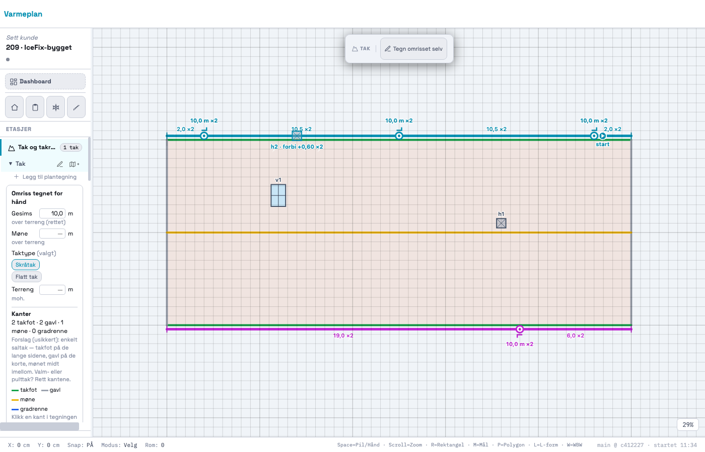
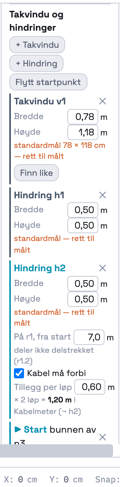
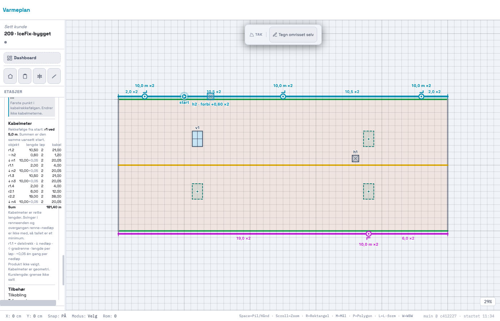
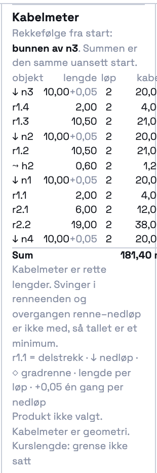
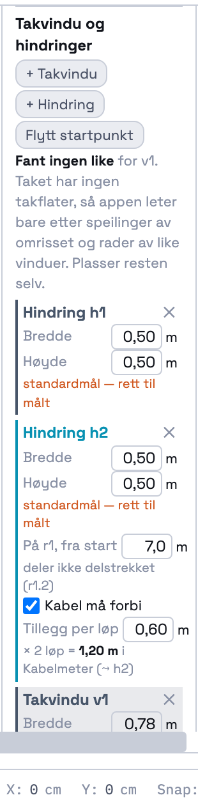

# 209 · Takvindu, hindringer, «finn like», startpunkt for kabel og symboler i kursens farge — rapport

07.11.2026 · `main` · én commit, ikke pushet · ingen SQL · `varmeplan-roof` ikke rørt.

## Kort

- **Takvindu og hindring.** Under «Takvindu og hindringer» i tak-kortet finnes knappene «+ Takvindu» og «+ Hindring».
  Du klikker på taket for å plassere. Hvert objekt får **bredde og høyde som felter**, og `prov.source = USER_DRAWN`.
  - Et takvindu legges parallelt med nærmeste takkant.
  - Målene starter på standardmål (`ESTIMATE`, oransje «rett til målt»). Når du retter et mål, blir det `USER_CONFIRMED`.
  - Klikker du utenfor omrisset, plasseres ingenting, og appen sier fra.
- **En hindring på et rennestrekk** følger strekket som et nedløp (`gutter`, `at_m`), men **deler ikke delstrekket**.
  Bare nedløp deler. Testen sjekker at delstrekkene er de samme før og etter.
  - Avkrysningen «Kabel må forbi» gir et felt «Tillegg per løp».
  - Tillegget × løpene på delstrekket blir en egen rad «⤳ h2» i Kabelmeter, rett etter delstrekket.
  - Appen foreslår aldri noe tall. Feltet står tomt med en melding til du skriver det.
- **«Finn like»** står på hvert takvindu.
  - Den markerer steder med samme form som stiplede felt, og ett klikk på et felt plasserer et vindu med samme mål der.
  - Ingenting plasseres av seg selv.
  - Finner den ingenting, står **«Fant ingen like»** i panelet og som melding.
- **Startpunkt for kabel** («Startpunkt for kabel» / «Flytt startpunkt»).
  - Ett klikk på et **nedløp** setter starten **nede i nedløpet**. Ett klikk på et rennestrekk setter den der.
  - Det finnes ett startpunkt per tak.
  - Startpunktet bestemmer **rekkefølgen i Kabelmeter-tabellen**, og panelet sier «Rekkefølge fra start: bunnen av n3».
  - **Kabelmeter endres ikke.** Startpunktet sorterer bare radene.
- **Kursens farge.** Hvert rennestrekk (= én kurs til T8 er avklart) har sin egen farge. Nedløp, hindringer på strekket
  og startpunktet tegnes i den, så du ser hvilke nedløp som hører sammen. r1 har samme farge som før.
  Etiketten ved nedløpet viser lengden fra 206 («10,0 m ×2»).
- **Klikk i tegneflaten virker bare i Tak-modulen.** Det går gjennom de samme krokene som i 205/206, og testen dekker det.

| Startpunkt nede i n3, to kurser | Panelet |
|---|---|
|  |  |

| «Finn like» (tre steder) | Kabelmeter fra n3 | Fant ingen like |
|---|---|---|
|  |  |  |

## STEG 0: hva jeg fant

1. **`SNOW_GUARD` og `ROOF_DRAIN` finnes ikke i koden.** De står bare i planen (§6.3, `RoofFeature.type`). Jeg har ikke
   laget dem. Takvindu (`SKYLIGHT`) og hindring (`OBSTACLE`) er nye typer i `S.tak[fid].features`, i samme mønster
   som 206: `geometry: {kind:'point'}`, `{value, prov}` på målene og `prov` på objektet. Se spm. 9.
2. **`roof.planes` er tom** (bekreftet: `_takManual` og `_takFromModel` gir `planes: []`). Derfor kan «Finn like» bare
   bruke omrisset, kantene og det brukeren har tegnet. Det gjør funksjonen **tynn** (spm. 1):
   - Den prøver speiling over omrissets akser (alle kantretninger og normalene på dem) og over mønelinja.
     Speilingen brukes bare hvis omrisset faktisk tåler den, innen 25 cm begge veier.
   - Den prøver også dreiing 180° om tyngdepunktet, og «neste i raden» når to like vinduer står.
   - Et forslag forkastes hvis det havner utenfor taket, oppå noe som finnes, eller på samme sted som kilden.
   - **Resultat:** et rektangulært saltak gir tre forslag for et vindu utenfor midten, og null for et vindu midt på.
     Et L-formet hus gir null. Ingenting kan *se* et faktisk takvindu (vi har ikke flyfoto).
3. **Taket har ingen kurser** (T8). «Kursens farge» er fortsatt rennestrekkets farge, gjennom `_takKursColor`. Funksjonen
   gir nå én farge per strekk fra `TAK_KURS_PALETTE`, der r1 har den gamle fargen. 208-symbolene leser samme funksjon.
4. **Startpunktet og 208-tilbehøret er ikke koblet.** Tilbehøret finner fortsatt sin egen start/tilkobling (spm. 6).
   Testen bekrefter at tilbehøret er byte-likt med og uten startpunkt.
5. **Rekkefølgen** (`_takCableOrder`):
   - Nedløpet med startpunktet kommer først.
   - Deretter kommer den korteste grenen langs renna og så den lengste, hver sortert etter avstand fra start.
     Ved et innløp kommer nedløpet før delstrekket videre, og «forbi»-raden står rett etter sitt delstrekk.
   - Andre strekk og gradrenner står etter, i tegnerekkefølge.
   - **Uten startpunkt er rekkefølgen nøyaktig som før.** Se spm. 5.

## Kabelmeter er uendret av startpunktet — egen sjekk

IceFix-bygget: 25 m renne med nedløp ved 2, 12,5 og 23 m, og h2 på r1 ved 7 m med tillegg 0,6 m × 2 løp.

| Startpunkt | Rekkefølge | Sum |
|---|---|---|
| ingen | r1.1 · r1.2 · ⤳h2 · r1.3 · r1.4 · n1 · n2 · n3 | 111,35 m |
| nede i n3 | n3 · r1.4 · r1.3 · n2 · r1.2 · ⤳h2 · n1 · r1.1 | 111,35 m |
| r1 ved 5,0 m | r1.2 · ⤳h2 · n1 · r1.1 · n2 · r1.3 · n3 · r1.4 | 111,35 m |

Testen går gjennom **ni startpunkt**: de tre nedløpene og renna ved 0, 5, 7, 12,5, 18 og 25 m. Den sjekker at radene
(som mengde, med kabelmeter) og summen er identiske for alle. Resultatet var 0 avvik.

Bildeoppsettet har et andre strekk (r2 på k3 med n4), og der er summen 181,40 m med alle startpunkt (`probe/vis.json`).

## Tester

### Ny: `_takRegressionTest209`: 48/48

- **Takvindu med ekte lerretsklikk:**
  - Det havner der du klikket, med 0,78 × 1,18 `ESTIMATE`, `USER_DRAWN` og 0° (k1).
  - Et klikk utenfor omrisset gir ingenting og en melding.
- **Hindringer med klikk:**
  - h1 plasseres løs. h2 plasseres på r1 ved 7,0 m, og **delstrekkene er uendret**. Summen er uendret uten «forbi».
  - Når «Kabel må forbi» krysses av i panelet, ber appen om et tall og legger ikke inn noe selv.
  - Tillegget 0,6 gir raden ⤳ h2 = 1,20 m rett etter r1.2, og summen øker med 1,20.
- **Mål i panelet:** feltet gir 0,94 `USER_CONFIRMED`, og angre setter verdien tilbake.
- **Startpunkt med ekte klikk** på n3-symbolet:
  - Starten er lovlig, og verktøyet avslutter seg selv.
  - Panelets rader står i rekkefølgen n3, r1.4, r1.3, n2, r1.2, h2, n1, r1.1, og panelet sier «bunnen av n3».
  - Summen i DOM-en er uendret. Ni startpunkt gir 0 avvik.
  - Start på renna ved 5 m gir den rekkefølgen tabellen over viser.
  - Det er bare ett startpunkt, og tilbehøret er likt med og uten startpunkt.
  - Uten startpunkt er rekkefølgen som før.
- **Lagre/åpne** (to runder): byte-identisk. v1, h1, h2 (på r1, forbi 0,6) og start i n3 ligger likt.
- **Kursens farge:**
  - r1 er `#0891b2` (som før), og r2 har en annen farge.
  - Alle fire nedløpsetiketter viser «10,0 m ×2» i kursens farge.
  - h2-etiketten er «h2 · forbi +0,60 ×2» i r1-farge, og «start» står ved n3 i r1-farge. Et løst takvindu er grått.
- **Klikk i tak-modulen:**
  - Et klikk på takvinduet velger det, og et klikk på startsymbolet velger startpunktet.
- **Sletting:**
  - Når nedløpet med startpunktet slettes, er startpunktet borte. Angre henter begge.
  - Når strekket slettes, står h2 igjen løs uten «forbi». Angre henter alt.
- **«Finn like»:**
  - Et ekte klikk på knappen gir tre felt (1900,300 · 1900,700 · 600,700), og **ingenting plasseres**.
  - Panelet sier «3 steder». Et klikk på et felt plasserer v2 med samme mål og `USER_DRAWN` («Finn like: …»), og to felt står igjen.
  - Et vindu midt på taket gir **«Fant ingen like»** i panelet og som toast.
  - L-formet hus: ingen like. Med to vinduer på L-en kommer bare det ene «neste i raden» som ligger på taket.
- **readOnly** avviser takvindu, hindring, startpunkt, mål og «Finn like».
- **Utenfor Tak-modulen:**
  - Innendørs etasje med et rom og en kopi av taket (takvindu, hindring på renna, startpunkt) lagt på etasjen.
  - Tre klikk (der takvinduet, startpunktet og rommet ville ligget) gir **samme tilstand med og uten taket**.
  - Rommet blir valgt, og ingen tak-objekter blir truffet.

### Hele regresjonssettet

`probe/alle.mjs` kjørte alle testene, hver i sin fane. HEAD = 208-kjøringen av c412227 (`docs/208/probe/alle-etter.json`).

```
HEAD: 76 tester, 69 grønne, 3439 deltester
NÅ:   77 tester, 70 grønne, 3487 deltester
like med HEAD: 76 · ulike: 0 · nye: 1  (_takRegressionTest209 48/48)
```

Ingen eksisterende test er endret. 204–208 og 213 er grønne som før. De 7 røde er de samme som på HEAD uten innlogging:
`_prosjektlaasRegressionTest` 66/67, `_kundeforslagRegressionTest` 270/271 og fem `_geo*`-tester som kaster når de kjøres alene.

## Kenneth sjekker

1. Åpne Tak & renner. Legg et rennestrekk med tre nedløp. Trykk «+ Takvindu» og klikk på taket, og trykk så «Finn like». Det skal komme tre stiplede felt. Klikk ett av dem.
2. Trykk «+ Hindring» og klikk på renna. Kryss «Kabel må forbi» og skriv 0,6. Raden «⤳ h…» skal stå i Kabelmeter.
3. Trykk «Startpunkt for kabel» og klikk et nedløp. Tabellen skal starte der, og summen skal være den samme som før.
4. Svar på `SPØRSMÅL.md`, særlig 1 («Finn like» uten takflater), 4 (tillegg per løp) og 6 (startpunkt mot tilkoblingen i 208).

## Filer

- `index.html`:
  - Blokka «209 · OBJEKTER PÅ TAKET»:
    - Data og regler: `_takObjs`, `_takStartOf`, `_takRecalcObjects`, `_takBypassRows` og `_takCableOrder`.
    - Endringer: `_takAddObject`, `_takSetObj` og `_takSetStart`.
    - «Finn like»: `_takLikeCandidates`, `_takFindLike` og `_takLikePlace`.
    - Tegning og treff: `_takDrawObjects`, `_takHitObject` og `_takObjMouseDown`.
    - Panel: `_takObjectsCardHtml`.
  - Endret:
    - `_takKursColor` (palett) og `_takRecalc` (kaller `_takRecalcObjects`).
    - `_takCableRows`/`_takCableSummary` (forbi-rader, rekkefølge, `bypass_m`).
    - Verktøy- og treffkrokene i 206 (`_takFeatMouseDown/Move`, `_takHitFeature`).
    - `_takDrawFeatures` (kursens farge) og panelet (`_takFeaturesCardHtml`, `_takCableSumHtml`).
  - `_takRegressionTest209`.
- `docs/209/`: rapport, spørsmål, bilder og `probe/` (`t.mjs`, `vis.mjs`, `alle.mjs` og `sammenlign.js`).
