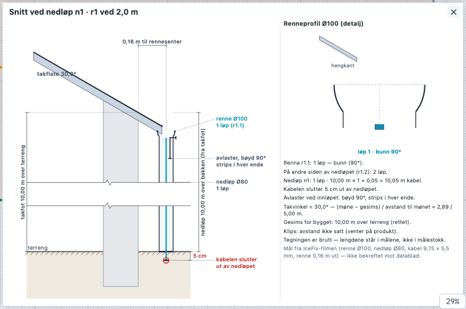
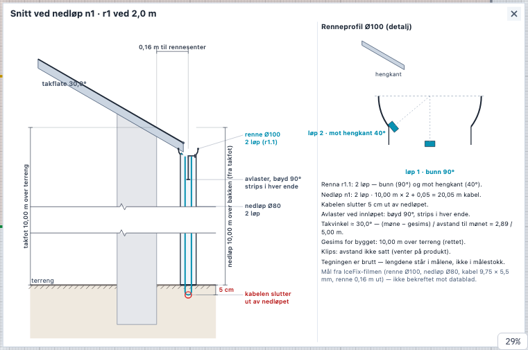
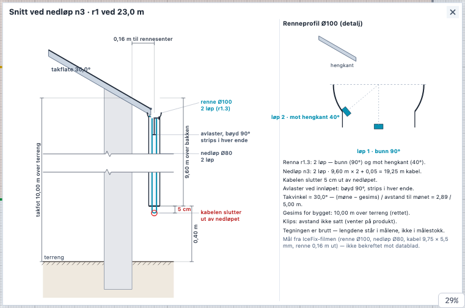
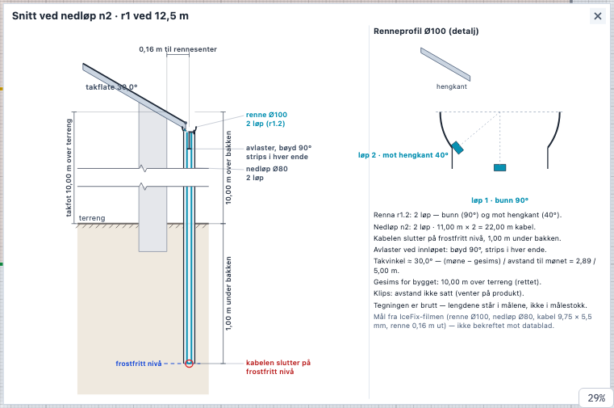
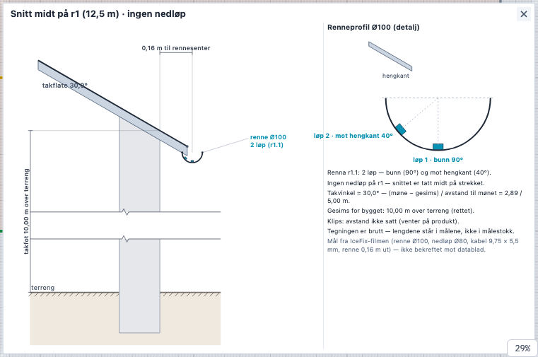
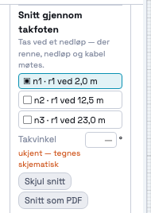
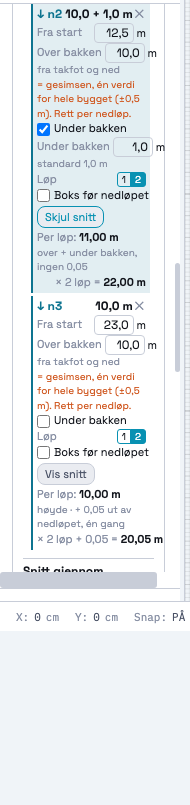
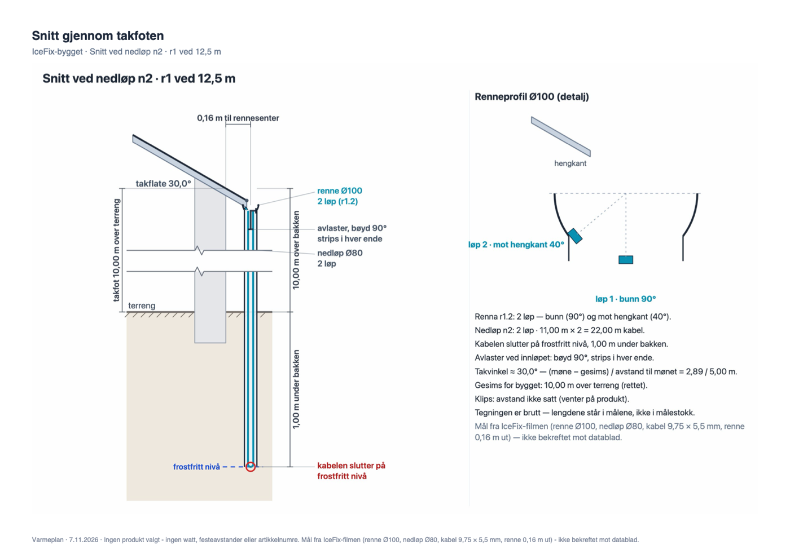

# 210 · Snitt gjennom takfoten — rapport

07.11.2026 · `main` · én commit, ikke pushet · ingen SQL · `varmeplan-roof` ikke rørt.

## Kort

- **Ett klikk gir snittet.** Velg et nedløp i tegningen og trykk **«Vis snitt»**, eller velg fra lista **«Snitt gjennom takfoten»** i panelet.
  - Lista har ett sted per nedløp. Et rennestrekk uten nedløp får «r2 midt · ingen nedløp».
  - Snittet legger seg nede til høyre på tegneflaten.
  - × eller Esc lukker det.
  - Klikker du et annet nedløp mens snittet står åpent, følger snittet med.
- **Snittet viser:**
  - takflaten med prosjektets vinkel og hengkanten;
  - renna Ø100 med kabelløpene der de ligger;
  - nedløpet Ø80 med én tråd eller en sløyfe;
  - avlasteren ved innløpet, bøyd 90° med strips i hver ende;
  - terrenget;
  - strekningen under bakken, når nedløpet går dit;
  - hvor kabelen slutter: 5 cm ut av nedløpet, eller på frostfritt nivå.

  Til høyre står en **detalj av renneprofilen** i større målestokk, med løp 1 · bunn 90° og løp 2 · mot hengkant 40°. Under den står notatene: kabelmeter for nedløpet, takvinkel, gesims, klips, kilde.
- **Målene** tegnes i samme stil som trappas geometrimål (grå, tikk i endene, korte hjelpelinjer, tallet langs linja):
  - takfot over terreng (referansepunktet står i teksten);
  - nedløp over bakken (fra takfot);
  - under bakken;
  - 5 cm;
  - 0,16 m fra takkant til rennesenter.

  Er utløpet over terrenget, får det et eget mål.
- **Tallene er ikke regnet på nytt.** Kabelmeterne kommer fra 213-formelen (`_takDownpipeCable`). Løpene og posisjonen i renna kommer fra 207 (`segments[].run_pos`). Testen sjekker at notatet og Kabelmeter-tabellen viser det samme tallet.
- **«Snitt som PDF»** lager én liggende A4-side. Bildet tegnes på hovedlerretet, som `_renderRoomToImage` gjør, og leses som JPEG.
- **Ingen produkter, festeavstander eller watt.** Klips står som «avstand ikke satt». Målene fra filmen står som det de er: «ikke bekreftet mot datablad».

## Bilder

| Ett løp i renna (og i nedløpet) | To løp i renna |
|---|---|
|  |  |

| Nedløp over bakken (n3 rettet til 9,6 m: utløp 0,40 m over terreng) | Nedløp ført 1,0 m under bakken |
|---|---|
|  |  |

| Rennestrekk uten nedløp (snitt på midten) | Panelet: snitt-kortet · «Vis snitt» på nedløpet |
|---|---|
|  |   |

PDF-siden (n2, 1,0 m under bakken), gjengitt fra den ekte PDF-fila: 

Alle snittene er tatt på IceFix-bygget: 25 × 10 m, gesims 10 m, møne 12,887 m midt på (= 30°) og tre nedløp på 2, 12,5 og 23 m.

## STEG 0: hva jeg fant

1. **Prosjektet har ingen takvinkel.** `S.tak[fid].surfaces[0]` har gesims, møne og taktype, men ingen vinkel (`planes` er tom). Snittet bruker derfor, i denne rekkefølgen:
   1. flatt tak: 0°;
   2. en vinkel brukeren skriver, lagret som `pitch_deg` på takflaten med `USER_CONFIRMED`;
   3. (møne − gesims) ÷ avstanden i plan fra snittpunktet til mønelinja fra 205. IceFix-bygget gir 2,887 / 5,00 m = 30,0°;
   4. ellers «ukjent». Da tegnes taket skjematisk, oransje og uten tall, og notatet ber om vinkelen.

   Se spm. 5.
2. **Utløpet har ingen egen høyde.** «Over bakken» på nedløpet (206) måles fra takfoten. Over bakken regnes utløpet derfor som takfot − nedløp, og takfoten er gesimsen. Med standardverdiene står utløpet på terrenget (spm. 4). Ført under bakken går røret ned til terrenget og videre ned til frostfritt nivå.
3. **Hvor rennesenteret ligger i forhold til omrisset finnes ikke i dataene.** Jeg har brukt filmens 0,16 m som konstant (spm. 2).
4. **Prosjekt-PDF-en (`exportPDF`) har ingen tak-sider.** Rommene tegnes med `_renderRoomToImage`, og et tak har ingen rom. Snittet har derfor sin egen PDF-knapp, og `exportPDF` er ikke rørt (spm. 7). Bildet lages likevel etter fellesregelen: hovedlerretet får midlertidig PDF-størrelse, snittet tegnes, bildet leses som JPEG, og så tilbake. Testen sjekker at lerretet har samme størrelse etterpå.
5. **Målestokken.** En 10 m vegg og en Ø100-renne får ikke plass i samme målestokk. Snittet bryter høyden (`_takSectionLayout`, bruddlinjer) mellom takfoten, utløpet, terrenget og frostfritt nivå. Renne, nedløp og kabel (9,75 × 5,5 mm) står i riktig forhold til hverandre. Detaljen til høyre viser profilen stor nok til at kabelen er tydelig (spm. 8).
6. **Trappas målkode er ikke rørt.** `_drawStairGeoDims` tegner bare venstre og under, men snittet trenger også mål til høyre og over. Snittet har derfor sin egen målrutine i samme stil og med samme oppdeling (`_takSectionDims` regner, `_takSectionPaint` tegner).

## Hvordan det er bygget

Samme mønster som trappas mål: rene funksjoner regner, én tegner tegner, og den tegneren tar imot hvilken som helst 2D-kontekst.

| Funksjon | Hva |
|---|---|
| `_takSectionTargets(t)` | stedene: hvert nedløp, og midten av strekk uten nedløp |
| `_takSectionModel(t, on)` | tallene (løp, posisjoner, høyder, kabel fra 213, vinkel, slutt) — ren |
| `_takSectionLayout(M)` | geometrien i snitt-cm med brudd (`ymap`) — ren |
| `_takSectionDims(M, L)` | målene `[{a, b, label, short, side, level, key}]` — ren |
| `_takSectionNotes(M, L)` | tekstlinjene — ren |
| `_takSectionPaint(c, M, box, o)` | tegner alt i en boks. Brukes av skjermen og av PDF-bildet |
| `_takDrawSectionInset()` | innfeltet på hovedlerretet (aldri i `_pdfMode`) |
| `_takSectionToImage` / `_takSectionPDF` | JPEG fra hovedlerretet / én liggende A4-side |
| `_takPitch`, `_takSetPitch` | vinkelen (se STEG 0.1) |

**Hva som lagres:** Hvilket snitt som vises (`_takSection`), lagres aldri. Det eneste nye i prosjektdataene er `pitch_deg`, og bare når brukeren skriver en vinkel. Testen sjekker at det lagrede taket er byte-likt etter at et snitt er vist, lukket og tegnet til bilde. Et prosjekt uten tak lagres fortsatt uten `tak`-nøkkel.

## Tester

`_takRegressionTest210` — 49/49:

- **Over bakken:** kabelen slutter 5 cm under utløpet, og målet «5 cm» står fra utløpet til kabelens ende. Målene «nedløp 10,00 m over bakken (fra takfot)», «takfot 10,00 m over terreng» og «0,16 m til rennesenter» står. Det finnes ikke noe mål under bakken.
- **Ført 1,0 m under bakken:** strekningen 0 → −100 cm er med, med målet «1,00 m under bakken». Kabelen slutter på frostfritt nivå og har ingen 5 cm. Rettet til 1,6 m følger snittet med.
- **Utløp over terreng:** et nedløp på 9,6 m fra en 10 m gesims gir «utløp 0,40 m over terreng», og kabelen slutter 35 cm over terreng.
- **Ett løp i renna gir ett kabelsnitt (bunn 90°). To løp gir to:** bunn 90° og mot hengkant 40°. Hengkant-løpet ligger på veggsiden og høyere opp. Dette sjekkes i tegningen (`info.gutterCables`) og i detaljen.
  - Andre siden av nedløpet står i notatene.
  - Ett/to løp i nedløpet gir én tråd eller en sløyfe.
- **Kabelmeter i snittet er lik tabellens rad.**
- **Rennestrekk uten nedløp:** ett snittsted på 12,5 m, uten rør og uten nedløpsmål. Ingen feil, og profilen er der.
- **Klikk:**
  - Et ekte lerretsklikk på n3 velger det, og «Vis snitt» i panelet åpner snittet ved n3.
  - Innfeltet har tegnede piksler på hovedlerretet.
  - Et klikk i innfeltet går ikke videre til tegningen.
  - Et klikk på n1 flytter snittet dit, og lista i panelet virker.
  - × og Esc lukker.
- **PDF:**
  - `_takSectionPDF(…, {noSave:true})` gir `data:image/jpeg` på over 60 kB.
  - Bildet dekodes: 3–60 % av pikslene er tegnet, og pikslene i kursfargen finnes.
  - PDF-en har én side med `/Subtype /Image` + `/DCTDecode` og er over 50 kB.
  - Hovedlerretet har samme størrelse etterpå.
- **Vinkel:**
  - Uten møne er vinkelen ukjent og tegnes skjematisk.
  - 35° skrevet av brukeren brukes, med `USER_CONFIRMED`.
  - 90° avvises.
  - Angre fjerner vinkelen.
  - I readOnly kan vinkelen ikke skrives, men snittet kan ses.
  - Flatt tak gir 0°.
- **Lagring:** se over.

Alle regresjonstester, kjørt hver i sin fane mot arbeidskopien og sammenlignet med HEAD (7fb2161, `docs/210/probe/alle-head.json`):

```
HEAD: 77 tester, 70 grønne, 3487 deltester
NÅ:   78 tester, 71 grønne, 3536 deltester
like med HEAD: 77 · ulike: 0 · nye: 1
  NY _takRegressionTest210: 49/49
røde nå:
   _prosjektlaasRegressionTest 66/67 [E: egen lås sier «Deg (annet vindu)»]
   _kundeforslagRegressionTest 270/271 [L/138: piltast i et felt bytter IKKE rom]
   _geoTileRegressionTest194 KASTER
   _geoScaleRegressionTest KASTER
   _geoCenterRegressionTest KASTER
   _geoOneStepRegressionTest KASTER
   _geoAddrRegressionTest KASTER
```

Ingen eksisterende test er endret. De 7 røde er de samme som på HEAD uten innlogging: `_prosjektlaasRegressionTest` 66/67, `_kundeforslagRegressionTest` 270/271 og fem `_geo*`-tester som kaster når de kjøres alene. PDF-testene (`_pdf*`) er like med HEAD.

## Kenneth sjekker

1. Åpne Tak & renner på et bygg med rennestrekk og nedløp. Velg et nedløp og trykk «Vis snitt».
2. Kryss «Under bakken» på nedløpet. Snittet skal få strekningen under bakken og «1,00 m under bakken».
3. Sett «1 løp» på delstrekket inn mot nedløpet. Profilen skal få ett kabelsnitt i bunnen.
4. Trykk «Snitt som PDF» og se på siden.
5. Svar på `SPØRSMÅL.md`, særlig **1 (T9: hva montøren trenger)**, 2 (vegg eller takkant / 0,16 m) og 4 (utløpets høyde).

## Filer

- `index.html`:
  - Blokka «210 · SNITT GJENNOM TAKFOTEN» (rett før 204-testene), med funksjonene i tabellen over og `_takSectionCardHtml`.
  - Kroker:
    - `render()` → `_takDrawSectionInset()` etter `drawSnapDot()`;
    - canvas-mousedown → `_takSectionMouseDown(e)` først i tak-linjene;
    - keydown → Esc lukker;
    - `_takFeatPickMouseDown` → et åpent snitt følger nedløpet du klikker;
    - nullstilling av prosjekt → `_takSection = null`;
    - `_takFeaturesCardHtml` → «Vis snitt» på hvert nedløp og snitt-kortet.
  - `_takRegressionTest210`.
- `docs/210/`: rapport, spørsmål, bilder og `probe/`:
  - `vis.mjs` lager bildene;
  - `pdf.mjs` skriver PDF-en;
  - `t.mjs` kjører én test;
  - `alle.mjs` og `sammenlign.js` kjører og sammenligner alle testene;
  - `blokk.js`, `test.js` og `patch.cjs` er kildene til innsettingen.
