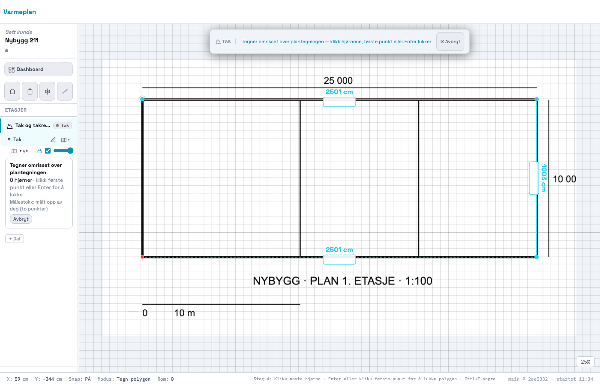
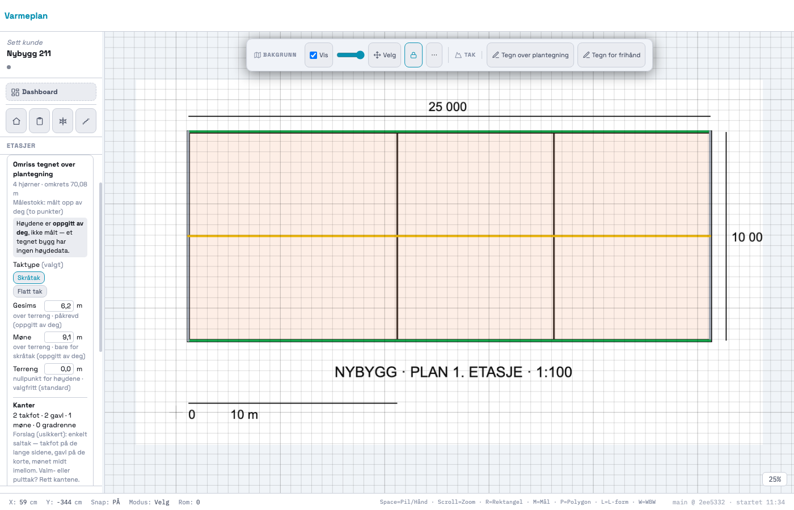
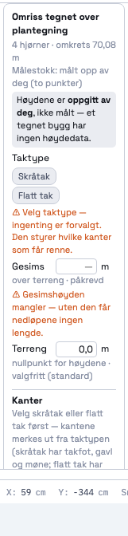
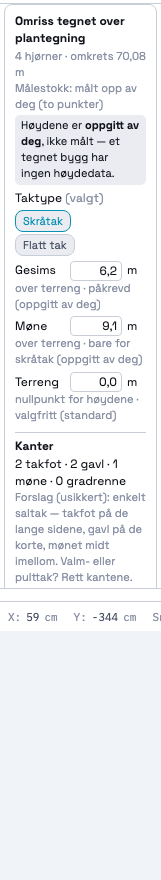
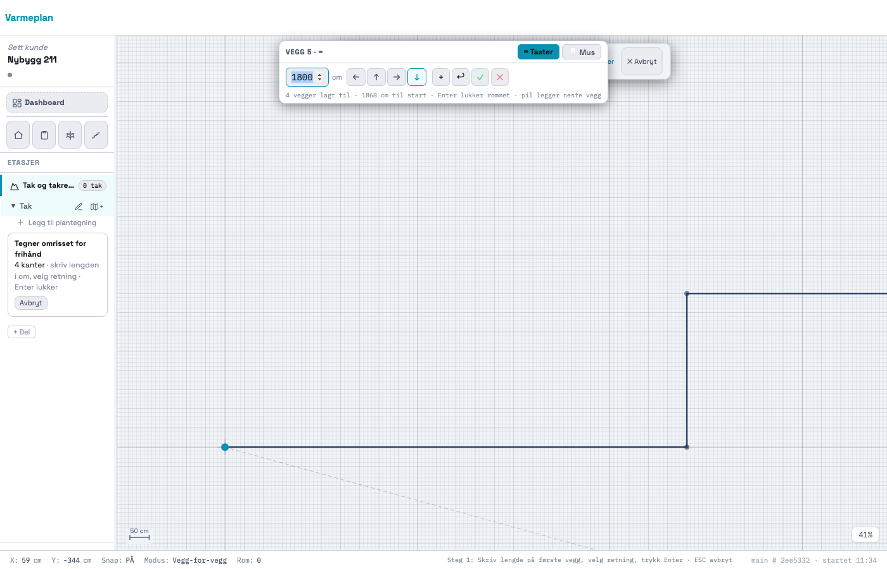
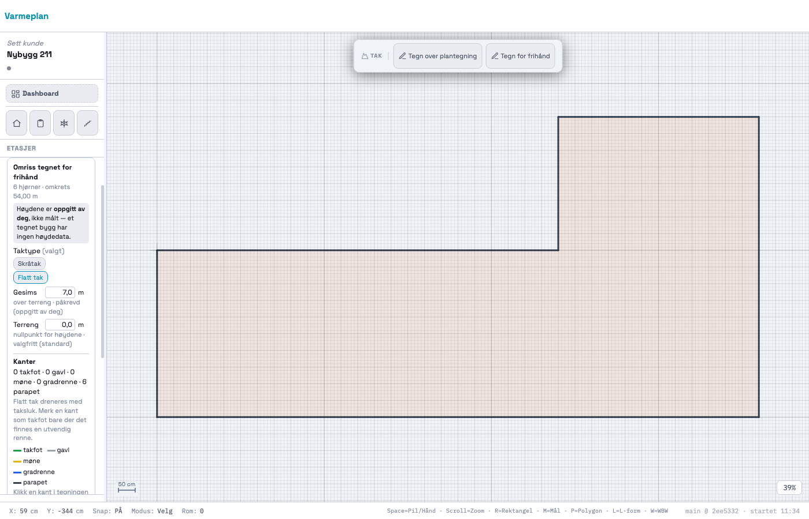
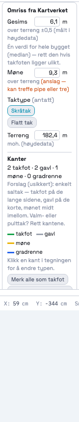

# 211 · Tegn bygget selv: over en plantegning eller for frihånd — rapport

07.11.2026 · `main` · én commit, ikke pushet · ingen SQL · `varmeplan-roof` ikke rørt.

## Kort

- **Tre veier til bygget.** Når Tak-modulen ikke har noe omriss ennå, viser kortet tre valg:
  1. **Finn bygget fra adressen.** Det 204 bygde, uendret og fortsatt standard (primærknapp «Hent kart»).
  2. **Tegn over en plantegning.** Last inn tegningen, sett målestokken og klikk hjørnene.
  3. **Tegn for frihånd.** Skriv lengden på hver kant.
- **Ingen ny tegnemotor.** Begge tegneveiene starter rom-modulens egne verktøy med `startDrawMode()`:
  - plantegning bruker **polygon** (som «P» for rom);
  - frihånd bruker **vegg-for-vegg** (som «W»).

  `createRoom()` i tak-delen leverer punktene til taket i stedet for å lage et rom. Plantegningen er rom-modulens bakgrunn (`S.bgs[fid]`), og den importeres og kalibreres med de samme funksjonene.
- **Målestokken sperrer.** Over en plantegning kan man verken begynne eller fullføre før målestokken er satt. Kortet viser «⚠ Målestokk mangler», «Sett målestokk» og en grå «Tegn omrisset». Når målestokken er satt, står den i panelet, for eksempel «Målestokk: målt opp av deg (to punkter) · tegningen er 30,03 m bred». Den lagres også på omrisset.
- **Høydene er oppgitt, ikke målt.** Et tegnet bygg får et eget statuskort med «Høydene er **oppgitt av deg**, ikke målt — et tegnet bygg har ingen høydedata». Rekkefølgen i kortet er taktype → gesims (påkrevd) → møne (bare skråtak) → terreng (valgfritt, 0). Alle høyder får `prov.source = USER_DRAWN`, `confidence = 1` og `height_ref`.
- **Taktypen må velges.** Ingenting er forvalgt. Uten taktype kan kantene ikke merkes, og appen sier hvorfor: «Velg skråtak eller flatt tak først — kantene merkes ut fra taktypen …».
- **Gesims mangler** → nedløpet får ingen lengde («? m»), panelet sier «gesimsen er ikke kjent», og Kabelmeter sier at summen mangler nedløpet. Det regnes aldri med 0.
- **Samme form.** Alle tre veier gir `surfaces[0].footprint = { world: [{x,y}], prov }`. Testen sammenligner strukturen fra tjenesten med strukturen fra de to tegnede veiene.

## Målestokk-kontrollen (tall)

Testtegningen er 1200 × 700 px:
- bygget 25,00 × 10,00 m fra (100,100) til (1100,500) px, altså 40 px/m;
- en målestokklinje på 10 m fra (100,620) til (500,620);
- tegningens egne mål står som tekst («25 000», «10 000»).

Den er kalibrert med rom-modulens to-punkts-kalibrering (`startBgCalibrate` → to klikk → `confirmBgCalibrate`, 10 m), og omrisset er tegnet med polygonverktøyet.

| Kjøring | Målestokk | Kanter | Avvik |
|---|---|---|---|
| `_takRegressionTest211` (lerretsklikk, standard snapp) | 2,5024 cm/px (fasit 2,5) | 25,027 · 10,007 · 25,027 · 10,007 m | 0,11 % · 0,07 % |
| `probe/vis.mjs` (ekte CDP-museklikk, som en bruker) | — | 25,010 · 10,031 · 25,010 · 10,031 m | 0,04 % · 0,31 % |
| Samme test med **rastersnapp på** (`S.snap.grid`) | 2,2950 cm/px | 22,500 · 9,500 m | **10 % · 5 %** — se under |

Kravet er 1 %, og begge vanlige kjøringer holder. Avviket som er igjen kommer av at et klikk treffer en hel skjermpiksel, både når målestokken settes og når hjørnene klikkes.

**Funn (rom-modulen, ikke rørt):** med rastersnapp på snapper kalibreringsklikkene til 50 cm-rasteret i den *ukalibrerte* verdenen. Målestokken blir da 8 % feil. Raster er av som standard (`snap.grid:false`), og testen låser standardinnstillingen. Dette gjelder rom like mye som tak. Se spm. 1.

**Frihånd** er eksakt, fordi lengdene skrives: 2500 → · 1000 ↓ · 2500 ← gir 25,00 · 10,00 · 25,00 · 10,00 m. Bildet viser en L-form med 12 · 4 · 6 · 9 · 18 · 5 m.

## Bilder

| De tre veiene | Plantegning uten målestokk | Målestokk satt |
|---|---|---|
|  |  |  |

**Vei 2, plantegning.** Polygonverktøyet tegner over tegningen. Verktøylinja sier «Tak · Tegner omrisset over plantegningen» og ikke «Tegn rom»:

Ferdig: skråtak valgt, gesims 6,2 og møne 9,1 oppgitt, kantforslag fra 205.

| Kortet rett etter tegningen | Ferdig kort |
|---|---|
|  |  |

**Vei 3, frihånd.** Vegg-for-vegg-panelet med fire kanter lagt, og så ferdig: L-form, flatt tak, alle kanter parapet.

**Vei 1, adressen.** Uendret fra 204, med stubbet tjenestesvar:

| Velg bygget | Statuskort fra Kartverket |
|---|---|
|  |  |

Kalibreringsdialogen er rom-modulens egen: `plan-2-kalibrer-hel.png`. Plantegningen rett etter import, med rom-modulens «sett målestokk»-overlegg: `plan-1-uten-maalestokk-hel.png`.

## STEG 0: hva jeg fant

### Hvor rom-modulens tegnemåter ligger

| Hva | Funksjon (linje i dag) |
|---|---|
| Start av et tegneverktøy | `startDrawMode(mode, name, floorId)` :71027 |
| **Polygon** («P»): klikk hjørnene | klikk i `canvas mousedown` (`mode==='polygon'`) :73740. Lukkes på første punkt; Enter i keydown. Snapping i `getWorldPos` :5009: raster → vinkel → geo-omriss → raster |
| **Vegg-for-vegg** («W», frihånd med mål) | `wbwDirPlace`/`addWbwWall` :71219, `finishWbwRoom` :71254, panelet `#wbw-panel` (lengde + pil eller mus) |
| Alle tegneverktøy ender i | `createRoom(pts, shape, …)` :64909 → `exitDrawing` :65086 |
| Plantegning som bakgrunn | `openBgImportPanel` :65944 → `_installBgImage` :66519 (import-kontekst `_bgImportCtx` :67777, låst til etasjen, 162). Tegnes fra `S.bgs[fid]` |
| Utsnitt (154/158) | `pdfView`/utsnitt i PDF-en. Ikke relevant her |

Prompt 154/158 handler om plantegning **i PDF-en**. Plantegning **som bakgrunn** er den eldre bakgrunnsimporten, som 162 låste til etasjen.

### Hvordan plantegningen kalibreres i dag

Målestokken er `bg.widthCm`/`bg.heightCm` (cm per bildepiksel = `widthCm / _srcW`). «Satt» betyr `bg._needsCalibration === false`. Det finnes tre veier, og alle brukes som de er:

1. **To punkter:** `startBgCalibrate` :66799 → to klikk (det andre låses vannrett/loddrett) → dialog → `confirmBgCalibrate` :66864. Den skalerer rundt første punkt og setter `_userCalibrated = true`.
2. **Fast målestokk** (PDF med papirstørrelse): `showFixedScaleModal`/`confirmFixedScale` :66916 setter `bg.fixedScale`.
3. **Lest fra fila** (052-motoren): `_planKalibrerUnderlag` :6813. Den er sikker ved tillit ≥ 0,8, ellers står `_needsCalibration` fortsatt på.

Et kart (`bg.geo`) har målestokk fra georeferansen og kalibreres aldri (`_bgIsGeo`). Det regnes som «satt».

### Bekreftet fra 204

- `S.tak[fid].surfaces` er en liste. Testen H sjekker `Array.isArray`.
- `roof_type` kan være usatt: `{ value: null, prov: null }`. Tjenestens «unknown» gir også `null`.
- Omrisset fra tjenesten er `footprint: { world: [{x,y}] (verdens-cm, uten gjentatt sluttpunkt), prov }`. De tegnede veiene gir nøyaktig det samme. Bare `prov` sier hvordan det ble tegnet: `source: 'USER_DRAWN'`, `method: 'plan'|'free'`, `scale` for plantegning.

### Avvik fra prompten

- **204 hadde allerede en egen tegnemodus for tak** (`_takDraw`, «Tegn omrisset selv»). Den er ikke slettet, fordi 204-testen bruker den. Knappen står bare når etasjen har kart, som sporing i kartet under adresse-veien. Uten kart er den byttet ut med de to nye veiene (spm. 2).
- **To 204-forventninger er endret** for å følge 211-regelen. Begge står med kommentar i testen.
  - C: kortet uten kart viser nå tre veier, ikke «Tegn omrisset selv».
  - I: en høyde på et tegnet omriss er `USER_DRAWN`, ikke `USER_CONFIRMED`.
- **Terrenget på et tegnet bygg** er lagret som 0 med `height_ref: 'terreng'` (nullpunkt) og merket `standard`. Det er ikke 0 moh. (spm. 3)

## Hvordan det er bygget

| Funksjon | Hva |
|---|---|
| `_takPlanStart(fid)` | Krever plantegning (eller kart) med målestokk. Låser tegningen, viser hele tegningen (`_fitViewToBg`) og starter `startDrawMode('polygon')` |
| `_takFreeStart(fid)` | Starter `startDrawMode('wbw')` |
| `_takRoomDraw` | `{ fid, via, mode, scale }`. Transient og lagres aldri. Nullstilles ved nytt prosjekt |
| `createRoom` (tak-delen) | `return _takRoomDrawCommit(pts, shape)` i stedet for den gamle avvisningen |
| `_takRoomDrawCommit` | `exitDrawing`. Sjekker målestokken igjen, så ingenting lagres hvis den forsvant underveis. Spør før arbeid kastes, og lager `S.tak[fid] = _takManual(ring, { method, scale })` |
| `_takBgState` / `_takBgScale` | Tegningen og målestokken: `none`/`plan`/`geo`, `measured`/`fixed`/`file`/`geo`, bredde i m og cm/px |
| `_takIsDrawn(t)` | `!t.building && footprint.prov.source === 'USER_DRAWN'` |
| `_takSetHeight` | Tegnet bygg gir `USER_DRAWN`/1 «oppgitt av bruker — ikke målt». Hentet bygg gir `USER_CONFIRMED` som før |
| `_takEdgesBlocked` | Gaten i `_takSetEdgeType`, `_takSetAllEdges`, `_takResuggest`, `_takResetEdges` og `_takEdgeMenu` |
| `_takDrawnCardInner` | Statuskortet for et tegnet bygg. Sperrer kanter og renner hvis plantegningen har mistet målestokken |
| `_takStartOver` | «Velg en annen vei»: fjerner taket (kan angres) |

Verktøylinja i tak-delen:
- uten tegning: «Tegn over plantegning» og «Tegn for frihånd», pluss «Tegn omrisset selv» når etasjen har kart;
- mens tak-omrisset tegnes: «Tak · Tegner omrisset …» og «✕ Avbryt», ikke rom-verktøylinja med «Rom 1».

Ingen nye hurtigtaster (`_SHORTCUTS` er urørt). R/M/P/L/W i tak-delen tegner nå omrisset i stedet for å avvises (spm. 5).

## Tester

### Ny: `_takRegressionTest211` — 64/64

- **A.** Tre veier i rekkefølge. Adressen er standard. Uten bakgrunn: «Last inn plantegning», og plantegning nektes.
- **B.** Plantegning med kjent målestokk og lerretsklikk gjennom rom-modulens kalibrering og polygonverktøy:
  - sperret før målestokken er satt (kort og `_takPlanStart`);
  - 2,5 cm/px ± 1 %;
  - kantene innenfor 1 % (tallene over);
  - ingen rom laget, opphav `USER_DRAWN`/1/`plan` med målestokken på;
  - tegningen er ikke flyttet eller skalert.
- **C.** Taktypen er ikke forvalgt, og det finnes ingen kanter. «Foreslå», merking og kantmenyen nektes med meldingen, og kortet sier hvorfor.
- **D.** Høydene:
  - kortteksten «oppgitt av deg, ikke målt»;
  - påkrevd-varsel for gesims;
  - møne skjult til skråtak er valgt;
  - terreng 0 «standard»;
  - oppgitte verdier er `USER_DRAWN`/1 med `height_ref`;
  - et ferskt omriss er ikke «arbeid».
- **E.** Gesims mangler: nedløpet er `null` (ikke 0), etiketten «? m», panelet sier det, og summen mangler nedløpet. Med gesims 10 følger nedløpet, og 1 løp gir 10,05 m.
- **F.** Plantegningen mister målestokken: kortet sperrer kanter og renner, og «Tegn på nytt» nektes. Forsvinner målestokken *under* tegningen, lagres ikke omrisset.
- **G.** Frihånd med vegg-for-vegg gir 25 × 10 m eksakt, `method: 'free'`, ingen rom, og panelet lukkes. Avbryt endrer ingenting, og angre fjerner omrisset.
- **H.** **Samme form:** tjenesten (`_takFromModel`, samme bygg 25 × 10 m), plantegning og frihånd sammenlignes på
  - nøklene i taket, flaten, omrisset, punktene og høydene;
  - at `surfaces` er en liste, at ringen ikke er lukket, og at `prov` har `source`/`confidence`.

  Alle er like. Tjenestens egen `roof_type.service` holdes utenfor.
- **I.** **Rom-modulen er uendret:**
  - polygon i innendørs lager fortsatt et rom (4 × 3 m), også med en gammel `_takRoomDraw` liggende;
  - vegg-for-vegg lager et rom (3 × 2 m);
  - rom-kalibreringen gir samme 2,5 cm/px;
  - ingen tak blir laget.
- **J.** **Et prosjekt uten tak er uendret:** ingen `tak`-nøkkel, og åpne → lagre → åpne → lagre er byte-identisk.
- **K.** Et skrivebeskyttet vindu kan ikke starte noen av veiene.

### Hele settet mot HEAD

`docs/211/probe/alle.mjs` + `sammenlign.js` (HEAD = `docs/210/probe/alle-etter.json`): **78 like med HEAD, 0 ulike, 1 ny** (`_takRegressionTest211` 64/64).

De sju røde er de samme som på HEAD, og røde uten innlogging:
- `_prosjektlaasRegressionTest` 66/67;
- `_kundeforslagRegressionTest` 270/271;
- fem `_geo*` som kaster når de kjøres alene.

Det endelige resultatet står i `probe/alle-etter.json`.

## Sjekkliste for Kenneth

1. Åpne et innendørsprosjekt og tegn et rom med P og W. Det skal være som før.
2. Nytt prosjekt med Tak & renner. Kortet skal vise tre veier.
3. Vei 2: last inn en plantegning (PDF/PNG). «Tegn omrisset» skal være grå til målestokken er satt. Sett målestokken med to punkter, klikk hjørnene og lukk på første punkt. Se at omkretsen i kortet stemmer med tegningens mål.
4. Velg skråtak og sett gesims. Kantforslaget kommer, og renner og nedløp får lengde. Prøv først uten gesims: nedløpet skal vise «? m».
5. Vei 3: «Tegn for frihånd», skriv lengdene og trykk Enter.
6. Svar på `docs/211/SPØRSMÅL.md`, særlig 1 (rasteret i kalibreringen), 2 (`_takDraw`) og 4 (gesims som sperre).
