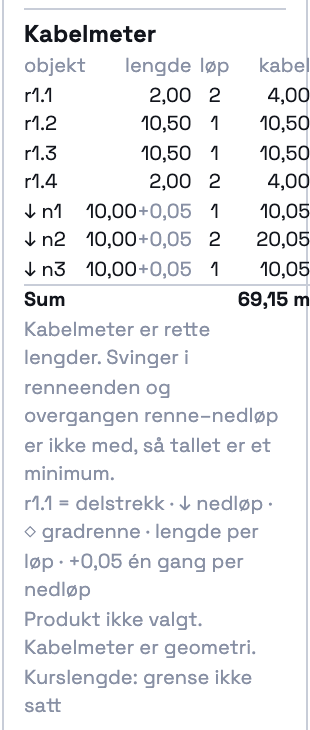
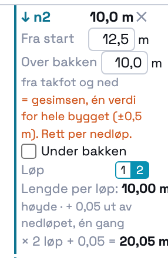

# 213 · De 5 cm ut av nedløpet regnes én gang per nedløp — rapport

07.11.2026 · `main` · én commit, ikke pushet · ingen SQL · `varmeplan-roof` ikke rørt.

## Kort

- **Formelen er rettet** (svar på 207 spm. 2). Den står nå ett sted, i `_takDownpipeCableFor(over, under, runs)`:
  - slutter over bakken: `over × løp + 0,05`
  - under bakken: `(over + under) × løp`, uten tillegg
- Panelet, tabellen, nedløpsboksen, forhåndsvisningen mens du tegner og summen leser alle denne funksjonen.
- **Panelet sier at tallet er et minimum** (svar på 207 spm. 7). Under summen står det: «Kabelmeter er rette
  lengder. Svinger i renneenden og overgangen renne–nedløp er ikke med, så tallet er et minimum.» Linja vises
  bare når summen er større enn null.
- Svarene på 207 spm. 1–10 står i `docs/207/SPØRSMÅL.md`. Kodeendringen gjelder bare spm. 2 og 7.

## STEG 0 — hva jeg fant

1. **Formelen sto to steder.**
   - `_takDownpipeCableM(d)` regnet ut 206-feltet `cable_m` = `over + 0,05` (eller `over + under`). Deretter
     ganget `_takRecalc` med antall løp: `cable_total_m = cable_m × runs`. Slik ble 0,05 regnet én gang per løp.
   - **Forhåndsvisningen av nedløpet hadde sin egen kopi:** `(ev.value + TAK_DOWNPIPE_TAIL_M) × løp`. Den
     ville ikke ha fulgt med på en endring i `_takRecalc`.
   - Disse brukte tallet: nedløpsboksen («Kabel per løp: 10,05», «× 2 løp = 20,10»), tabellen (radens
     «lengde» var `cable_m` = 10,05, og «kabel» var `cable_total_m`), summen (`_takCableSummary`),
     forhåndsvisningen og testene i 206 (`cable_m`) og 207 (`cable_total_m` og summene).
   - **Materiallista bruker ikke takkabel i dag.** `_takCableSummary` blir bare kalt fra panelet og fra
     forhåndsvisningen. Det finnes altså ingen fjerde leser å samle.
2. **Under bakken var det ikke noe 0,05-tillegg.** `_takDownpipeCableM` returnerte `over + under`. Ingen avvik.
3. **Tallene i dag er bekreftet.** Metode 1 = 80,15 m og metode 2 = 110,30 m. 207-testen var grønn på HEAD
   med 39/39 (`docs/207/probe/alle-etter.json`), og den sjekker begge tallene.

## Endringen

```js
_takDownpipeCableFor(over, under, runs)   // → { len_m, tail_m, cable_m } · under = null → over bakken
_takDownpipeCable(d, runs)                // for et lagret nedløp (under bakken uten dybde → null)
_takDownpipeCableM(d)                     // 206-feltet cable_m = kabel med ETT løp (samme verdi som før)
d.cable_total_m = _takDownpipeCable(d, d.runs).cable_m     // i _takRecalc, ikke lenger cable_m × runs
```

- **Tabellen.** For et nedløp viser lengde-kolonnen nedløpets lengde og tillegget hver for seg:
  «↓ n1 | 10,00+0,05 | 2 | 20,05». Da går raden opp: lengde × løp + tillegg (spm. 1).
- **Nedløpsboksen.** Den viser «Per løp: 10,00 m» og «× 2 løp + 0,05 = 20,05 m». Under bakken står det
  «over + under bakken, ingen 0,05».
- **Forhåndsvisningen.** Den bruker `_takDownpipeCableFor(gesims, null, standard løp)` og viser to desimaler,
  slik tabellen gjør (spm. 2).
- **Lagrede prosjekter.** `cable_m` har samme verdi som før. `cable_total_m` er avledet og regnes på nytt
  når prosjektet åpnes (`_takRecalc` i `_restoreProject` fra 207). Et prosjekt lagret av 207 viser derfor de
  nye tallene straks det åpnes.

## Tallene — før og etter

Filmens bygg: renne 25 m, tre nedløp på 10 m, alle slutter over bakken. Tallene er målt i appen med
`probe/vis.mjs`, og tabellene er kopiert fra DOM-en.

| Oppsett | Renne | Nedløp | Før (207) | **Etter (213)** |
|---|---|---|---|---|
| Boks ved hvert nedløp = metode 1 | 2 | 1 | 80,15 | **80,15** (uendret) |
| To løp hele veien = metode 2 | 2 | 2 | 110,30 | **110,15** |
| Ett løp i renna og i nedløpene | 1 | 1 | 55,15 | **55,15** (uendret) |
| Ett nedløp, 2 løp | | | 20,10 | **20,05** |
| Ett nedløp 10 + 1,0 under bakken, 2 løp | | | 22,00 | **22,00** (uendret) |

Metode 2 ligger nå 1,75 m over filmens 108,4 m. Før lå den 1,90 m over. Resten av avviket er svinger og
radier, som ikke er med (spm. 7 i 207, og minimums-linja).

### Kenneths blandede rute, regnet om

| Objekt | Løp | Håndregning før | **Håndregning nå** | **Appen nå** |
|---|---|---|---|---|
| n1 | 1 | 10,05 | 10 × 1 + 0,05 = **10,05** | 10,05 |
| r1.1 | 2 | 4,00 | 2 × 2,0 = **4,00** | 4,00 |
| r1.2 | 1 | 10,50 | **10,50** | 10,50 |
| n2 | 2 | 20,10 | 10 × 2 + 0,05 = **20,05** | 20,05 |
| r1.3 | 1 | 10,50 | **10,50** | 10,50 |
| r1.4 | 2 | 4,00 | **4,00** | 4,00 |
| n3 | 1 | 10,05 | **10,05** | 10,05 |
| **Renna** | | 29,00 | **29,00** | 29,00 |
| **Nedløpene** | | 40,20 | **40,15** | 40,15 |
| **Sum** | | 69,20 | **69,15 m** | **69,15 m** |

 

## Tester

### Ny: `_takRegressionTest213` — 22/22

- **Formelen:** 10,0 over bakken gir 10,05 med 1 løp og **20,05** med 2 løp. 10,0 + 1,0 under bakken gir 11,00
  med 1 løp og 22,00 med 2 løp. Ukjent høyde gir null, ikke 0,05.
- **Filmens bygg:** metode 2 = 110,15 i panelet, og hvert nedløp gir 20,05. `cable_m` er fortsatt 10,05.
  Tabellraden er «↓ n1|10,00+0,05|2|20,05». Nedløpsboksen viser «10,00 m» og «× 2 løp + 0,05 = 20,05 m».
  Metode 1 = 80,15.
- **Under bakken, med et ekte nedløp:** 11,00 med 1 løp og 22,00 med 2 løp. Tabellen viser «11,00|2|22,00»
  uten +0,05.
- **Blandet rute:** renna 29,00, nedløpene 40,15 og summen 69,15 i panelet.
- **Minimums-linja:** står under summen med nøyaktig Kenneths tekst. Den mangler når summen er null (bare et
  nedløp uten høyde: tabellen vises, linja ikke). Uten objekter vises verken tabell eller linje.
- **Forhåndsvisningen er lik tabellen etterpå** (egen sjekk). Jeg leser tallet i forhåndsvisningen av et
  strekk og av et nedløp med musa over kanten, legger objektet med et ekte klikk, og sammenligner med
  tabellraden og summen i panelet. Nedløpet viser «+20,05», og raden blir 20,05.

### Endrede forventninger i `_takRegressionTest207`

Ingen sjekker er fjernet. Hver endring har det gamle tallet i en kommentar `// 213: før …` i testen.

| Sjekk | Før | Nå | Hvorfor |
|---|---|---|---|
| Metode 2, og summen i panelet | 110,30 | 110,15 | 3 nedløp × 0,05 færre |
| Klikk «1» på n1 | 100,25 | 100,15 | 110,15 − 20,05 + 10,05 |
| n3 under bakken, totalen | 112,20 | 112,10 | to nedløp over bakken med 2 løp |
| Blandet: nedløpene / sum | 40,20 / 69,20 | 40,15 / 69,15 | n2 har 2 løp |
| Arv: nytt nedløp | 89,30 | 89,20 | + 20,05 i stedet for 20,10 |
| Gradrenna i summen | 79,20 | 79,15 | følger av den blandede ruten |
| Forhåndsvisning, strekk | «+50,0 m kabel (×2) → x,x» | «+50,00 m kabel (×2) → x,xx» | to desimaler som tabellen |
| Forhåndsvisning, nedløp | «+20,1 m kabel (×2)» | «+20,05 m kabel (×2) → …» | ny formel og to desimaler |
| Nedløp lagt med klikk | +20,10 | +20,05 | ny formel |
| Tak lagret av 206 åpnes | 110,30 | 110,15 | ny formel |

Uendret: 80,15, 55,15, 22,0, gradrenna 10,0/5,0 og alle sjekker av struktur, angring, readOnly og rundtur.
`_takRegressionTest206` er ikke endret, fordi `cable_m` (ett løp) har samme verdi som før. Den er 59/59.

### Hele regresjonssettet

`probe/alle.mjs` kjørte alle `_xxxRegressionTest*`, hver i sin fane. HEAD-tallene er 207-kjøringen av
d5ef811 (`probe/alle-head.json` = `docs/207/probe/alle-etter.json`).

```
HEAD: 74 tester, 67 grønne, 3380 deltester
NÅ:   75 tester, 68 grønne, 3402 deltester
like med HEAD: 74 · ulike: 0 · nye: 1  (_takRegressionTest213 22/22)
```

207 står som «lik» fordi den er 39/39 både før og etter: forventningene er endret sammen med formelen.
De 7 røde er de samme som på HEAD uten innlogging: `_prosjektlaasRegressionTest` 66/67,
`_kundeforslagRegressionTest` 270/271 og fem `_geo*`-tester som kaster når de kjøres alene.

## Kenneth sjekker

1. Tak & renner → legg et rennestrekk på 25 m og tre nedløp på 10 m. Summen skal være **110,15 m**, og hver
   nedløpsrad skal vise «10,00+0,05 | 2 | 20,05».
2. Under summen står linja om at kabelmeter er et minimum.
3. Hold musa over takfoten med nedløpsverktøyet. Forhåndsvisningen skal si «+20,05 m kabel (×2)», og
   raden blir 20,05 når du klikker.

## Filer

- `index.html`:
  - `_takDownpipeCableFor` og `_takDownpipeCable` (ny), og `_takDownpipeCableM` (nå en innpakning).
  - `_takRecalc` og `_takCableRows` (`tail_m` på nedløpsradene).
  - Panelet: nedløpsboksen, tabellen og `TAK_CABLE_MINIMUM_NOTE`.
  - Forhåndsvisningen i `_takDrawFeatures`.
  - `_takRegressionTest207` (forventningene over) og `_takRegressionTest213` (ny).
- `docs/207/SPØRSMÅL.md`: Kenneths svar under hvert spørsmål.
- `docs/213/`: rapport, spørsmål, bilder og `probe/` (`t.mjs`, `vis.mjs`, `alle.mjs` og `sammenlign.js`).
