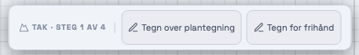
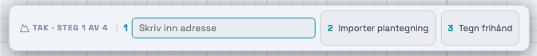
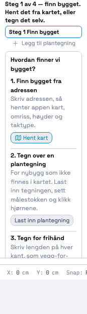
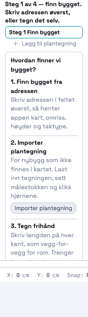

# 216 · Tak steg 1: adressefeltet i toppmenyen, og navn som sier hva du skal gjøre — rapport

08.11.2026 · `main` · én commit, ikke pushet · ingen SQL · `varmeplan-roof` ikke rørt.

## Kort

- Toppmenyen i steg 1 viser nå **`[1 Skriv inn adresse]  2 Importer plantegning  3 Tegn frihånd`**. Adressefeltet er et ekte felt, og det har fokus når et tomt tak åpnes.
- Søket er kartdialogens eget (`_kvAddrLookup`, `_roofAddrInput`, `_roofAddrKey`, `_roofAddrPick`). Ingen ny søkekode. Fra 3 tegn, 250 ms, 8 treff, piltaster, Enter, Esc.
- Når en adresse er valgt, tar kartdialogen over med fremdrift og «Prøv igjen». Kartet og bygget hentes av samme kode som før.
- «Importer plantegning» åpner nå filvalget. Den gamle knappen i toppmenyen ga bare beskjeden «Last inn plantegningen først».
- Panelets punkt 1 har ingen knapp, og teksten peker opp på feltet. Punkt 2 og 3 har samme navn som toppmenyen.
- **Snø-modulen er uendret:** panel, toppmeny og kartdialog gir samme HTML-hash på HEAD og nå.
- **Tester:** ny `_takRegressionTest216` 58/58. De 82 andre gir samme resultat som på HEAD (se under for de røde).

## Før og etter

| | Før | Etter |
|---|---|---|
| Toppmeny |  |  |
| Panel |  |  |

Treffliste over tegningen: [etter-treffliste.png](etter-treffliste.png).

## Hva testen på :29405 faktisk dekker

Prompten beskriver den som 007-testen for snø-modulens kartknapp. Målt er det litt annerledes:

- Den heter `142: knappen heter «Hent kart» (ikke «Finn bygg»)` og ligger i `_geoOneStepRegressionTest`.
- Den leser `#_roof-ov`, altså **kartdialogen**, ikke snø-panelet. Dialogen er felles for snø og tak.
- 007-merknaden (Kenneth 25.09.2026) står ved snø-panelets tomme tilstand, på `index.html:2324`. Den teksten er en annen, og også den er urørt.

Følgen er at knappen inne i dialogen fortsatt heter «Hent kart», også når dialogen åpnes fra tak. Testen er grønn med samme forventning, på HEAD og nå.

## STEG 0 — hva som fantes

| Antakelse | Målt | Følge |
|---|---|---|
| Toppmenyen viser «Tegn over plantegning» og «Tegn for frihånd» | Stemmer | Byttet |
| `_kvAddrLookup` er felles | Stemmer | Gjenbrukt, og alt rundt den også |
| Panelets veier ved `way(3, …)` | Stemmer | Endret |
| Toppmenyen kan holde et felt | **Nei, ikke uten mer.** `updateCtxBar` bygger hele linja på nytt med `innerHTML` | Tekst, markør, fokus og liste tas vare på gjennom ombygging |

## Valg jeg tok

- **Knapp 2 følger tilstanden**, på begge steder: ingen tegning = «Importer plantegning», tegning uten målestokk = «Sett målestokk», med målestokk = «Tegn omrisset». Å importere en tegning du alt har, gjør ingenting (`openBgImportPanel` gjør ingenting med en tegning på plass). Spm. 1.
- **Med kart på etasjen** er knapp 2 «Tegn omrisset selv», den knappen som alt sto der. Spm. 2.
- **Når bygget er funnet, er feltet sperret** og viser adressen. Et nytt kart under et ferdig omriss ville ligget feil. Veien er «Velg en annen vei». Spm. 3.
- **Feltet er fylt ut med prosjektets adresse** hvis den finnes, og teksten er merket. Enter henter da kartet med én gang, som i dialogen.
- **Statuslinja i steg 1** sa «Hent det fra kartet». Den sier nå «Skriv adressen øverst, eller tegn det selv», siden knappen er borte.

## Ting testene fant

- Etasje-id-er går igjen mellom prosjekter, så skrevet tekst fulgte med til neste prosjekt. `_resetProjectState` rydder nå feltet.
- `_roofClose` lot den forsinkede søketimeren leve, og den traff neste søk. Timeren stoppes nå.
- Klikk i tegningen ga feltet fokus igjen, fordi klikket bygger linja på nytt. Klikk i lerretet tar nå feltet ut av fokus først.
- **Ikke rettet:** `_resetProjectState` tømmer ikke `S.geo`. Feltet leser derfor kartets adresse bare når etasjen har kart. Spm. 6.

## Tester

`_takRegressionTest216` 58/58, med stubbet nett:

| Punkt | Resultat |
|---|---|
| Tre i rekkefølge, feltet først | grønn |
| Fokus på tomt tak, ikke tatt tilbake, ikke stjålet fra et annet felt | grønn |
| «Steinliveien 1» → liste → Enter → kartet hentes | grønn |
| Piltaster, Esc, 3 tegn, 250 ms, svar på gammel tekst, ingen treff | grønn |
| Feil hos karttjenesten gir dialogen med «Prøv igjen» | grønn |
| Gamle navn borte, punkt 1 uten knapp, samme navn i panel og toppmeny | grønn |
| Filvalg, «Sett målestokk», tegning med målestokk, frihånd | grønn |
| Snø har ikke feltet | grønn |

Ekte tastetrykk og klikk i Chrome (`probe/ekte.mjs`, `probe/klikk2.mjs`): R, P, M, W og ? blir bokstaver i feltet og starter ingen verktøy. Lista velges med mus, og klikk i lerretet lukker den.

Bredde: på tomt tak er linja 652 px, og den får plass ned til 1000 px vindu. Med kart er den 1028 px, samme som på HEAD (feltet er smalere der).

**Eksisterende tester.** Seks forventninger i 204, 211 og 214 låste de gamle navnene og «Hent kart»-knappen i tak-panelet. De er rettet til de nye navnene. Forventningen på :29405 er ikke rørt.

**Røde, like på HEAD og nå:**
- `_prosjektlaasRegressionTest` 66/67 og `_kundeforslagRegressionTest` 270/271.
- Fem `_geo…`-tester kaster i `alle.mjs` fordi de må kalles med `results`. Kjørt riktig (`await _geoRegressionTest().async`) gir de 140/141 på begge. Den ene røde er «Kartet slutter her».

**Ikke prøvd:** ekte svar fra Kartverket og karttjenesten, og filvalget med en ekte fil. Testene stubber dem.

`000-KJØR-MEG.md` for serie 204–215 finnes ikke i repoet. Den eneste under `docs/tak-modul/` gjelder 001–007.
