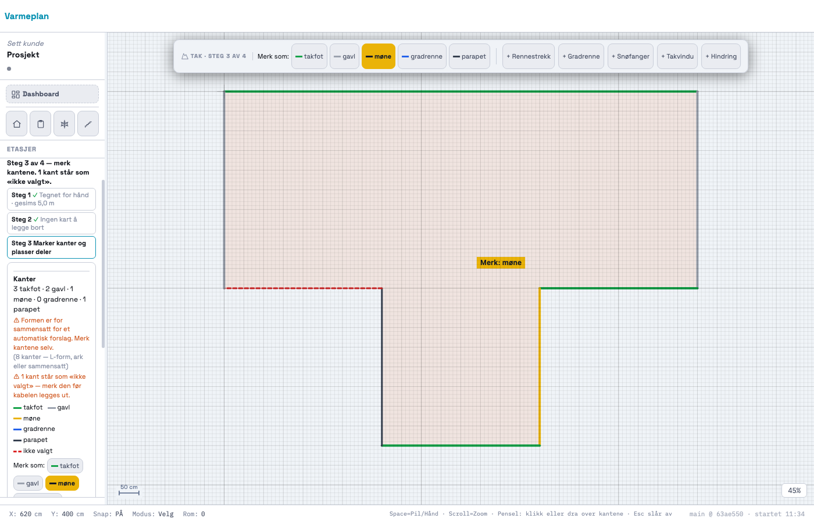

# 218 · Penselmodus for kantmerking — rapport

08.11.2026 · `main` · én commit, ikke pushet · ingen SQL · `varmeplan-roof` ikke rørt.

## Kort

- Steg 3 har nå **«Merk som:»** med fem fargede knapper, både i verktøylinja og i panelet. Trykk en type, og klikk eller dra over kantene.
- **Menyen står som før** når penselen er av. Esc, eller et nytt trykk på samme knapp, slår penselen av.
- En kant merket med penselen får `USER_CONFIRMED`/1 og samme notat som fra menyen («rettet fra ikke valgt»). Begge veier går gjennom én funksjon, `_takStampEdge`.
- **Tester:** ny `_takRegressionTest218` 37/37. De 84 andre gir samme resultat som på HEAD. Sju av dem er røde både før og etter, se under.

## Klikktallet

Samme 8-kants L-tak som i 214, ekte museklikk (`probe/maal.mjs`). Fordeling: 4 takfot, 2 gavl, 1 møne, 1 parapet.

| Vei | Klikk | Slik |
|---|---|---|
| Før: menyen | **16** | 8 kanter × 2 |
| Etter: penselen, klikk | **12** | 4 typevalg + 8 kanter |
| Etter: penselen, dra | **8** | 4 typevalg + 4 dra (ett dra over alle fire takfotene, ett over begge gavlene) |

Prompten regnet 10 klikk, men da er typevalget for den tredje typen ikke med (spm. 2). Med tre typer blir det 11 (regnet, ikke målt).

Andre bilder: `pensel-hover.png` (kanten lyser i fargen som males, før du klikker) og `pensel-dra.png` (midt i et dra).

## STEG 0

| Spørsmål | Funn |
|---|---|
| Kantklikket | Krok øverst i `mousedown` (`_takEdgeMouseDown`). Menyen åpnes på `click` i capture-fasen. |
| Bare i tak-modulen? | Ja, via `_takEdgeActiveFid`. Låst i 205 med lerretets hendelser. Penselen går gjennom den samme sjekken. |
| «Merk alle som takfot/parapet», «Nullstill», «Foreslå på nytt» | Finnes alle. Står uendret, og penselen ligger ved siden av. |
| Dagens klikktall | 16, målt på nytt mot HEAD-kopi. |

## Hva som er bygget

- **Kroken** `_takBrushMouseDown` står foran objektvalget. Ellers ville en renne på takfoten tatt klikket.
- **Dra:** ett dra er ett angre-steg. Bevegelsen sveipes i steg på 3 px, så en rask hånd ikke hopper over en kant.
- **Dra som starter utenfor en kant** merker ingenting og flytter ikke tegningen. Midtknapp, Alt + dra og håndverktøyet panorerer som før.
- **Markøren** er et trådkors med en merkelapp i fargen («Merk: takfot»). Merkelappen er tegnet på lerretet og kommer ikke med i PDF.
- **En linje inne i taket** (mønet) kan bare males som møne eller gradrenne, samme regel som i menyen. Klikker du den med en annen type, får du en melding.
- **Slås av av seg selv** ved stegbytte, tak-verktøy og åpning av prosjekt. Hviler ved skrivebeskyttelse, presentasjon og håndverktøy. Lagres aldri.
- **Hurtigtast:** Esc har fått en rad i `_SHORTCUTS`.

## To feil målingen fant

1. **Knappene brakk verktøylinja.** Den ble 178 px høy og dekket øverste takkant, så klikket der aldri nådde tegningen (første måling ga «k1 ikke merket»). Nå er linja én rad, 58 px, ned til 1280 px med et rennestrekk på plass. Ved 1100 px er den to rader (spm. 6).
2. **Markøren forsvant.** Resten av `mousemove` setter markøren tilbake etter hover. Den ligger nå i CSS med `!important`, styrt av en klasse.

## Tester

- **`_takRegressionTest218` 37/37:** ett klikk, flere kanter i ett dra, ett angre-steg, langt musehopp, hjørne, dra utenfor, mønet, renne på kanten, Esc, samme knapp, stegbytte, skrivebeskyttelse, lagring og innendørs med og uten påslått pensel.
- **Ekte hendelser, `probe/ekte.mjs`, 9 av 9:** klikk, dra, hover, slipp over sidepanelet, Esc og menyen etterpå.
- **Klikk utenfor tak-modulen, `probe/uendret.mjs`:** ekte taster og klikk i rom, snø og trapp mot HEAD-kopi. Ingen felt ulike, og lagringen har samme hash.
- **Hele settet** (`probe/sammenligning.txt`): 85 tester, 84 like HEAD, 0 ulike, 1 ny. Røde før og etter: `_prosjektlaasRegressionTest` 66/67, `_kundeforslagRegressionTest` 270/271 og fem `_geo*`-tester som kaster uten innlogging.

## Ikke prøvd

Alt er kjørt i headless Chrome. Ingen har holdt musa, så følelsen av å dra rundt et ekte tak gjenstår (spm. 4). Selve OS-markøren syns ikke på skjermbilder, men `getComputedStyle` viser `crosshair`. Forslagene fra 205 og kabelberegningen er ikke rørt.
