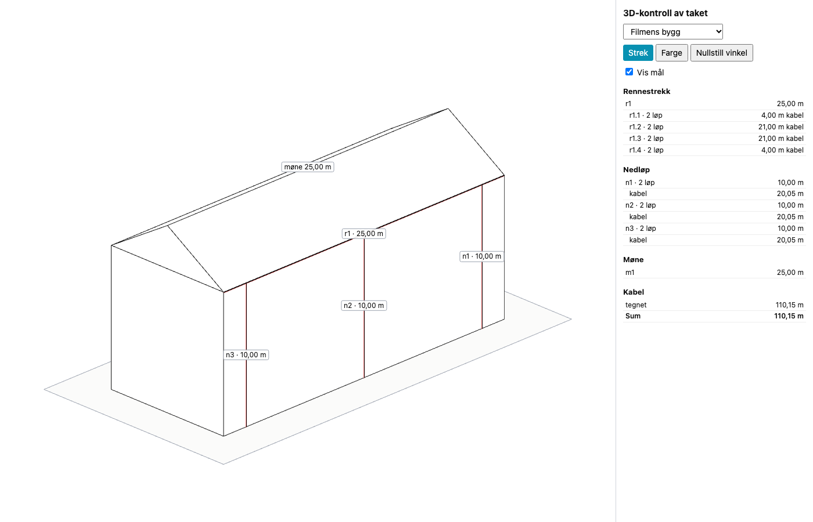
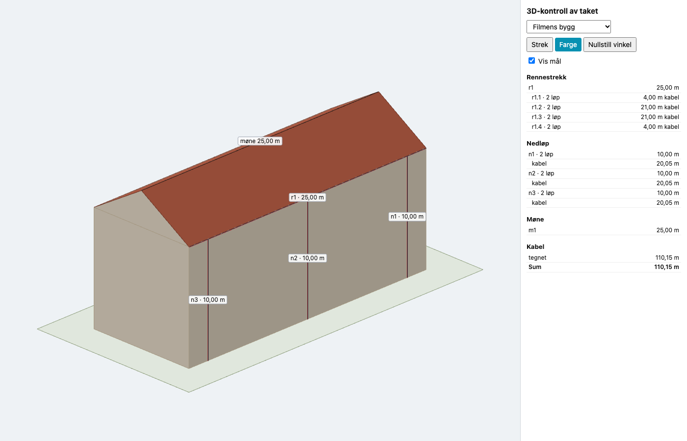
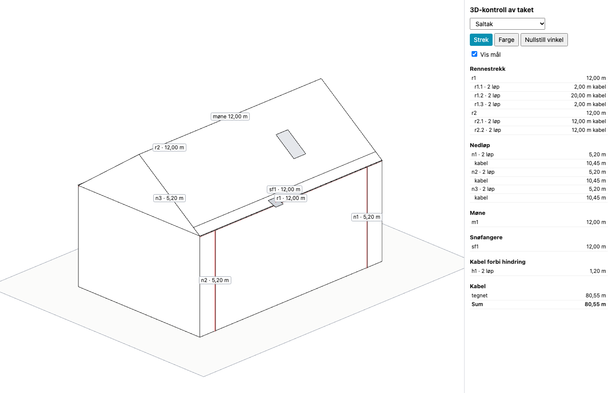
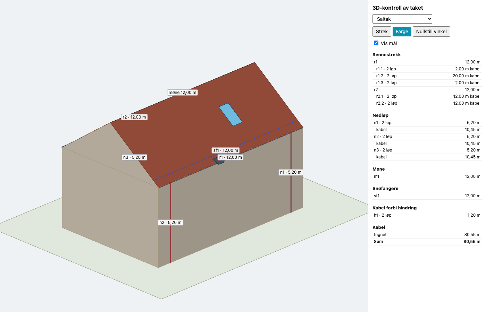
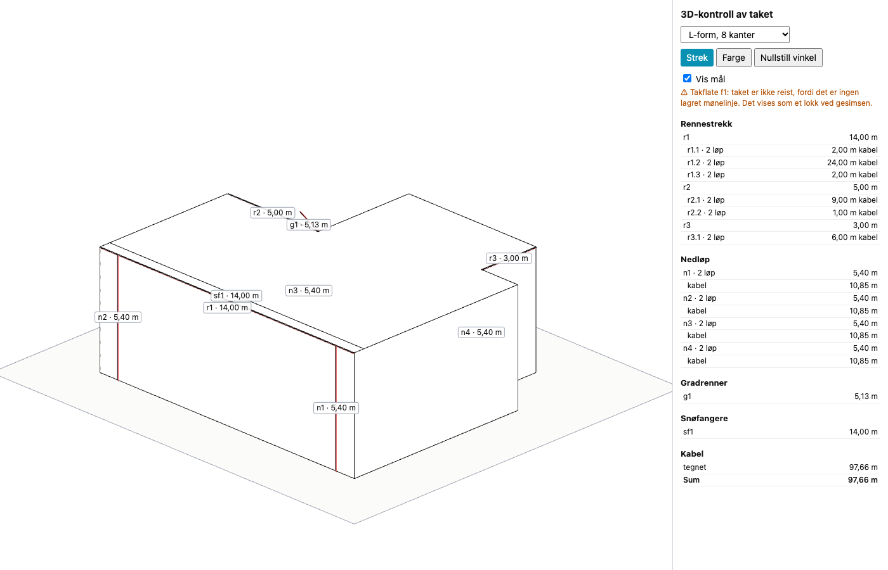
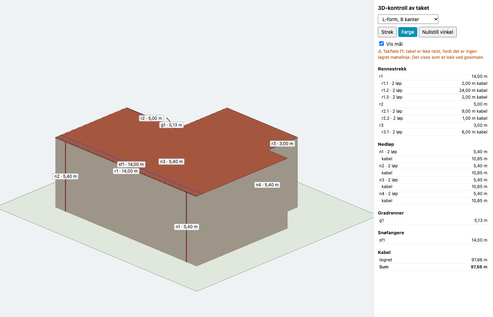
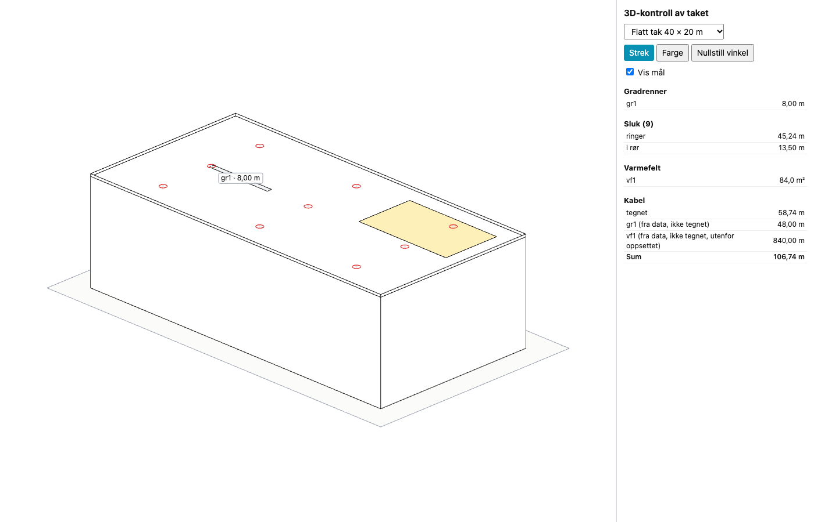
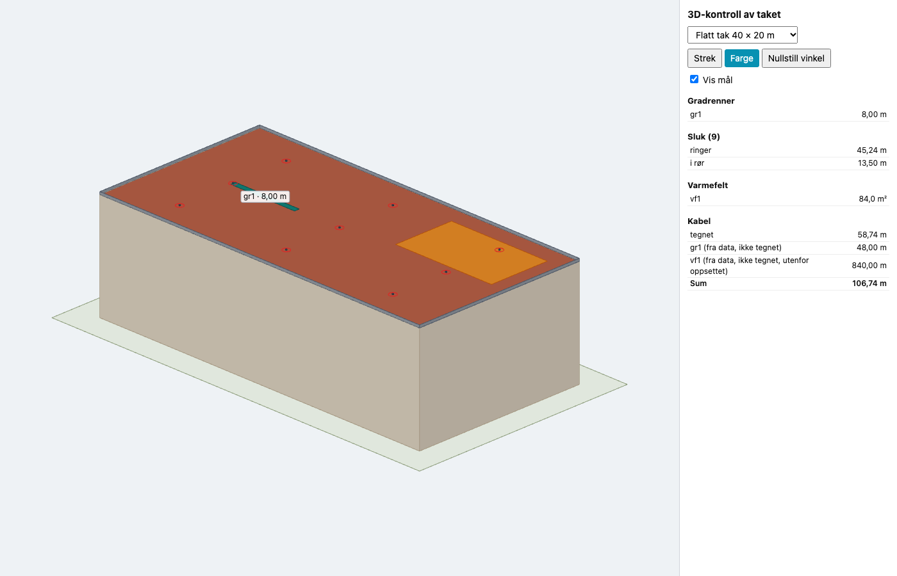
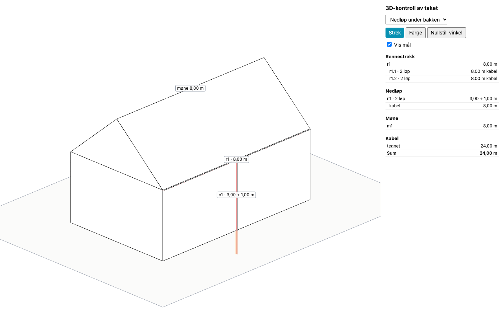
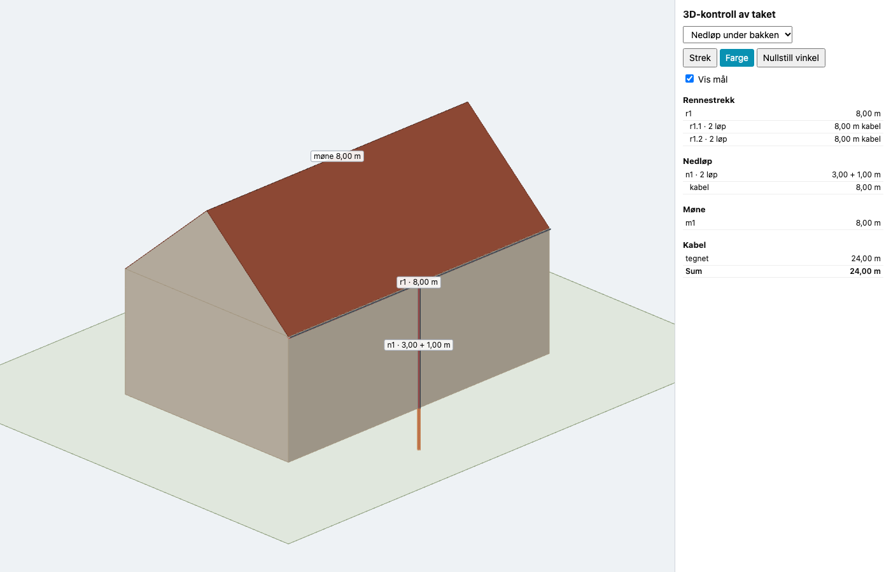

# 219 · 3D fase 0: motoren som bygger taket fra prosjektets egne data

`index.html` er ikke endret (test 6 sjekker at den er byte-identisk med HEAD). Ingen SQL, ikke pushet.

## Resultat

- **Filmens bygg: 110,15 m med to løp i nedløpene og 80,15 m med ett.** Begge stemmer med 213.
- `node docs/3d/test-3d.mjs`: **640 av 640 sjekker bestått.** Største avvik mellom 3D og 2D er 0 mm i alle fem fixturene (tabellen under).
- Alle fem fixturene er tegnet i ekte WebGL i begge stiler, uten konsollfeil.
- `varmeplan-3d.js` er **40,9 kB** ukomprimert. three.js 0.160.0 lastes fra jsDelivr først når `tegnScene` kalles.

**Viktigste funn: et L-formet skråtak kan ikke reises i dag.** Mønelinje finnes bare som `kind:'line'`, og den lages bare av rektangel-forslaget i `_takSuggest`. Appen har ikke noe verktøy for å tegne møne selv (205 spm. 3). Kenneths eget hus har derfor ingen lagret mønelinje. Prompten sier at manglende tall ikke skal regnes ut, så motoren regner ikke ut møner. Taket vises som et lokk ved gesimsen, med en tydelig advarsel. Renner, nedløp og kabler på L-formen er fullt ut riktige. Se SPØRSMÅL 1.

## Filer

| Fil | Hva |
|---|---|
| `varmeplan-3d.js` | `byggTak`, `maal` (rene, kjører i Node), `tegnScene` (three.js) |
| `docs/3d/forhandsvisning.html` | Forhåndsvisning på `http://localhost:4000/docs/3d/forhandsvisning.html`, ikke lenket fra appen |
| `docs/3d/fixtures/*.json` | De fem fixturene, laget med 2D-motorens egne funksjoner (`lag-fixtures.mjs`) |
| `docs/3d/todmotor.mjs` | Skjærer tak-blokkene ut av `index.html` og kjører dem i Node |
| `docs/3d/test-3d.mjs` | Testene (`--md` skriver tabellen under) |
| `docs/219/probe/bilder.mjs` | Tegner bildene via Chrome |

## Slik er det bygget

**2D-motoren i testen er den ekte.** Testen kopierer ingen formler. Den skjærer blokkene 204–215 ut av `index.html` og kjører dem i en `vm` med stubber for tegning og lagring. Fixturene er laget med de samme funksjonene (`_takAddGutter`, `_takAddDownspout` osv.), og testen krever at de er lik det 2D-motoren selv regner ut.

**`maal()` måler geometrien.** Tallene summeres fra punktene i scenen, og leses aldri fra `length_m` eller `cable_total_m`. En test flytter ett punkt og krever at tallet endres.

**Hva motoren leser, og hva den regner:**

| Del | Kilde |
|---|---|
| Mønelinje, kanttyper, delstrekk, løp, `run_pos`, nedløpets lengder | Lest fra `S.tak` |
| Nedløpshalen (5 cm) | `cable_total_m − lengde × løp`, altså det 2D har lagt på. `index.html`-konstanten er ikke kopiert |
| Snøfangerens plassering | **Regnes**, fordi posisjonen ikke er lagret. Samme regel som `_takGuardLine`, og testen krever under 1 mm avvik fra den ekte funksjonen |
| Takflatens noder mellom gavl og møne | Rett linje mellom lagrede punkter, bare for tegningen |

**Testene biter.** Jeg satte inn ti feil med vilje: 5 cm feil rennehøyde, speilet z-akse, droppet hale, ignorert `ground_z`, feil radius og lignende. Ni ble fanget med en gang. Den tiende (motoren flytter mønet ved å endre inndataene) slapp gjennom fordi testen leste fasiten etter kjøringen. Testen er rettet, og den feilen fanges nå også. `byggTak` har også fått en sjekk på at den aldri endrer `S.tak`.

**Kontrollen virker begge veier.** Testen retter et nedløp til 9,6 m på 10 m gesims: det slutter 0,40 m over bakken, likt med snittet i 2D (`_takSectionModel.outlet_m`), og scenen advarer. Ved 10,5 m går det 0,50 m under terrenget og advarer. Motoren retter ingenting.

## Kjente forenklinger

1. **Ingen takutstikk.** Veggene står rett under omrisset. Koblet til `docs/210/SPØRSMÅL.md` spm. 2, som er ubesvart.
2. **Renner og nedløp ligger på omrisslinja**, der de er lagret. Snittet i 2D plasserer rennesenteret 0,16 m ut (`TAK_SECTION_GUTTER_OUT_M`), men det tallet er ikke i `S.tak`. Den ytre halvdelen stikker ut av veggen, og en strek på yttersiden holder dem synlige i oversikten.
3. **Ingen terrengmodell.** Bakken er en flate ved `ground_z`.
4. **Rene visningstall** uten plass i datamodellen (`VISNING` øverst i filen). Ingen går inn i `maal()`: parapethøyde 0,30 m, slukets Ø0,20 × 0,12 m, 3 cm mellom trådene, 2 cm løft over takflaten. Se SPØRSMÅL 2.
5. **Kabel i flatt-tak-gradrenner, varmefelt og snøfangerfelt tegnes ikke som tråder.** Flatene tegnes, og kabelmeteren står i listen som «fra data, ikke tegnet». Summen følger valgt oppsett, slik `_takFlatSummary` gjør.
6. **«Kabel må forbi»** er tegnet som en loddrett sløyfe ved hindringen, med lengden fra dataene.
7. **Halen på 5 cm** går under terrenglinja når utløpet står på bakken, som i snittet fra 210.

## Sammenligning 3D mot 2D

Tabellen er utskriften fra `node docs/3d/test-3d.mjs --md`. Lengder i meter, areal i m².

| Fixture | Hva | 3D (m) | 2D (m) | Avvik (mm) |
|---|---|---:|---:|---:|
| 1-filmens-bygg | delstrekk r1.1 | 2.000 | 2.000 | 0 |
| 1-filmens-bygg | kabel r1.1 (2 løp) | 4.000 | 4.000 | 0 |
| 1-filmens-bygg | delstrekk r1.2 | 10.500 | 10.500 | 0 |
| 1-filmens-bygg | kabel r1.2 (2 løp) | 21.000 | 21.000 | 0 |
| 1-filmens-bygg | delstrekk r1.3 | 10.500 | 10.500 | 0 |
| 1-filmens-bygg | kabel r1.3 (2 løp) | 21.000 | 21.000 | 0 |
| 1-filmens-bygg | delstrekk r1.4 | 2.000 | 2.000 | 0 |
| 1-filmens-bygg | kabel r1.4 (2 løp) | 4.000 | 4.000 | 0 |
| 1-filmens-bygg | rennestrekk r1 | 25.000 | 25.000 | 0 |
| 1-filmens-bygg | nedløp n1 over bakken | 10.000 | 10.000 | 0 |
| 1-filmens-bygg | kabel n1 (2 løp) | 20.050 | 20.050 | 0 |
| 1-filmens-bygg | nedløp n2 over bakken | 10.000 | 10.000 | 0 |
| 1-filmens-bygg | kabel n2 (2 løp) | 20.050 | 20.050 | 0 |
| 1-filmens-bygg | nedløp n3 over bakken | 10.000 | 10.000 | 0 |
| 1-filmens-bygg | kabel n3 (2 løp) | 20.050 | 20.050 | 0 |
| 1-filmens-bygg | kabel renne | 50.000 | 50.000 | 0 |
| 1-filmens-bygg | kabel nedløp | 60.150 | 60.150 | 0 |
| 1-filmens-bygg | kabel gradrenne | 0.000 | 0.000 | 0 |
| 1-filmens-bygg | kabel forbi | 0.000 | 0.000 | 0 |
| 1-filmens-bygg | SUM kabelløp (_takCableSummary) | 110.150 | 110.150 | 0 |
| 2-saltak | delstrekk r1.1 | 1.000 | 1.000 | 0 |
| 2-saltak | kabel r1.1 (2 løp) | 2.000 | 2.000 | 0 |
| 2-saltak | delstrekk r1.2 | 10.000 | 10.000 | 0 |
| 2-saltak | kabel r1.2 (2 løp) | 20.000 | 20.000 | 0 |
| 2-saltak | delstrekk r1.3 | 1.000 | 1.000 | 0 |
| 2-saltak | kabel r1.3 (2 løp) | 2.000 | 2.000 | 0 |
| 2-saltak | delstrekk r2.1 | 6.000 | 6.000 | 0 |
| 2-saltak | kabel r2.1 (2 løp) | 12.000 | 12.000 | 0 |
| 2-saltak | delstrekk r2.2 | 6.000 | 6.000 | 0 |
| 2-saltak | kabel r2.2 (2 løp) | 12.000 | 12.000 | 0 |
| 2-saltak | rennestrekk r1 | 12.000 | 12.000 | 0 |
| 2-saltak | rennestrekk r2 | 12.000 | 12.000 | 0 |
| 2-saltak | nedløp n1 over bakken | 5.200 | 5.200 | 0 |
| 2-saltak | kabel n1 (2 løp) | 10.450 | 10.450 | 0 |
| 2-saltak | nedløp n2 over bakken | 5.200 | 5.200 | 0 |
| 2-saltak | kabel n2 (2 løp) | 10.450 | 10.450 | 0 |
| 2-saltak | nedløp n3 over bakken | 5.200 | 5.200 | 0 |
| 2-saltak | kabel n3 (2 løp) | 10.450 | 10.450 | 0 |
| 2-saltak | forbi h1 (2 løp) | 1.200 | 1.200 | 0 |
| 2-saltak | snøfanger sf1 | 12.000 | 12.000 | 0 |
| 2-saltak | kabel renne | 48.000 | 48.000 | 0 |
| 2-saltak | kabel nedløp | 31.350 | 31.350 | 0 |
| 2-saltak | kabel gradrenne | 0.000 | 0.000 | 0 |
| 2-saltak | kabel forbi | 1.200 | 1.200 | 0 |
| 2-saltak | SUM kabelløp (_takCableSummary) | 80.550 | 80.550 | 0 |
| 3-l-form-8-kanter | delstrekk r1.1 | 1.000 | 1.000 | 0 |
| 3-l-form-8-kanter | kabel r1.1 (2 løp) | 2.000 | 2.000 | 0 |
| 3-l-form-8-kanter | delstrekk r1.2 | 12.000 | 12.000 | 0 |
| 3-l-form-8-kanter | kabel r1.2 (2 løp) | 24.000 | 24.000 | 0 |
| 3-l-form-8-kanter | delstrekk r1.3 | 1.000 | 1.000 | 0 |
| 3-l-form-8-kanter | kabel r1.3 (2 løp) | 2.000 | 2.000 | 0 |
| 3-l-form-8-kanter | delstrekk r2.1 | 4.500 | 4.500 | 0 |
| 3-l-form-8-kanter | kabel r2.1 (2 løp) | 9.000 | 9.000 | 0 |
| 3-l-form-8-kanter | delstrekk r2.2 | 0.500 | 0.500 | 0 |
| 3-l-form-8-kanter | kabel r2.2 (2 løp) | 1.000 | 1.000 | 0 |
| 3-l-form-8-kanter | delstrekk r3.1 | 3.000 | 3.000 | 0 |
| 3-l-form-8-kanter | kabel r3.1 (2 løp) | 6.000 | 6.000 | 0 |
| 3-l-form-8-kanter | rennestrekk r1 | 14.000 | 14.000 | 0 |
| 3-l-form-8-kanter | rennestrekk r2 | 5.000 | 5.000 | 0 |
| 3-l-form-8-kanter | rennestrekk r3 | 3.000 | 3.000 | 0 |
| 3-l-form-8-kanter | nedløp n1 over bakken | 5.400 | 5.400 | 0 |
| 3-l-form-8-kanter | kabel n1 (2 løp) | 10.850 | 10.850 | 0 |
| 3-l-form-8-kanter | nedløp n2 over bakken | 5.400 | 5.400 | 0 |
| 3-l-form-8-kanter | kabel n2 (2 løp) | 10.850 | 10.850 | 0 |
| 3-l-form-8-kanter | nedløp n3 over bakken | 5.400 | 5.400 | 0 |
| 3-l-form-8-kanter | kabel n3 (2 løp) | 10.850 | 10.850 | 0 |
| 3-l-form-8-kanter | nedløp n4 over bakken | 5.400 | 5.400 | 0 |
| 3-l-form-8-kanter | kabel n4 (2 løp) | 10.850 | 10.850 | 0 |
| 3-l-form-8-kanter | gradrenne g1 | 5.132 | 5.132 | 0 |
| 3-l-form-8-kanter | kabel g1 (2 løp) | 10.265 | 10.265 | 0 |
| 3-l-form-8-kanter | snøfanger sf1 | 14.000 | 14.000 | 0 |
| 3-l-form-8-kanter | kabel renne | 44.000 | 44.000 | 0 |
| 3-l-form-8-kanter | kabel nedløp | 43.400 | 43.400 | 0 |
| 3-l-form-8-kanter | kabel gradrenne | 10.265 | 10.265 | 0 |
| 3-l-form-8-kanter | kabel forbi | 0.000 | 0.000 | 0 |
| 3-l-form-8-kanter | SUM kabelløp (_takCableSummary) | 97.665 | 97.665 | 0 |
| 4-flatt-tak | kabel renne | 0.000 | 0.000 | 0 |
| 4-flatt-tak | kabel nedløp | 0.000 | 0.000 | 0 |
| 4-flatt-tak | kabel gradrenne | 0.000 | 0.000 | 0 |
| 4-flatt-tak | kabel forbi | 0.000 | 0.000 | 0 |
| 4-flatt-tak | SUM kabelløp (_takCableSummary) | 0.000 | 0.000 | 0 |
| 4-flatt-tak | sluk sl1 ringer | 5.027 | 5.027 | 0 |
| 4-flatt-tak | sluk sl1 rør | 1.500 | 1.500 | 0 |
| 4-flatt-tak | sluk sl2 ringer | 5.027 | 5.027 | 0 |
| 4-flatt-tak | sluk sl2 rør | 1.500 | 1.500 | 0 |
| 4-flatt-tak | sluk sl3 ringer | 5.027 | 5.027 | 0 |
| 4-flatt-tak | sluk sl3 rør | 1.500 | 1.500 | 0 |
| 4-flatt-tak | sluk sl4 ringer | 5.027 | 5.027 | 0 |
| 4-flatt-tak | sluk sl4 rør | 1.500 | 1.500 | 0 |
| 4-flatt-tak | sluk sl5 ringer | 5.027 | 5.027 | 0 |
| 4-flatt-tak | sluk sl5 rør | 1.500 | 1.500 | 0 |
| 4-flatt-tak | sluk sl6 ringer | 5.027 | 5.027 | 0 |
| 4-flatt-tak | sluk sl6 rør | 1.500 | 1.500 | 0 |
| 4-flatt-tak | sluk sl7 ringer | 5.027 | 5.027 | 0 |
| 4-flatt-tak | sluk sl7 rør | 1.500 | 1.500 | 0 |
| 4-flatt-tak | sluk sl8 ringer | 5.027 | 5.027 | 0 |
| 4-flatt-tak | sluk sl8 rør | 1.500 | 1.500 | 0 |
| 4-flatt-tak | sluk sl9 ringer | 5.027 | 5.027 | 0 |
| 4-flatt-tak | sluk sl9 rør | 1.500 | 1.500 | 0 |
| 4-flatt-tak | gradrenne gr1 (flatt) | 8.000 | 8.000 | 0 |
| 4-flatt-tak | varmefelt vf1 m² | 84.000 | 84.000 | 0 |
| 4-flatt-tak | ringer sum | 45.239 | 45.239 | 0 |
| 4-flatt-tak | SUM oppsett «valleys» (_takFlatSummary) | 106.739 | 106.739 | 0 |
| 5-nedlop-under-bakken | delstrekk r1.1 | 4.000 | 4.000 | 0 |
| 5-nedlop-under-bakken | kabel r1.1 (2 løp) | 8.000 | 8.000 | 0 |
| 5-nedlop-under-bakken | delstrekk r1.2 | 4.000 | 4.000 | 0 |
| 5-nedlop-under-bakken | kabel r1.2 (2 løp) | 8.000 | 8.000 | 0 |
| 5-nedlop-under-bakken | rennestrekk r1 | 8.000 | 8.000 | 0 |
| 5-nedlop-under-bakken | nedløp n1 over bakken | 3.000 | 3.000 | 0 |
| 5-nedlop-under-bakken | nedløp n1 under bakken | 1.000 | 1.000 | 0 |
| 5-nedlop-under-bakken | kabel n1 (2 løp) | 8.000 | 8.000 | 0 |
| 5-nedlop-under-bakken | kabel renne | 16.000 | 16.000 | 0 |
| 5-nedlop-under-bakken | kabel nedløp | 8.000 | 8.000 | 0 |
| 5-nedlop-under-bakken | kabel gradrenne | 0.000 | 0.000 | 0 |
| 5-nedlop-under-bakken | kabel forbi | 0.000 | 0.000 | 0 |
| 5-nedlop-under-bakken | SUM kabelløp (_takCableSummary) | 24.000 | 24.000 | 0 |
| 1-filmens-bygg | **kontroll, to løp i nedløpene** | 110.150 | 110.150 (213) | 0 |
| 1-filmens-bygg | **kontroll, ett løp i nedløpene** | 80.150 | 80.150 (213) | 0 |

## Bilder

Alle er tatt fra forhåndsvisningen med mål slått på.

| Fixture | Strek | Farge |
|---|---|---|
| 1 Filmens bygg |  |  |
| 2 Saltak |  |  |
| 3 L-form, 8 kanter |  |  |
| 4 Flatt tak |  |  |
| 5 Nedløp under bakken |  |  |

## Til 220 (kobling inn i Tak-modulen)

- `import('./varmeplan-3d.js')` fra Tak-kortet, og `tegnScene(byggTak(S.tak[fid]), beholder, { stil: 'strek' })`.
- Test 6 blir rød mens `index.html` har endringer som ikke er committet. Den må tas bort eller byttes ut i 220.
- Snøfangerens plassering bør på sikt lagres av 2D, slik at motoren slipper den ene regelen den har kopiert.
