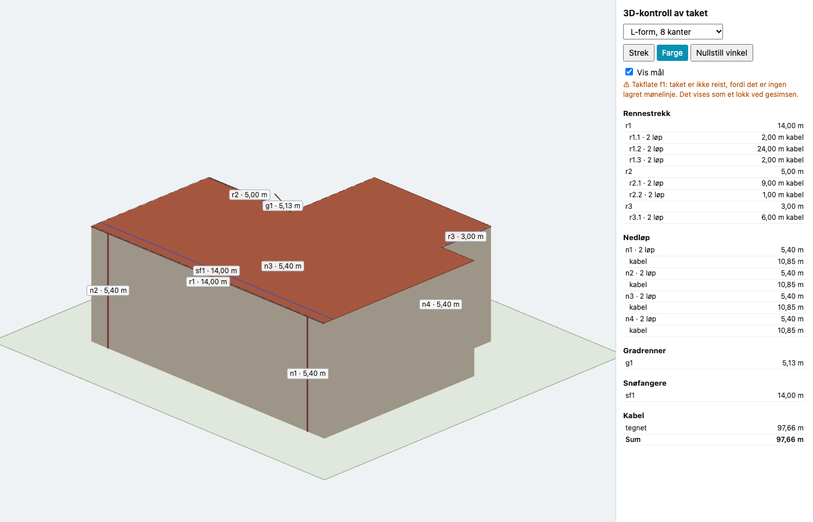
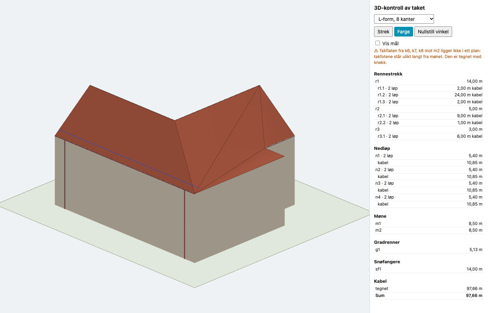
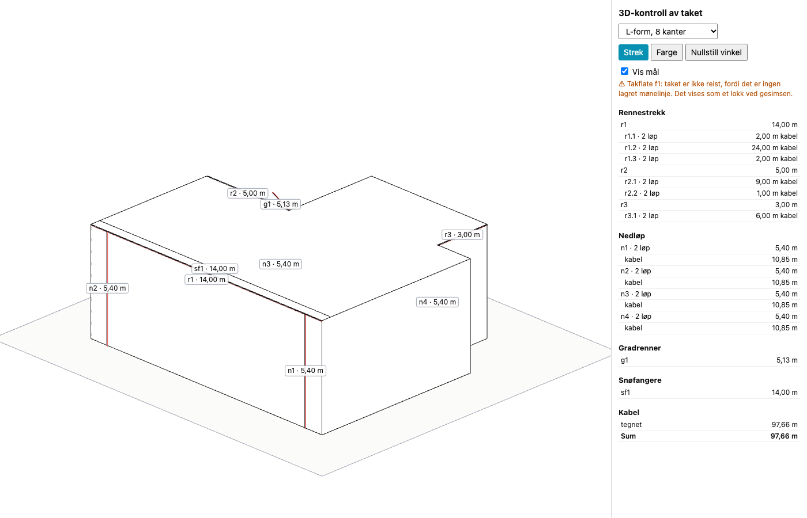
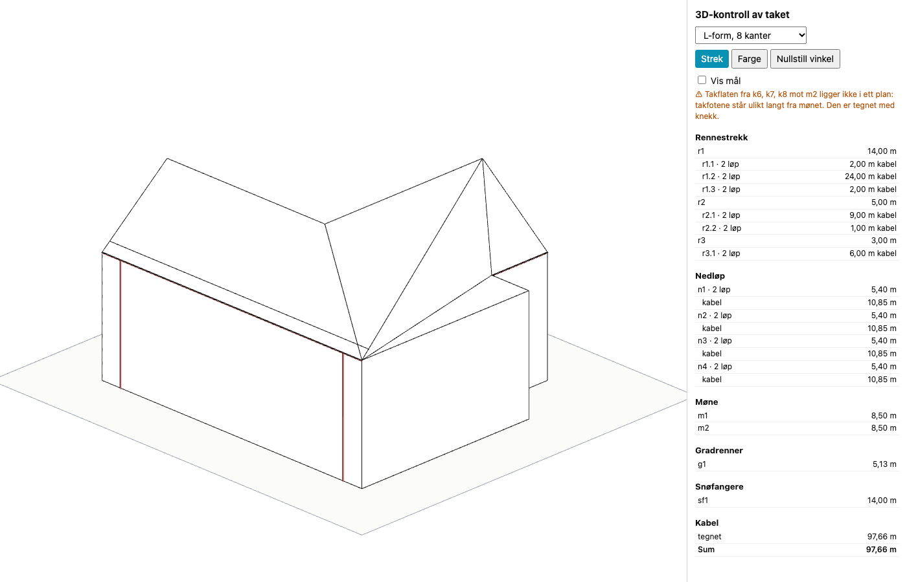
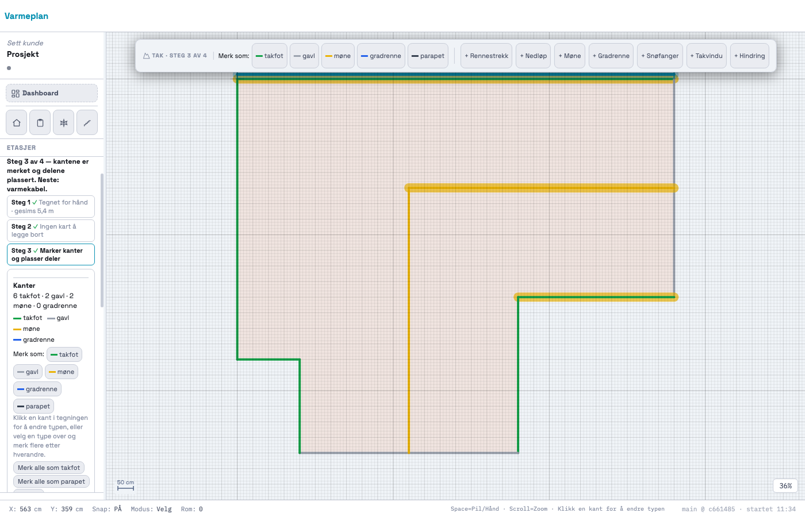
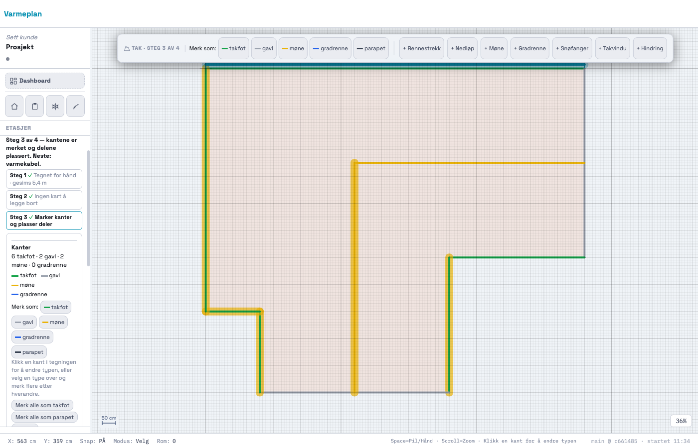
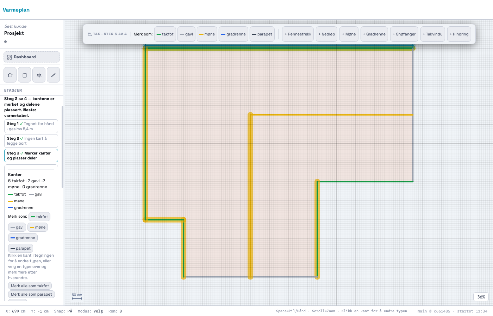
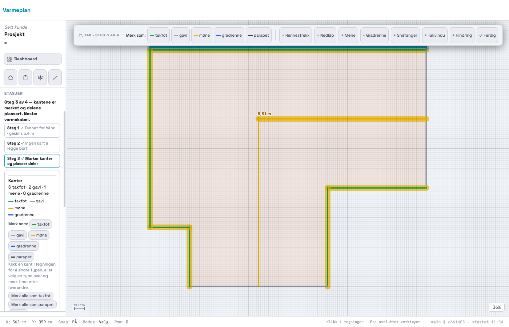

# 220 · Tegn mønet selv, og koble hver takfot til sitt møne

Ikke pushet. Ingen SQL.

## Resultat

- **L-formen reises.** Med to møner tegnet og takfotene koblet er advarselen «vises som et lokk» borte. Takflatene dekker hele omrisset, og hver flate går fra gesims (5,40 m) til møne (8,20 m).
- **`node docs/3d/test-3d.mjs`: 712 av 712.** Største avvik mellom 3D og 2D er 0 mm i alle fem fixturene.
- **Filmens bygg er uendret: 110,15 / 80,15 m.** Fixturene 1, 2, 4 og 5 er byte-identiske med 219. Kun fixture 3 er endret, og alle lengder og kabelmeter der er som før (97,66 m).
- Møner som tegnes med snapping treffer eksakt (0 mm), og to møner som møtes, deler punkt.
- `_takRegressionTest220`: 44 av 44. Ekte museklikk (`docs/220/probe/ekte.mjs`): 12 av 12.

## L-formen i 3D

| Før (219) | Etter (220) |
|---|---|
|  |  |
|  |  |

Advarselen som står igjen, er riktig: k6, k7 og k8 er koblet til samme møne, men står ulikt langt fra det, så de kan ikke ligge i ett plan (spm. 2).

## Koblingen vist i 2D

Velg et møne, så lyser det og takfotene som heller opp mot det, i mønets farge.

| m1 valgt | m2 valgt | k1 rettet til m2 med ett klikk |
|---|---|---|
|  |  |  |

Mens du tegner: 

## STEG 0, bekreftet

| Spørsmål | Funn |
|---|---|
| Hvordan lagres mønet? | `kind:'line', type:'ridge'` i `S.tak[fid].edges`. Bare `_takSuggest` laget det |
| Hva trenger `byggTak`? | Begge endene måtte treffe omrisset. Et møne som slutter inne på taket, ga `null`. Det er hele grunnen til at en egen vei for koblede tak trengs |
| Gradrenne (206) | `_takFeat` med `kind`, to klikk, Esc. Møneverktøyet er samme modus |
| Kantklikk og pensel | Går gjennom `_takEdgeActiveFid`, som er `null` utenfor tak-modulen. Klikk-kroken for koblingen bruker den også |

## Slik er det bygget

**Datamodell (additiv).** Et tegnet møne har samme form som forslaget, pluss `prov.source = USER_DRAWN` og `height_m: { value, height_ref, prov }`. Takfot-kanten får `ridge_link: { id, prov }`. Koblingen har egen `prov`, så opphavet til kanttypen står urørt.

**Forslaget.** Nærmeste møne fra kantens midtpunkt, målt mot linjestykket. Målt mot uendelig linje ville k8 i L-formen valgt feil møne. Brukerens valg (`USER_CONFIRMED`) røres aldri.

**Rene 205-forslag lagrer ingen koblinger.** Derfor er gamle prosjekter og fixturene uendret. 3D bruker den gamle veien for dem. Først når du tegner et møne, retter en kobling eller setter en høyde, fylles koblingene ut.

**Hva motoren leser, og hva den gjør (`reisKoblet`):**

| Lest fra `S.tak` | Satt sammen i motoren |
|---|---|
| Mønelinjene, høyde per møne, hvilken takfot som hører til hvilket møne, kanttypene | Rekkefølgen på hjørnene i hver flate: takfotene, gavlkantene ut til møneenden, mønet tilbake |

Motoren finner aldri på et møne, en høyde eller en kobling. Graten og kilen i et hjørne er ingen egne objekter. De er bare der to flater møtes.

**Valmtak og T-form virker også**, med tester. Det krevde ingen tilleggsregel for valm. Ved T-form deler et møne som ender på et annet, flatene på sin side.

## Endret utenfor bestillingen

1. **`_takPitch` tar det nærmeste mønet, med mønets egen høyde.** Før tok den det første mønet på taket. Med to møner ville en snøfanger på k4 blitt regnet mot 6 m i stedet for 3,5 m, uten varsel. Tak med ett møne og uten egen høyde regnes nøyaktig som før (spm. 6). 3D følger samme regel.
2. **«Merk alle som …» beholder et møne du har tegnet**, og «Foreslå på nytt» spør også når du har tegnet møner (spm. 11).
3. **Verktøylinja:** under 1340 px skjules «Merk som:», ellers brakk «+ Møne» den til to rader ved 1280 px (spm. 12). Målt: 1058 px, 58 px høy, én rad.
4. **`docs/3d/test-3d.mjs`:** test 6 fra 219 («index.html = HEAD») er tatt bort, fordi den ikke lenger kan stemme. I stedet er det en ny blokk 6 for møner og koblinger (totalt fra 640 til 712 sjekker).
5. **`_takRegressionTest204`:** ett punkt talte «over terreng» i hele kortet, og møneraden har nå sitt eget referansepunkt. Tellingen er avgrenset til høydeblokken.

## Testene biter

Jeg satte inn 17 feil med vilje (`docs/220/probe/biter.mjs`). I første runde slapp fire gjennom, og det lærte meg dette:

- En flate som krysser seg selv, har **samme planareal** som en riktig flate. Testen krever nå at sidene ikke krysser hverandre.
- Takvinkelen med flere møner var ikke testet i 3D. Den er testet nå, med en snøfanger på k4.
- To av feilene viste at koden hadde unødvendige grener. Den ene var en egen regel for valm, den andre en reserveregel. Begge er fjernet.

Etter det: alle 10 i motoren og alle 7 i 2D er fanget.

## Regresjon

Alle tester kjørt mot en HEAD-kopi og mot endelig kode (`docs/220/probe/sammenligning.txt`):

- **85 av 85 eksisterende tester har samme resultat som på HEAD.** Den nye `_takRegressionTest220` er 44 av 44.
- **Sju er røde både før og etter**, altså ikke «alle grønne» slik prompten ber om: `_prosjektlaasRegressionTest` (66/67), `_kundeforslagRegressionTest` (270/271) og fem `_geo*`-tester som kaster. De samme sju var røde ved 218. Ingen av dem er berørt av 220.
- **Utenfor tak-modulen:** `uendret.mjs` kjører rom, snø og trapp med ekte tastetrykk og klikk mot begge versjoner. Resultatet er byte-identisk, også hashen av lagringsfilen. `_takRegressionTest220` sjekker i tillegg at et møne som er valgt på taket, ikke reagerer i et annet modul.

## Sjekkliste for deg

- [ ] Tegn mønene på det ekte huset: + Møne i steg 3, klikk start og slutt.
- [ ] Klikk et møne og se om riktige takfot lyser. Klikk en takfot for å rette.
- [ ] Svar på `SPØRSMÅL.md`, særlig 1, 2 og 6.

3D er fortsatt ikke koblet inn i appen (egen prompt). Forhåndsvisningen er `http://localhost:4000/docs/3d/forhandsvisning.html`.
