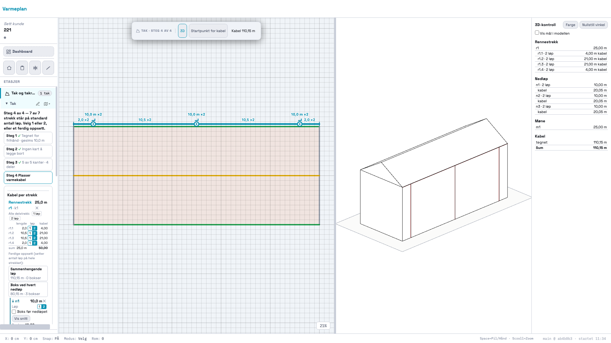
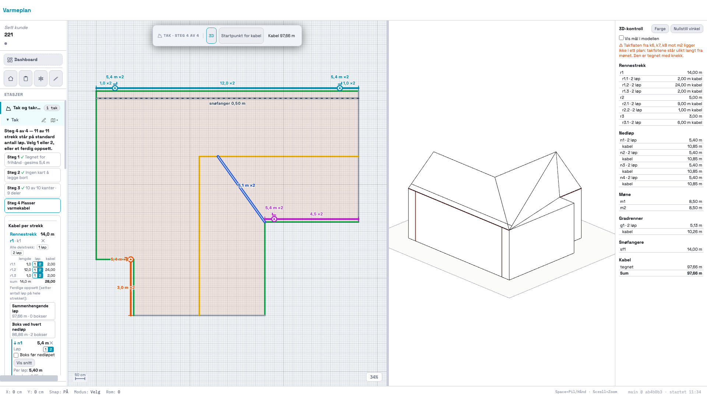

# 221 · 3D ved siden av 2D i Tak-modulen

Bygget og committet på `main`. Ikke pushet. Ingen SQL.

## Resultat

| Test | Resultat |
|---|---|
| Ekte mus og tastatur (`probe/ekte.mjs`) | 52 av 52 |
| three.js blokkert, motorfila blokkert, PDF (`probe/nett-pdf.mjs`) | 22 av 22 |
| `docs/3d/test-3d.mjs` | 712 av 712 |
| Regresjon mot HEAD (`probe/alle.mjs`) | 86 av 86 tester gir samme tall som HEAD, pluss ny `_takRegressionTest221` 11/11 |
| Innendørs, snø, trapp med ekte hendelser (`probe/uendret.mjs`) | Byte-lik med HEAD |

De sju røde radene er de samme som før, og de er røde uten innlogging også på HEAD: prosjektlås, kundeforslag og fem `_geo*`-tester.

## Bilder

Flere bilder i mappa:
- `delt-filmens-bygg-strek.png` og `delt-filmens-bygg-farge.png`: 1400 px
- `delt-l-form-steg4.png`: L-formen ved 1400 px
- `smal-3d.png`: 820 px, ikke delt
- `uenig.png`: påtvunget avvik
- `l-form-uten-mone.png`: advarselen om manglende møne
- `three-blokkert.png`: three.js utilgjengelig

## STEG 0

- **Lasting:** `varmeplan-3d.js` lastes med `import()` fra `_tak3dLastMotor`, og three.js først inne i `tegnScene`. Bekreftet med nettlogg (under). Fila er nå 52,9 kB. Prompten sa 40,9, men 220 og 221 har lagt til kode.
- **Forhåndsvisningen er gjenbrukt:** lista er flyttet inn i motoren som `maalHtml(M)`, og både `forhandsvisning.html` og appen bruker den. Sum i forhåndsvisningen er fortsatt 110,15 m.
- **Knappen** står rett etter steg-merket i `_takToolbarHtml`, i steg 2, 3 og 4, og bare når det finnes et omriss.

### Nettkall (målt med CDP)

| | Kall mot `varmeplan-3d.js` eller three.js |
|---|---|
| Etter at appen og taket er åpnet (10 kall i alt) | **0** |
| Etter trykk på 3D | `varmeplan-3d.js`, `three@0.160.0/+esm`, `OrbitControls.js/+esm` |

### Tidtaking (median av 10 kjøringer, three.js allerede lastet)

| | `byggTak` | `tegnScene` | Tak som tekst |
|---|---|---|---|
| Filmens bygg | 0,1 ms | 11,2 ms | 5,4 kB |
| L-formen | 0,2 ms | 11,3 ms | 9,6 kB |

- Fra trykk på 3D til modellen står, første gang uten nettleserbuffer: 268 ms på denne maskinen og linja.
- Sammenligningen som oppdager endringer koster 0,004–0,007 ms per runde, 6–7 ganger i sekundet, og bare mens ruta er åpen.
- Tid fra ekte klikk i 2D til 3D-lista er oppdatert: **547 ms**.

### Hvorfor PDF-en ikke kan påvirkes

three.js tegner på et eget `<canvas>` inni `#tak3d-view`. PDF-en leser hovedlerretet (`_renderRoomToImage`, `canvas.toDataURL`), og ingen kode i appen leter etter lerreter med `querySelector('canvas')` (søkt). Det eneste 3D gjør med hovedlerretet er å gjøre det smalere. `_renderRoomToImage` setter lerretet til målstørrelsen selv og setter det tilbake, synkront.

Målt, med samme prosjekt (seks rom pluss tak, åtte sider):

| | Lengde | sha256 |
|---|---|---|
| 3D lukket | 2 100 041 | `03094d30…1e082` |
| 3D åpen | 2 100 041 | `03094d30…1e082` |
| 3D lukket igjen | 2 100 041 | `03094d30…1e082` |

Snitt-PDF-en fra 210 er også byte-lik med 3D åpen og lukket (`probe/pdf.json`).

To felt er låst i testen, opprettelsestidspunkt og fil-ID, fordi jsPDF setter dem for hver fil. Alt annet er sammenlignet byte for byte.

## Slik er det bygget

- **Delt skjerm:** ruta er et flex-søsken til `#canvas-wrap`, samme mønster som kundepanelet i 032. Fordelingen er `flex-grow`, så lerretet følger av seg selv via ResizeObserver-en som allerede finnes. Forholdet ligger i `localStorage`, ikke i prosjektet.
- **Smal skjerm (under 900 px):** ruta legges over lerretet, under verktøylinja. Lerretet beholder størrelsen, og knappen sier «2D».
- **3D følger 2D:** taket sammenlignes som tekst hvert 150. millisekund mens ruta er åpen. Det fanger alle veiene `S.tak` endres på uten en krok i hver av dem, og `render()` er urørt. Seks endringer på rad gir én nybygging.
- **Motoren får en kopi** av taket (`JSON.parse`), så den kan ikke endre prosjektdata. Egen test: `S.tak` og hele lagringen er byte-like etter drag, klikk, hjul og høyreklikk-drag.
- **`settScene` er nytt i motoren:** uten den ville hver endring i 2D nullstilt vinkelen brukeren hadde dreid til. Har du ikke dreid, følger utsnittet bygget.
- **Uenighet:** `_tak3dUenig` sammenligner `maal(scene)` med tallene 2D-panelet viser, og skriver begge tallene. Ingen av dem endres.
- **Uten three.js:** målelista og advarslene virker fortsatt, for de trenger ikke three.js. Bare modellen erstattes av meldingen. «Prøv igjen» er testet med nettet tilbake, for både three.js og motorfila.

## Endringer utenfor bestillingen

- Lista manglet kabel på gradrenner. L-formens `g1` har 10,26 m kabel i 2D, men lista viste bare lengden, så tallene kunne ikke leses mot panelet. Raden er lagt til, og forhåndsvisningen får den også.
- Verktøylinja er gjort kompakt mens 3D er åpen. Den ble tre rader i den halve bredden og dekket tegningen.
- Står hele bygget i bildet når 3D åpnes, tilpasses 2D den halve bredden. Står du zoomet inn på en detalj, står du der.
- `Sum` står fast nederst i lista, så den synes uten å rulle.
- «Vis mål i modellen» er tatt med fra forhåndsvisningen.
- Ruta skjules ved utskrift.

## Funn

- **Filmens bygg får ikke plass i 2D ved 1400 px.** Laveste zoom er 20 %, og 25 m krever mer enn de 605 px lerretet har i delt visning. Ved 1920 px står det helt. Se spørsmål 1.
- **Er jsDelivr helt nede, starter ikke appen.** `supabase-js` og `xlsx` kommer også derfra, og oppstarten kaster `Cannot access '_lockState' before initialization`. Det gjelder uten 3D også og er ikke endret her. Testen av punkt E blokkerer derfor bare three.js sine adresser.
