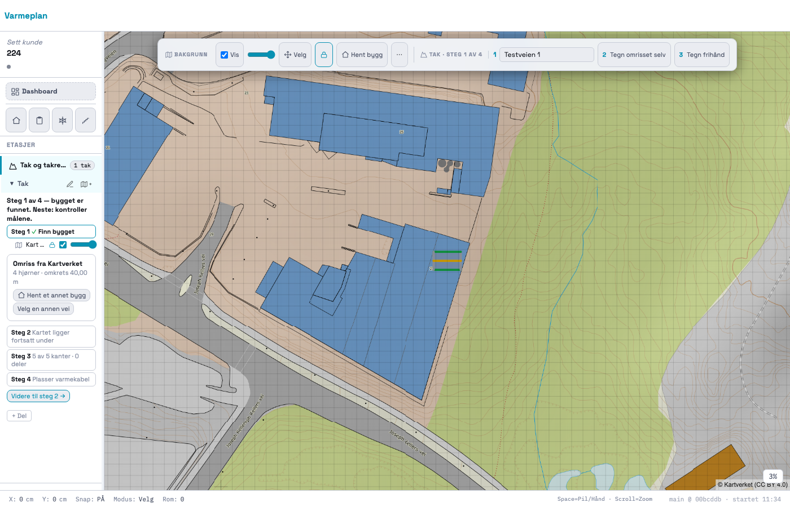
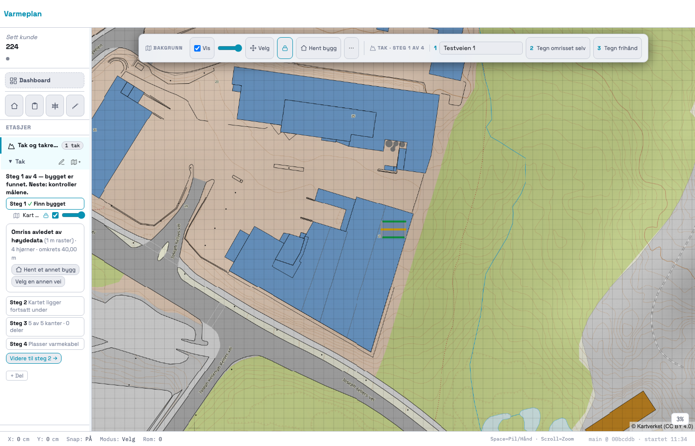
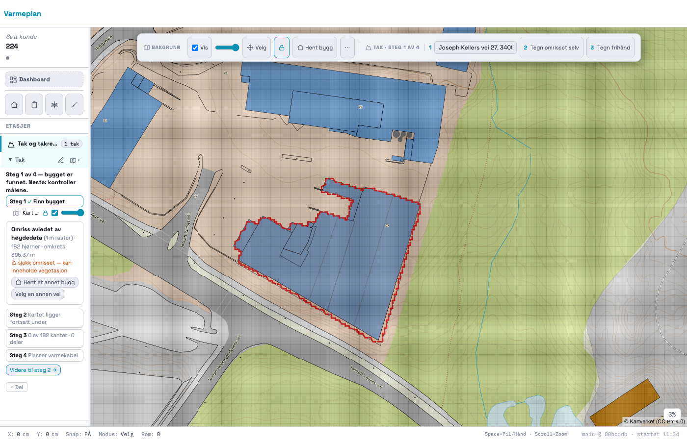
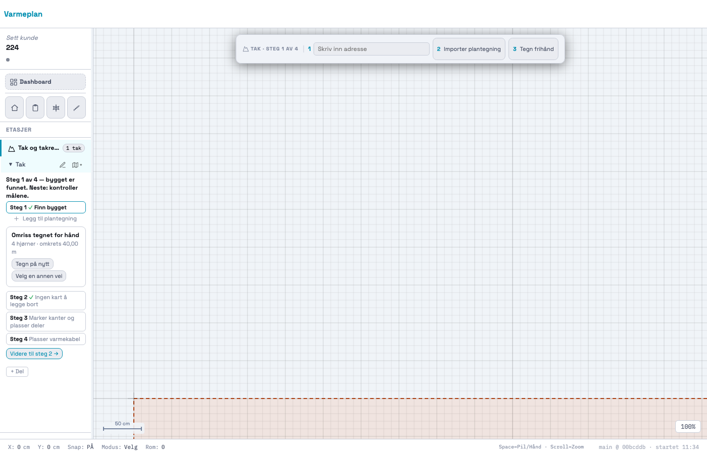

# 224 · Kortet sier om omrisset er kartlagt, avledet eller tegnet

Bygget og committet på `main`. Ikke pushet. Ingen SQL. `varmeplan-roof` er ikke endret.

## Hvor kjeden var brutt

Linjenumrene gjelder `index.html` på `00bcddb`, før endringen. Målt med Joseph Kellers vei 27 mot lokal
`varmeplan-roof` (`probe/ekte.json`).

| Ledd | Sted | Målt |
|---|---|---|
| `/roof/locate` | tjenesten | `source: DOM1`, `prov: DOM_RASTER, 0.3, "sjekk omrisset — kan inneholde vegetasjon"`. **Riktig.** |
| `/roof/model?level=quick` | tjenesten | `prov: FOOTPRINT, 0.9, "omriss fra kalleren"`. Riktig: tjenesten fikk omrisset av oss og vet ikke opphavet. Appen bruker ikke denne verdien. |
| Kandidat → `S.geo` | `:82085-86`, `:90246-47`, `:90255-56`, `:82233` | Kilde og tillit tas med. **Notatet kastes** på alle veiene. |
| `S.geo` → `surfaces[0].footprint.prov` | `:82157-62` | `DOM_RASTER` og 0,3 er riktig. Notatet erstattes av appens eget `"Kartverket (DOM1)"`. |
| Kortet, steg 1 | **`:82840`** | **Her er feilen brukeren så.** `_takStep1Inner` har «Omriss fra Kartverket» hardkodet og leser aldri `DOM_RASTER`. |
| Kortet, øvrige steg | `:82637` | Linja prompten pekte på. Den er riktig, men `:82634` returnerer til steg 1-kortet før den nås. Derfor sto ikke «(avledet av høydedata)» på skjermen. |
| Oppsummering, lukket steg | `:82820` | Samme hardkodede tekst når adresse mangler. |

Årsaken er altså i appen, ikke i tjenesten.

**Lagring:** `S.tak` og `S.geo` lagres hele, så `prov` overlever lagring og åpning. Det som manglet, var at notatet
aldri kom inn. Det er nå med, og del B krevde ingen egen lagringskode.

**Begge veier inn** (klikk i kartet via `_geoPickStore`, og adressedialogen via `_roofFetchBackground`) ender i samme
`_takChooseBuilding` / `_takFetchModel`. Modellkallet bidrar ikke med opphav på noen av dem.

## Endringen

- `footprintNote` følger kandidaten på alle veiene inn og brukes av `_takFootprintProv`.
- Ny `_takFootprintInfo(prov)` er eneste kilde til teksten, og brukes av steg 1, statuskortet og oppsummeringen.
- Avledet: **Omriss avledet av høydedata** (1 m raster) · hjørner · omkrets.
- Advarselen vises under 0,5, altså ved 0,3, med tjenestens notat ordrett.
- `FKB` og `USER_DRAWN` har samme tekst og oppsett som før.

## Resultat

| Test | Resultat |
|---|---|
| Ny `_takRegressionTest224` (FKB, DOM 0,5, DOM 0,3 × begge veier + forhåndsvalgt, lagre og åpne, tegnet, gammelt prosjekt) | 68 av 68 |
| Mutasjoner: notat droppet to steder, steg 1 hardkodet igjen (`probe/ekte.json`) | Testen blir rød i alle tre (3, 4 og 8 rader) |
| Ekte tjeneste, Joseph Kellers vei 27 | «Omriss avledet av høydedata (1 m raster) · 182 hjørner · omkrets 395,37 m» + notatet. Likt etter lagre og åpne. |
| Regresjon mot HEAD (`probe/alle.mjs`) | 92 av 92 eksisterende tester gir samme resultat som HEAD |
| Rom, snø og trapp med ekte hendelser (`probe/uendret.mjs`) | Likt med HEAD |

**Ikke alt er grønt.** Sju eksisterende tester er røde uten innlogging, likt på HEAD og i rapport 221:
`_prosjektlaasRegressionTest` (66/67), `_kundeforslagRegressionTest` (270/271) og fem `_geo*`-tester som kaster unntak
under oppsett (`_geoTileRegressionTest194`, `_geoScaleRegressionTest`, `_geoCenterRegressionTest`,
`_geoOneStepRegressionTest`, `_geoAddrRegressionTest`). De fem `_geo*`-testene har derfor ikke prøvd endringen.
Adressedialogens vei er dekket av `_takRegressionTest224`.

Målingen er gjort mot lokal `varmeplan-roof`, ikke mot Fly (port 4100 på maskinen er Lumelo-backenden, så tjenesten ble
kjørt midlertidig på 4110).

## Bilder

Tilfelle 3 er ekte tjeneste. Tilfelle 1 og 2 har stubbet svar over samme kart. Tilfelle 4 er tegnet for hånd uten kart.

### 1 · Kartlagt (FKB)

### 2 · Avledet, tillit 0,5

### 3 · Avledet, tillit 0,3: Joseph Kellers vei 27

### 4 · Tegnet for hånd

Spørsmål står i `SPØRSMÅL.md`.
